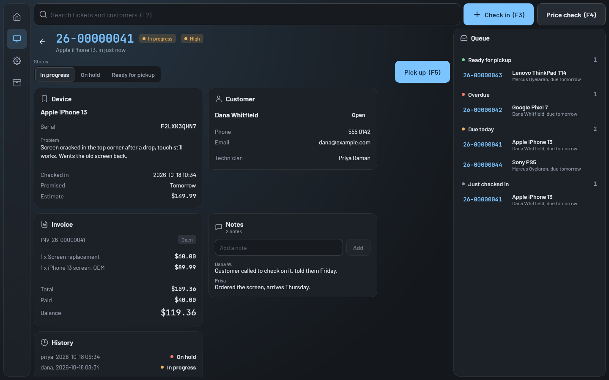

# TicketMan

A ticket tracking app for repair shops, or any shop that runs its work through tickets. Staff check devices in at
the counter, track the repair, take payment at pickup and keep customer, inventory and photo records along the way.

It's a Kotlin Multiplatform project: a Compose Multiplatform client with a Ktor server with an H2 database.

There will most likely be breaking changes often so this is nowhere near production ready. But it does work!



**[See every screen](docs/screenshots.md)**, wide and on a phone.

## What it does

- **The counter**: check devices in (several at once, with an intake checklist, the passcode and a signature),
  quick search, the queue, pickup with payments, sales from stock, refunds, store credit and gift cards
- **Repairs**: custom statuses, a work log that bills time and parts, estimates the customer approves, warranties,
  storage fees for devices left too long, and each customer's devices with their history
- **Customers**: a status page they can check without logging in, and email and text messages when their device
  is ready
- **Stock and purchasing**: SKUs, barcodes and labels, scanner input, low stock, suppliers and purchase orders
- **Running the shop**: reports (sales, profit, tax, techs and commission, turnaround), an appointment calendar, a
  time clock with timesheets, and exports for a spreadsheet, QuickBooks or Xero
- **Staff and devices**: access levels, account requests and invites, PIN sign in at counter stations, kiosk mode,
  an audit log, and backups with restore

## Quick start

You need JDK 17 or newer (21 is what it's developed on). Gradle comes with the repo.

```bash
# Start a server on port 8098 that keeps its data in /tmp/tm, with admin / admin_pass as the first login
PORT=8098 DATA_PATH=/tmp/tm ADMIN_PASSWORD=admin_pass ./gradlew :server:run -Pdevelopment

# In another terminal, start the desktop client and connect it to http://localhost:8098
./gradlew :composeApp:run
```

On Windows use `.\gradlew.bat` in PowerShell, and set the variables with `$env:PORT = "8098"` and so on first.

[Getting started](docs/getting-started.md) covers the other targets, tests and hot reload.

## Running it in Docker

```bash
docker run -d --name ticketman -p 8080:8080 -e ADMIN_PASSWORD=change_me -v ticketman-data:/data mr0btain/ticketman:latest
```

Then open `http://localhost:8080` and log in as `admin`. That's plain HTTP, fine for a look on one machine.

- [Run TicketMan in Docker](docs/how-to/run-in-docker.md): the published image, trying it from the source with
  made up records (`scripts/docker_local.sh`), and a shop's server behind Caddy with HTTPS
- [Running a server](docs/operations.md): first start, the data folder, backups and restore, stations and kiosks,
  and putting the customer status page on the internet
- [The Docker Hub page](docker/dockerhub.md): every setting, volume and port of the image

## Platforms

| Platform | Status |
|----------|--------|
| Linux | Main target, Done |
| Windows | Done |
| macOS | Builds a DMG, not tested on a Mac yet |
| Web (Wasm) | Served by the server when built with `-PwithWeb`, Done |
| Server | Done |
| Android | Done |
| iOS | Written, not built or tested yet (needs a Mac) |

## Roadmap

Phases 0 to 6 are done: custom statuses, the customer status page, messages and estimates, counter money,
inventory and purchasing, repair depth, and running the business. What's next, in order
([the full roadmap](docs/roadmap.md)):

**Phase 7: Big integrations**

- **Payment processing**: card terminals and payment links (Stripe Terminal or Square), and paying the balance from
  the status page
- **More than one location**: a location on tickets, stock, stations, users and numbering. It touches nearly every
  query, so it comes last
- **Booking from the status page**: customers picking an appointment time themselves, left over from Phase 6

**iOS: test and fix (needs a Mac)**

- Make it build: `./gradlew :composeApp:compileKotlinIosSimulatorArm64`, then the app from Xcode on a simulator,
  fixing the Security framework and Foundation calls written without a compiler
- Walk through it on a simulator, an iPhone and an iPad: connecting and trusting a server, logging in, records and
  photos, check-in with a signature, pickup, AirPrint, saving PDFs and backups to Files, restoring, the admin tabs
  and kiosk mode with Guided Access
- Fix what it finds, then build the IPA in every release
- Later, with a paid Apple Developer account: a signed IPA, or TestFlight and the App Store

**macOS: test the desktop app (needs a Mac)**

- Run it from source and from the released DMG on Apple silicon
- Walk through it like Linux and Windows: trusting a server, the session coming back after a restart, photos,
  signatures on a trackpad, printing and labels, file dialogs, the admin tabs and kiosk fullscreen
- An x64 DMG for Intel Macs if anyone needs one
- Later, with a paid Apple Developer account: sign and notarize the DMG so it opens without a warning

## Caveats

If there has to be Any breaking changes (changes that require both client and server to be updated) they should be made between Major revisions only once were stable. Ex: 1.0.0->2.0.0. For now theres going to be Breaking changes that are just thrown in untill we hit 1.0.

## Documentation

Developer docs are in [`docs/`](docs/README.md): how the code is organized, how a request travels from the UI to the
database, configuration, running a server and more. Pretty much all of this is AI generated. I haven't looked through 
it yet so it may or may not be accurate.
