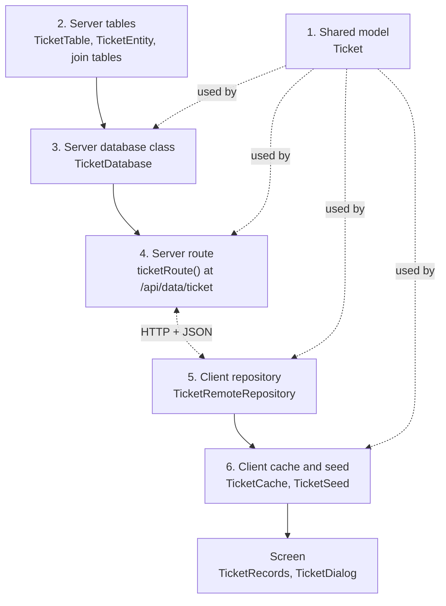

# Entity layers

Each main record type (Customer, Ticket, Inventory, User) is built from the same six layers, from the shared model
out to the client. Adding a field or a whole entity means touching each layer in turn, so it helps to know what
each one does. This page follows Ticket through all six.

## The layers



| # | Layer | Ticket's files | Base class or pattern |
|---|-------|----------------|-----------------------|
| 1 | Shared model | `shared/.../data/ticket/Ticket.kt` and its parts (`Device`, `TicketStatus`, `TicketPriority`, `TicketNumber`) | extends `MainItem` |
| 2 | Server tables | `server/.../database/tables/ticket/` (`TicketTable`, `TicketEntity`, `TicketNoteTable`, ...) | Exposed `UuidTable` + `UuidEntity` |
| 3 | Server database class | `server/.../database/TicketDatabase.kt` | extends `Database<Ticket>` |
| 4 | Server route | `server/.../routing/TicketRoute.kt` | `fun Route.ticketRoute(...)`, mounted in `Routing.kt` |
| 5 | Client repository | `composeApp/.../network/database/TicketRemoteRepository.kt` | extends `RemoteRepository<Ticket>` |
| 6 | Client cache and seed | `composeApp/.../data/ticket/TicketCache.kt`, `TicketSeed.kt` | extend `CustomCache`, `DataSeed` |

The screen on top (`TicketRecords`, `TicketDialog`) isn't part of the pattern, but it's the thing that calls the
seed and the repository.

## 1. Shared model

[`Ticket`](../../shared/src/commonMain/kotlin/org/mr0btain/ticketman/data/ticket/Ticket.kt) is a `@Serializable`
data class extending `MainItem`. It's the exact object sent over the wire, so the client and server agree on its
shape at compile time.

```kotlin
@Serializable
data class Ticket(
    override val identifier: Uuid = Uuid.generateV7(),
    val device: Device = Device("", ""),
    val status: TicketStatus = ...,
    val priority: TicketPriority = ...,
    val number: TicketNumber? = null,   // given out by the server
    val problem: String = "",
    ...
): MainItem(), SubItem
```

Things to know:

- The identifier is a v7 `Uuid`, which has its creation time built in. `MainItem.timestamp` reads it back with
  `identifier.createdAt()`, so there's no separate "created" field anywhere.
- The client makes the identifier, not the server. A new ticket already has its final id before it's saved.
- Every field has a default. That lets older clients and servers read JSON that's missing newer fields.
- Some fields belong to the server (`number`, `pickedUpAt`). The client carries them so they show on screen and
  survive a round trip, but the server ignores them on update.
- Links to other records (the ticket's customer, its assigned tech) aren't fields on the model. They're separate
  join tables on the server and separate calls from the client.

## 2. Server tables

Exposed table objects in
[`tables/ticket/`](../../server/src/main/kotlin/org/mr0btain/ticketman/components/database/tables/ticket):

| Table | What it stores |
|-------|----------------|
| `TicketTable` (`tickets`) | One row per ticket. `device`, `status` and `priority` are JSON columns holding the shared classes directly |
| `TicketNoteTable` (`ticket_updates`) | Join from a ticket to its rows in the shared `NoteTable` |
| `TicketStatusHistoryTable` | Every status change, with who made it |
| `TicketSignatureTable` | The customer's signature from check-in |
| `CustomerTicketTable` (in `tables/customer/`) | Join to the customer. Unique on the ticket, so a ticket has at most one customer |
| `UserTicketTable` (in `tables/user/`) | Join to the assigned tech |

`TicketEntity` is the DAO class over `TicketTable`. Its `toTicket()` turns a row back into the shared model, and
it's the only place that mapping lives.

New tables have to be listed in `LocalDatabase.tables`, in an order where a table comes after the tables it
references. A table that gains a column later also goes in `migratedTables`; see
[Migrations](../server/migrations.md).

Column names that are SQL reserved words break H2. That's why `condition` is stored as `device_condition`.

## 3. Server database class

[`TicketDatabase`](../../server/src/main/kotlin/org/mr0btain/ticketman/components/database/TicketDatabase.kt)
extends the abstract
[`Database<T : MainItem>`](../../server/src/main/kotlin/org/mr0btain/ticketman/components/database/Database.kt),
which fixes the set of operations every record type has:

| Abstract in `Database` | Provided by `Database` |
|------------------------|------------------------|
| `add`, `update`, `remove` | `updateNote`, `removeNote` (checked against `noteLinkColumn`) |
| `getById`, `getPagedItems`, `count`, `search` | `addImagesToNote` |
| `addNote`, `getNotes`, `noteLinkColumn` | helpers `insertNote`, `attachNote` for subclasses |

On top of those, `TicketDatabase` adds what only tickets need: `getByNumber`, `getPagedItemsForUser`,
`recordStatusChange`, `getStatusHistory`, `setCustomer`, `setUser`, `getSignature` and so on.

Every method wraps its work in `dbQuery(TAG) { ... }` for reads (returns the value, or null if it failed) or
`dbWrite(TAG) { ... }` for writes (returns whether it happened). For example `update` returns `false` when the
ticket isn't there:

```kotlin
override fun update(data: Ticket): Boolean =
    dbWrite(UPDATE_TAG) {
        val item = TicketEntity.findById(data.identifier) ?: return@dbWrite false
        // Number and pick up time are owned by the server, so they aren't taken from the client
        item.device = data.device
        ...
        true
    }
```

`add` runs under a lock so two counters saving at once can't be handed the same ticket number.

## 4. Server route

[`ticketRoute()`](../../server/src/main/kotlin/org/mr0btain/ticketman/components/routing/TicketRoute.kt) is
mounted at `/api/data/ticket` in `Routing.kt`. Routes are split by who may call them:

```kotlin
authenticate("restricted") {   // any logged in user, including Restricted
    get(RecordPaths.GET) { ... }
    get(RecordPaths.FETCH) { ... }     // ?offset=&limit=, read with call.pagedRequest()
    get(RecordPaths.SEARCH) { ... }    // ?query=&limit=, read with call.searchQuery()
    get(TicketPaths.BY_NUMBER) { ... }
}

authenticate {                 // NORMAL access or higher
    post(RecordPaths.ADD) { ... }
    post(RecordPaths.UPDATE) { ... }
    delete(RecordPaths.REMOVE) { ... }
    post(TicketPaths.SET_CUSTOMER) { ... }
}

noteRoute(database, userDatabase, auditLog, "ticket")   // /add/note, /get/notes, /update/note, /remove/note
```

A route reads the body, calls the database class, and turns the result into a status: `404` when the record
isn't there, `500` when a write failed, `201`/`202`/`200` otherwise. Every write also records an audit entry with
`call.audit(...)`.

Every path is a constant in shared's `ApiRoutes.kt`: the ones every entity has in `RecordPaths` and `NotePaths`,
the ticket's own (like `/fetch/mine` and `/number/{number}`) in `TicketPaths`. The client's repositories use the same
constants, so a renamed path breaks the build on both sides.

## 5. Client repository

[`TicketRemoteRepository`](../../composeApp/src/commonMain/kotlin/org/mr0btain/ticketman/components/network/database/TicketRemoteRepository.kt)
extends
[`RemoteRepository<T>`](../../composeApp/src/commonMain/kotlin/org/mr0btain/ticketman/components/network/database/RemoteRepository.kt),
which already knows the shared routes. A subclass only passes its route and types:

```kotlin
class TicketRemoteRepository(client: HttpClient) : RemoteRepository<Ticket>(
    tag = "TicketRemoteRepository",
    client = client,
    route = ApiRoutes.TICKET,
    types = itemTypes<Ticket>()
)
```

and then adds functions for its own routes (`fetchMine`, `getByNumber`, `setCustomer`, ...).

All repositories share the one authenticated `HttpClient` that `RemoteHandler` builds, so tokens and refresh are
handled once for all of them. `serverUrl` stays blank until a server has been reached, and every call returns
early with a "No server set" error while it's blank.

Everything returns a `TmResult<T, ServerError>` (or `EmptyResult` for a change), so a screen can tell a record that
isn't there (`NOT_FOUND`) from one that couldn't be loaded. See [Networking](../client/networking.md#repositories).

## 6. Client cache and seed

[`TicketSeed`](../../composeApp/src/commonMain/kotlin/org/mr0btain/ticketman/components/data/ticket/TicketSeed.kt)
is the ticket currently open on screen. It extends
[`DataSeed`](../../composeApp/src/commonMain/kotlin/org/mr0btain/ticketman/components/data/DataSeed.kt) and holds
each field as Compose state, so the UI updates when it changes.

- `setTicket(...)` loads a ticket (plus its notes, customer and tech) and calls `markClean()`, which takes a
  snapshot of `fields()`.
- `change<Field>(...)` functions edit it.
- `isDirty` compares `fields()` with the snapshot. Changing something back counts as unchanged, so record dialogs
  keep Save turned off until `isDirty` is true.
- `getChangedFields()` says which fields differ, so saving only sends what's needed.
- `ticket` builds a `Ticket` from the current fields, ready to send.

A new field has to be added to `fields()`, or edits to it won't make the seed dirty.

[`TicketCache`](../../composeApp/src/commonMain/kotlin/org/mr0btain/ticketman/components/data/ticket/TicketCache.kt)
is a small LRU of recently opened tickets, with their notes and links, so opening a ticket again doesn't refetch
it. A save drops the ticket from the cache so the next open pulls it fresh.

## The screen on top

[`TicketRecords`](../../composeApp/src/commonMain/kotlin/org/mr0btain/ticketman/ui/screens/records/components/ticket/TicketRecords.kt)
(reached as `viewModel.tickets`) owns the cache, the seed, the list pager, and the `select`, `save`, `remove` and
`search` actions. The composables in `ui/screens/records/components/ticket/` show the seed and call those actions.
[Request lifecycle](request-lifecycle.md) follows `save()` all the way through.

## Gotchas

- **Paths come from `ApiRoutes.kt`.** Write a new one there rather than as a string in a route file or repository,
  and run `check_api_docs.py`, which reads the constants to find the routes.
- **Fields the server owns** must be left out of `update` on the server, or a client could overwrite them.
- **New columns need a default or must be nullable**, so they can be added to databases that already have rows.
- **The `user` table is special.** H2 can't list its columns because `user` is a reserved word, so its new columns
  go in `LocalDatabase.addUserColumns()` instead of `migratedTables`.

## See also

- [Overview](overview.md)
- [Request lifecycle](request-lifecycle.md)
- [Add a field to a record](../how-to/add-a-field.md)
- [Add a record type](../how-to/add-an-entity.md)
