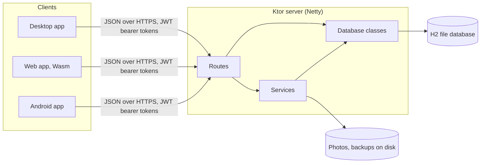
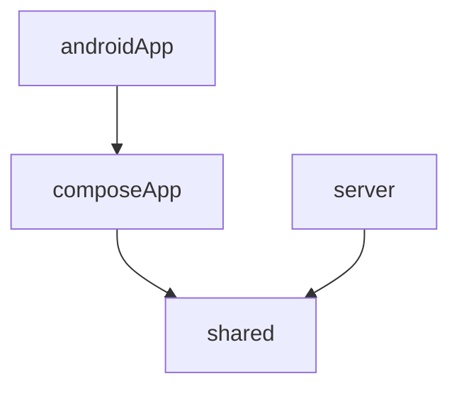

# Architecture overview

TicketMan is one Gradle build with four modules. A Compose Multiplatform client talks JSON over HTTP to a Ktor
server, which keeps records in an H2 database and photo files on disk. Both sides share one library of models, so a
`Ticket` is the same class on the client and the server.

## The running system

There is one server per shop. Every client device (counter PCs, a tablet, a kiosk) connects to it by URL, and the
server is the only thing that touches the database. The server can also serve the web client itself, so a browser
only needs the server's address. Clients keep only a cache of what they've loaded, plus
settings and login tokens.

## Modules

| Module | What it is | Targets |
|--------|------------|---------|
| [`shared`](../../shared) | Models, request and response DTOs, `Result` and error enums, money maths, logging and platform helpers. Everything both sides need | Android, JVM, Wasm |
| [`composeApp`](../../composeApp) | The client: all UI, client state, networking and printing. Built as an Android *library* | Android, desktop JVM, Wasm |
| [`androidApp`](../../androidApp) | A thin Android application around `composeApp`. Just `MainActivity` and the manifest | Android |
| [`server`](../../server) | The Ktor app: routes, services, the database layer, photo storage, backup and restore | JVM |
| [`iosApp`](../../iosApp) | Xcode project. Not wired up, since the iOS targets are commented out | - |

The client and the server never depend on each other, only on `shared`. That keeps the contract between them in
one place: if a model or DTO changes, both sides see it at compile time.

The package root everywhere is `org.mr0btain.ticketman`.

## Inside `shared`

`shared/src/commonMain/kotlin/org/mr0btain/ticketman/`

| Folder | Holds |
|--------|-------|
| `data/` | `@Serializable` models, one folder per area (`ticket/`, `customer/`, `invoice/`, `user/`, ...). `MainItem` is the base for the main record types |
| `server/request`, `server/response` | Bodies for requests and responses that aren't just a model |
| `error/` | `Result<D, E>`, the `Error` interface, one error enum per area, `appLogTryCatch` |
| `logging/` | `AppLogger` (`expect`), `SimpleResult` |
| `util/` | `AppDir` (where app data lives on each platform), `Platform` |

`jvmMain` is used by both the desktop client and the server.

## Inside `server`

`server/src/main/kotlin/org/mr0btain/ticketman/`

| Path | Holds |
|------|-------|
| `Application.kt` | `module()`: builds the database and services, installs plugins, mounts routes, starts the hourly sweep, makes the first admin |
| `components/plugins/` | Ktor plugins: JSON, JWT auth providers (`Security.kt`), Range and ETag support for file downloads |
| `components/routing/` | One `<Area>Route.kt` per URL area, mounted in `Routing.kt`. `Helpers.kt` reads the caller from the token and writes audit entries |
| `components/service/` | Logic that spans tables or isn't just storage: login and tokens, accounts, check-in, invoices, photos, backup, restore |
| `components/database/` | One `<Entity>Database` per area on top of `LocalDatabase`, plus `DbCall.kt` (`dbQuery`, `dbWrite`) |
| `components/database/tables/` | Exposed table objects and DAO entities, one folder per area |
| `components/image/` | `ImageStore` (photo files on disk) and `ImageProcessor` (resizing and cleaning uploads) |

## Inside `composeApp`

`composeApp/src/commonMain/kotlin/org/mr0btain/ticketman/`

| Path | Holds |
|------|-------|
| `App.kt` | The root composable: theme, photo loader, and the app shell or the kiosk |
| `ui/MainViewModel.kt` | App lifetime state. Owns the `RemoteHandler` and one handler per part of the app |
| `ui/screens/` | One folder per screen: `records`, `counter`, `kiosk`, `admin`, `settings`, `login`, `invoice`, `navigation`. Each screen's state lives in an `<Area>Handler` under its `components/` |
| `ui/kit/` | The UI kit: every shared composable, `Tm`-prefixed, plus theme tokens and a component gallery |
| `components/network/` | `RemoteHandler`, one `<Entity>RemoteRepository` per server area, login, large transfers |
| `components/data/` | Client caches and seeds (the record being edited), `LocalStorage` for settings and tokens |
| `components/print/` | Print templates, an HTML renderer and a QR code encoder |
| `components/pagination/` | `OffsetPager`, used by record lists |
| `components/injection/` | Koin modules and `initKoin()` |

Platform source sets (`desktopMain`, `androidMain`, `wasmJsMain`) hold the entry points and the `actual` side of
each `expect` declaration: the HTTP engine, printing, file saving, photo shrinking and so on.

## Main libraries

| Library | Used for |
|---------|----------|
| Compose Multiplatform | All client UI |
| Ktor | The server, and the HTTP client on every platform |
| Exposed + H2 | Server database, as a single file database |
| kotlinx.serialization | JSON on both sides, and JSON columns in some tables |
| Koin | Client dependency injection |
| FileKit | Picking and saving files on the client |
| Coil | Loading photos on the client |
| Haze | The blurred glass surfaces in the UI |
| KSafe | Client key value storage for settings and tokens |
| Thumbnailator | Resizing photos on the server |

Versions are in [`gradle/libs.versions.toml`](../../gradle/libs.versions.toml).

## How a feature is built

Most features cut across every layer, in the same order each time. Adding a field to tickets, for example, touches
the shared model, the server table and database class, the route, the client repository and the client seed.
[Entity layers](entity-layers.md) walks through those layers using Ticket, and
[Request lifecycle](request-lifecycle.md) follows one save through all of them at run time.

## Known gaps

- iOS targets are commented out, so `iosApp` doesn't build.
- Android and web compile but haven't been run end to end on a device or in a browser yet. See
  [Platforms](../client/platforms.md#known-gaps).
- Some `TODO` comments describe ideas that were never started.

## See also

- [Getting started](../getting-started.md)
- [Entity layers](entity-layers.md)
- [Request lifecycle](request-lifecycle.md)
