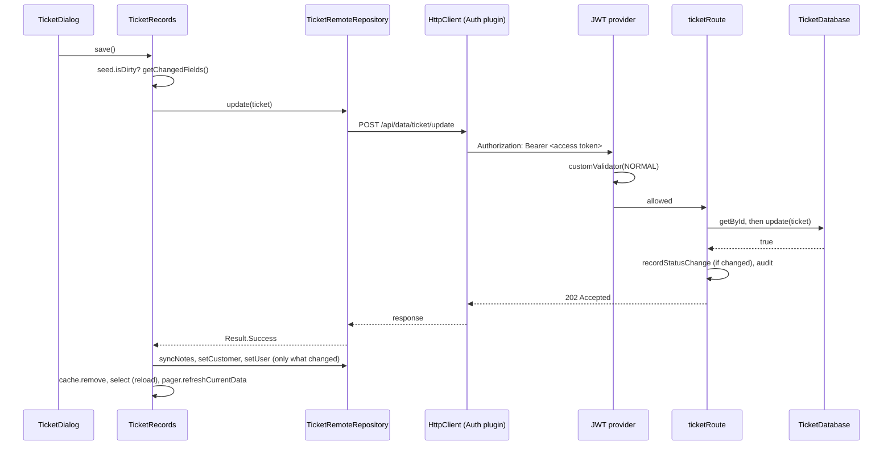

# Request lifecycle

What happens between pressing Save on a ticket and the row changing in the database, and how a failure makes its
way back to the screen. Every other save in the app follows the same path with different names, so this is the
quickest way to get a feel for how the client and server fit together.

The example is editing an existing ticket's problem text in the records screen and pressing Save.

## The whole trip



## On the client

### 1. The screen calls the handler

`TicketDialog` edits the `TicketSeed` directly through its `change<Field>()` functions. Its Save button stays off
until `seed.isDirty`, and pressing it calls `onContinue`, which `RecordsScreen` wires to
`viewModel.tickets.save()`. Composables never call a repository themselves. They call a handler, here
[`TicketRecords`](../../composeApp/src/commonMain/kotlin/org/mr0btain/ticketman/ui/screens/records/components/ticket/TicketRecords.kt).

### 2. The handler works out what to send

`save()` returns straight away if nothing changed. Otherwise it reads everything it needs from the seed up front
(the `Ticket`, notes, customer, tech and the set of changed fields) and launches a coroutine on the view model's
scope, so the dialog doesn't wait on the network.

A ticket's links and notes are saved through their own routes, so the handler only calls `update` when a field of
the ticket itself changed:

```kotlin
val linkFields = setOf(ChangedField.NOTE, ChangedField.CUSTOMER, ChangedField.USER)

if ((changed - linkFields).isNotEmpty()) {
    val updated = repo.update(ticket)

    if (updated is Result.Error) {
        snackBarHost.showSnackbar("Ticket not saved: ${updated.error.message}")
        return@launch
    }
}
```

A new ticket goes through `repo.create(ticket)` instead, which returns the saved ticket so the seed picks up the
number the server gave it.

### 3. The repository makes the call

[`RemoteRepository.update()`](../../composeApp/src/commonMain/kotlin/org/mr0btain/ticketman/components/network/database/RemoteRepository.kt)
posts the ticket as JSON to `<server>/api/data/ticket/update`. The call is wrapped in `networkRequest(TAG)`,
which logs any exception and gives back a `Result` saying what kind of failure it was: `REQUEST_TIMEOUT`,
`NO_INTERNET` (no route to the server, connection refused or dropped), `SERIALIZATION` (JSON the app can't read) or
`UNKNOWN`. Cancellation is rethrown, so a call from a screen that's gone stops cleanly.

### 4. The HTTP client adds the token

Every repository shares the one `HttpClient` that `RemoteHandler` builds in
[`CreateDatabaseHttpClient.kt`](../../composeApp/src/commonMain/kotlin/org/mr0btain/ticketman/components/network/database/CreateDatabaseHttpClient.kt).
It has:

- **Bearer auth**: loads the access and refresh tokens from `LocalStorage` and adds `Authorization: Bearer ...`.
  On a `401` it calls `RemoteHandler.refreshTokens()` and retries once. Each refresh hands back a new refresh token
  too, which replaces the saved one. A `403` isn't retried.
- **Timeouts**: a 60 second request timeout. Long uploads and downloads lift it per request with
  `transferTimeout()`.
- **Logging**: headers only, with `Authorization` hidden. Logging bodies would hold every photo and backup in
  memory.
- **JSON**: kotlinx.serialization with `ignoreUnknownKeys`, so a newer server can add fields without breaking older
  clients.

If refreshing fails, `refreshTokens()` falls back to logging in with the saved username and password (unless
`credentialFallback` is off, as it is on a kiosk). If that fails too it clears the session and emits
`authExpired`, which brings up the login dialog.

## On the server

### 5. The JWT provider checks the caller

`/update` sits in a plain `authenticate { }` block, which is the default provider set up in
[`Security.kt`](../../server/src/main/kotlin/org/mr0btain/ticketman/components/plugins/Security.kt). There are four
providers:

| Provider | Used for | Lets in |
|----------|----------|---------|
| default | Writes | `AccessLevel.NORMAL` and above |
| `"restricted"` | Reads | `RESTRICTED` and above |
| `"admin"` | Admin routes | `ADMIN` |
| `"setup"` | First login setup | Any active user, even before setup is finished |

Each one calls `JwtService.checkAccess`, which checks the token's audience and type, that its session (`sid` claim)
still exists for that user and hasn't expired, and that the user can access that level (`User.canAccess`: active,
setup finished, level high enough). The session check is what makes logging out or ending a session from the admin
screen take effect straight away rather than when the token runs out.

A caller whose token is no good gets `401 Unauthorized`. One whose token is fine but whose access level isn't gets
`403 Forbidden` with `You don't have access to that`.

### 6. The route handles the request

[`ticketRoute()`](../../server/src/main/kotlin/org/mr0btain/ticketman/components/routing/TicketRoute.kt):

```kotlin
post(RecordPaths.UPDATE) {
    val received = call.receive<Ticket>()
    val existing = database.getById(received.identifier)

    if (existing == null) { call.respond(HttpStatusCode.NotFound); return@post }
    if (!database.update(received)) { call.respond(HttpStatusCode.InternalServerError); return@post }

    if (existing.status.status != received.status.status) {
        database.recordStatusChange(received.identifier, received.status.status, call.username(userDatabase))
    }

    call.audit(auditLog, AuditAction.UPDATE, ENTITY_TYPE, received.identifier, "...")
    call.respond(HttpStatusCode.Accepted)
}
```

Routes stay thin: read the body, call the database class (or a service, for things like check-in and pickup that
change several records together), record side effects, and pick a status code. `call.audit(...)` writes who did
what to the audit log, taking the caller from the token through `getIdentifierFromToken()`.

### 7. The database class writes the row

`TicketDatabase.update()` runs inside `dbWrite(UPDATE_TAG) { ... }` from
[`DbCall.kt`](../../server/src/main/kotlin/org/mr0btain/ticketman/components/database/DbCall.kt). `dbWrite`:

- opens an Exposed transaction (unless one is already open, see below),
- returns whatever the block returned (`false` when the ticket wasn't found),
- catches an exception, logs it under the tag, and returns `false`, which rolls the transaction back.

`dbQuery` does the same for reads and returns the value or `null`.

When a service needs several writes to succeed or fail together (check-in makes a ticket, links a customer, takes
a deposit and stores a signature), it opens its own `transaction { }` and calls the database methods inside it.
`dbQuery` and `dbWrite` see the open transaction and let exceptions through instead of catching them, so one
failure rolls back everything.

## Back on the client

### 8. The response becomes a `Result`

`handleActionHttpResponse` turns the response into `EmptyResult<ServerError>`:

| Response | Result |
|----------|--------|
| the call threw | `Error(ServerError(<what it threw, mapped>))` |
| 2xx | `Success(Unit)` |
| anything else | `Error(ServerError(<mapped NetworkError>, <short plain text body, if any>))` |

`networkErrorFor` maps the status code to a `NetworkError` (`404` → `NOT_FOUND`, `5xx` → `SERVER_ERROR`, ...).
`ServerError.message` is the server's own reason when it sent a short plain text one, otherwise the readable
message on the `NetworkError`. That message is what ends up in the snackbar, like
"Ticket not saved: Not found on the server".

`handleDataHttpResponse` does the same for calls that return a body, giving `Result<T, ServerError>`.

### 9. The handler finishes up

After a successful update `save()`:

1. syncs notes if they changed (`syncNotes` in `RecordNotes.kt` adds, updates and removes notes to match the seed),
2. sets the customer and tech if those changed,
3. drops the ticket from the cache and calls `select()`, which reloads it from the server and calls `markClean()`,
   so the seed now matches what the server has,
4. refreshes the visible page of the list so it shows the new values.

Each of these shows its own snackbar if it fails, so a ticket can be saved with its customer link failing, and the
user is told which part didn't work.

## Error handling in short

- The client never throws out of a network call (apart from cancellation). Exceptions stop in `networkRequest`, and failures travel as
  `Result.Error` carrying something that implements `Error`, which always has a readable `message`.
- The server never throws out of a database call either. `dbQuery`/`dbWrite` turn failures into `null`/`false`,
  and routes turn those into `404` or `500`. A throw that escapes a route anyway is caught by `StatusPages`: a body
  that couldn't be read is a `400`, anything else a `500`, with the details only in the server's log
  (see [API reference](../api/README.md#gotchas)).
- Inside an outer transaction the server does let throws through, on purpose, so the whole transaction rolls back.

## Gotchas

- **Check access before calling.** A Restricted user calling a write route gets a `403`, shown as "You don't have
  access to that". The counter and records handlers check `canEdit` before calling, and their screens hide the
  buttons that change things, so it doesn't get that far. New write actions should do the same.
- **Some reads return `null` or an empty list on failure** rather than a `Result`, so the screen can't always tell
  "nothing there" from "couldn't load".

## See also

- [Entity layers](entity-layers.md)
- [Overview](overview.md)
