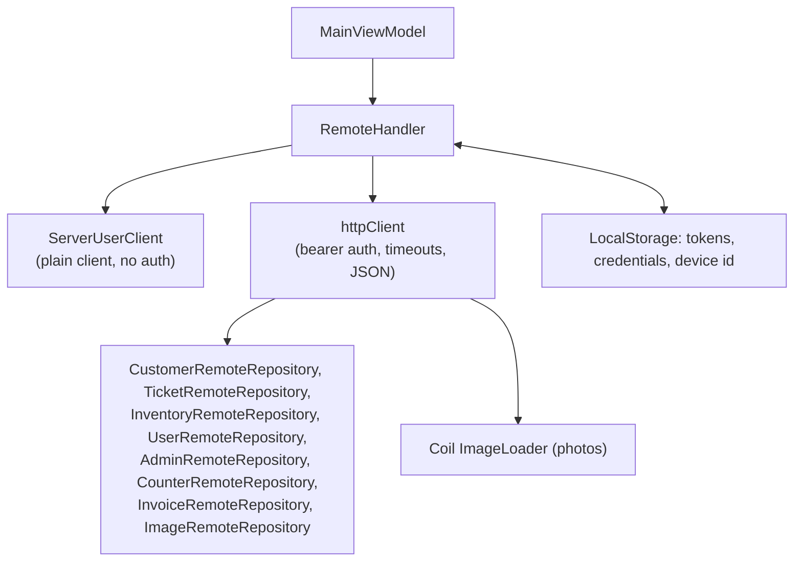
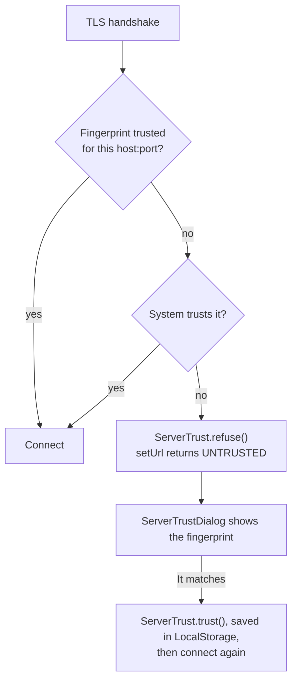
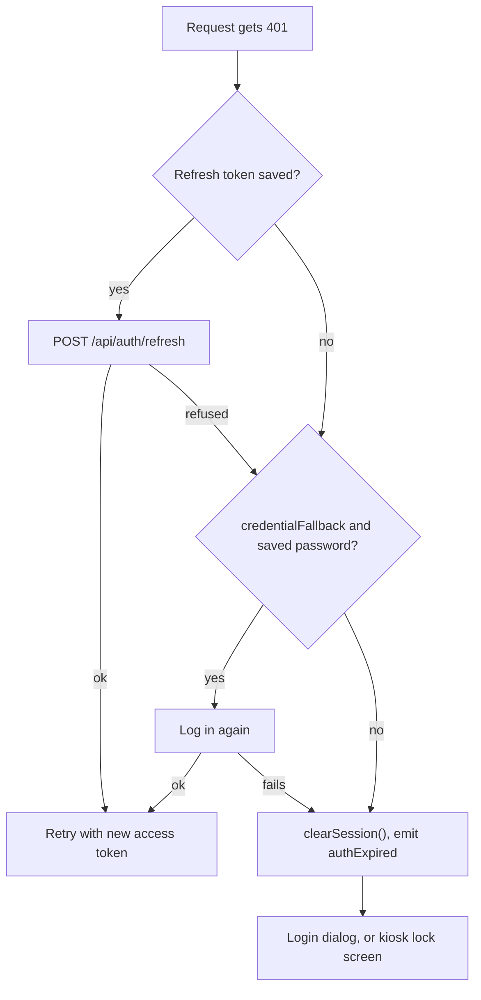

# Networking

How the client talks to the server: the `RemoteHandler` that owns the HTTP clients and repositories, how it
connects and logs in, how tokens are kept fresh, and the helpers every call goes through. The server side of login
is on [Authentication and sessions](../server/auth.md).

## The pieces



| File (`composeApp/.../components/network/`) | Does |
|-----------------|------|
| `RemoteHandler.kt` | Owns both clients and every repository. Connecting, login, refresh, logout, PIN login |
| `user/ServerUserClient.kt`, `user/CreateUserHttpClient.kt` | Calls that happen before there's a token: checking the server is up, login, refresh, PIN login, account requests, invite setup |
| `database/CreateDatabaseHttpClient.kt` | Builds the authenticated client; `transferTimeout()` |
| `database/RemoteRepository.kt` | Base class for the four record repositories |
| `database/*RemoteRepository.kt` | One per server area |
| `image/ImageRemoteRepository.kt` | Photo uploads and URLs |
| `Helpers.kt` | `networkRequest`, `networkErrorTryCatch`, `handleHttpResponse`, `handleActionHttpResponse`, `handleDataHttpResponse`, `networkErrorFor` |
| `ServerError.kt`, `ConnectionResult.kt` | Error and connection result types |
| `HttpEngine.kt` | `expect fun getHttpEngine(trust)` |
| `ServerTrust.kt`, `ServerAddress.kt` | Which self-made server certificates are trusted; how typed addresses are read |
| `jvmSharedMain/.../PinningTrustManager.kt` | The certificate and host name checks the desktop and Android engine use |
| `transfer/` | Streaming big uploads and downloads, see [Transfers and photos](transfers-and-photos.md) |

## Two HTTP clients

- **`ServerUserClient`** uses a plain client with no auth plugin. It's for calls that make or renew tokens, so they
  can't get caught in the auth plugin's own refresh loop. It doesn't follow redirects, so it can see a server
  sending plain HTTP to HTTPS (see [Connecting](#connecting)).
- **`RemoteHandler.httpClient`** is the authenticated one, shared by every repository and by the photo loader so
  photo requests carry the same token. It installs:
  - **bearer auth**: `loadTokens` reads the access and refresh tokens from `LocalStorage`; `refreshTokens` calls
    `RemoteHandler.refreshTokens()`,
  - **timeouts**: 60 seconds per request; `transferTimeout()` lifts the request timeout for one call (keeping a
    socket timeout) for uploads and downloads,
  - **JSON** with `ignoreUnknownKeys`,
  - **logging** of headers only, with `Authorization` hidden. Logging bodies would buffer every photo and backup.

Both are built on the engine from `getHttpEngine(trust)`: OkHttp on desktop and Android, Ktor's Js engine on web.
`MainViewModel` makes it, unless a test passes in a mock engine.

## Server addresses

`SettingsHandler.setServerUrl` saves addresses through `normalizeServerAddress`: with no `http://` or `https://`,
an address means HTTPS. Addresses saved before HTTPS had no scheme and always went out as plain HTTP, so
`LocalStorage` adds `http://` to them once when it loads (`migrateSavedServerAddress`) and they keep working.
`SessionHandler.connectionSecure` is false on `http://`, and the admin Server tab shows a **Not secure** badge.

On web, with no address saved, `MainViewModel` tries `defaultServerAddress()` (the page's origin) and saves it if a
server answers there.

## Connecting

`SessionHandler.connect(url)`, called on start with the saved server address and whenever it's changed in Settings,
calls `RemoteHandler.setUrl(url)`:

1. For an `http://` address, `ServerUserClient.httpsRedirectOf` asks `/api/ping` first. A server with
   `HTTP_MODE=redirect` answers with a redirect; when it points at the same host's `/api/ping` on `https://`, the
   rest of the steps use that address instead. `RemoteHandler.address` holds the address actually used, and
   `SessionHandler` saves it through `onServerMoved` (to `SettingsHandler.rememberServerUrl`), so it's only moved
   once. A redirect to another host isn't followed.
2. `GET <url>/api/ping` must answer `TicketMan`. Servers from before `/api/ping` answer 404, and then `GET <url>/`
   counts if it isn't a web page (so the web client's dev server isn't taken for a server). If neither works, the
   result is `UNREACHABLE`, or `UNTRUSTED` when the server's certificate was refused (below). Nothing else changes.
3. Every repository's `serverUrl` is set. Until then it's blank, and every repository call returns straight away
   with a "No server set" error instead of hitting a relative URL.
4. It tries to log in with the saved username and password. The result is `LOGGED_IN` or `CONNECTED`.

## Trusting a server's certificate

A server usually makes its own certificate (see [Running a server](../operations.md#https)), which no authority
vouches for. On desktop and Android the engine trusts it the first time someone checks it, then only that
certificate from that address. It's the same idea as SSH remembering a host's key.



- `PinningTrustManager` accepts what the system's trust store accepts, so a real certificate just works, plus the
  one fingerprint (SHA-256 of the certificate) `ServerTrust` holds for that `host:port`. Anything else is passed to
  `ServerTrust.refuse()` and the handshake fails.
- `PinningHostnameVerifier` runs OkHttp's usual name check, and lets a trusted fingerprint through even when the
  certificate doesn't list the name the server was reached by.
- `SessionHandler.untrustedCertificate` is the refused certificate for the current server, and `App` shows
  `ServerTrustDialog` for it, above the login popup. The dialog shows the fingerprint in two lines to read off
  against the admin Server tab or the server's log. A **changed** certificate (a different one from an address
  trusted before) gets a warning, since it can mean something is pretending to be the server.
- **Don't connect** leaves the server unconnected and doesn't ask about that certificate again until the app
  restarts. **It matches, connect** saves the fingerprint (`trusted_certificates` in `LocalStorage`) and connects again.
- On web the browser does all of this itself, and nothing here runs.

After connecting, `SessionHandler` reloads the current user (`GET /api/user/me`) and the device's station, and
`MainViewModel` refreshes the record lists.

## Logging in and out

`RemoteHandler.login(user, pass)` → `ServerUserClient.login`, which posts a `LoginRequest` with this device's id and
name and returns a `LoginOutcome`: `LoggedIn(needsSetup)`, `PendingApproval`, `InviteSetup(username, setupToken)`
or `Failed(error)`. On success the tokens go in `LocalStorage`, and the username and password too if **Remember login** is on.
`Failed` carries the `NetworkError`: `UNAUTHORIZED` (the server's 401) is a wrong username or password, and the login
dialog says so; anything else, like a timeout or the server being down, shows that error's message instead.

`onLoggedIn()` then clears the auth plugin's cached tokens so the next request loads the new ones.

`logout()` posts `/api/auth/logout`, clears the tokens and the saved password (the username stays to prefill the
form), and clears the auth plugin's tokens. `endSession()` is the same without touching credentials; the kiosk uses
it when locking.

## Keeping tokens fresh



The server swaps the refresh token on every refresh, so `ServerUserClient.refreshTokens` saves the new one from
`RefreshTokenResponse.refreshToken` along with the access token. The old one won't work again. A server from before
rotation sends no refresh token, and the saved one is kept.

A `403` isn't a token problem, so it isn't refreshed: the call fails with `NetworkError.FORBIDDEN` ("You don't have
access to that").

`credentialFallback` is on by default and turned off by kiosk mode, so an expired PIN session doesn't silently log
the device's owner back in.

`authExpired` is collected in `MainViewModel.init()`: a kiosk locks, anything else shows the login dialog.

## Repositories

[`RemoteRepository<T: MainItem>`](../../composeApp/src/commonMain/kotlin/org/mr0btain/ticketman/components/network/database/RemoteRepository.kt)
has the calls every record type shares, matching the server's shared routes:

| Call | Route | Returns |
|------|-------|---------|
| `add(data)` | `POST add` | `EmptyResult<ServerError>` |
| `update(data)` | `POST update` | `EmptyResult<ServerError>` |
| `remove(id)` | `DELETE remove/{id}` | `EmptyResult<ServerError>` |
| `get(id)` | `POST get` | `T?` |
| `fetch(offset, limit)` | `POST fetch` | `List<T>`, empty on failure |
| `search(query, limit)` | `POST search` | `List<SearchResult>` |
| `getNotes(id)`, `addNote`, `updateNote`, `removeNote` | note routes | notes, `EmptyResult` |
| `fetchPage`, `getEntity`, `setEntity` (protected) | for subclasses | |

A subclass passes its `route` (`"api/data/ticket"`) and `itemTypes<T>()`, which carries the `TypeInfo` for `T` and
`List<T>`. That's needed because `T` is erased in the generic base, and kotlinx.serialization can't find a
serializer for an erased type.

The other repositories (`AdminRemoteRepository`, `CounterRemoteRepository`, `InvoiceRemoteRepository`,
`ImageRemoteRepository`) don't extend the base; they follow the same shape by hand.

### Writing a call

```kotlin
suspend fun getByNumber(number: TicketNumber): Ticket? {
    if (serverUrl.isBlank()) return null

    val response = networkErrorTryCatch(GET_BY_NUMBER_TAG) {
        client.get { url("$serverUrl/number/$number") }
    } ?: return null

    handleHttpResponse<Ticket>(GET_BY_NUMBER_TAG, response).onSuccess { return it }
    return null
}
```

- Return early when `serverUrl` is blank.
- Wrap the call in `networkRequest(TAG)` when the failure reaches the user, so a timeout or a bad response says so
  instead of "Couldn't reach the server". `networkErrorTryCatch(TAG)` gives back the value or `null`, for reads that
  only need to know whether it worked.
- Turn the response into a result: `handleActionHttpResponse` for success or failure, `handleDataHttpResponse<T>`
  for a body, `handleHttpResponse<T>` for a body with a `NetworkError`.
- Calls that change something return `Result`/`EmptyResult` with a `ServerError`, so the handler can show the
  server's reason. Reads usually return `T?` or a list.

See [Request lifecycle](../architecture/request-lifecycle.md) for what each helper does with errors.

## Testing

Repositories and handlers are tested in `composeApp/src/commonTest` with Ktor's `MockEngine`: build a
`RemoteHandler` on a `MockEngine` that answers the routes under test, and an `InMemoryKeyValueStore` for
`LocalStorage`. The mock has to answer `SERVER_PING_PATH` with `SERVER_PING_BODY`, or connecting fails.
`PinnedHttpsTest` (desktopTest) runs a real HTTPS server with a self-made certificate against the OkHttp engine.

## Gotchas

- **Route strings aren't checked against the server.** Rename a route on one side and the other still compiles.
- **Repositories keep their own copy of the server URL.** `setUrl` sets each one by name, so a new repository must be
  added to that list as well as constructed in `RemoteHandler`.
- **Trust is per `host:port`.** The same server reached by its IP address and by its name is asked about twice.
- **A login with credentials not remembered can't be refreshed by password.** Once the refresh token is refused the
  user has to log in again. That includes a refresh whose answer was lost: the server had already swapped the
  token, so the one the device kept is refused.

## See also

- [App state and handlers](state.md)
- [Storage](storage.md)
- [Request lifecycle](../architecture/request-lifecycle.md)
