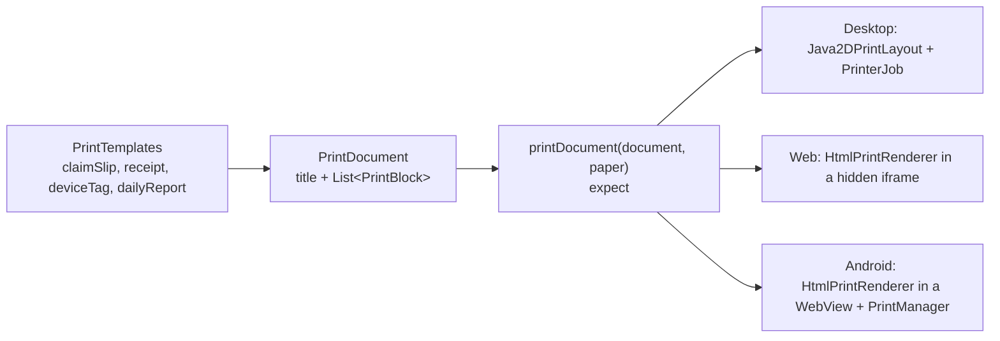

# Printing

The counter prints claim slips, device tags and receipts, and the admin screen prints the end of day report. A
printout is described once, as platform neutral blocks, and each platform lays those blocks out for the paper and
sends them to its own print system. So one template works on an 80mm receipt printer and on a letter page, on
desktop, Android and the web.

## How it fits together

All in `composeApp/.../components/print/`, with the platform files beside them in each source set.

## The document

[`PrintDocument`](../../composeApp/src/commonMain/kotlin/org/mr0btain/ticketman/components/print/PrintDocument.kt)
is a title and a list of blocks, top to bottom:

| Block | Draws |
|-------|-------|
| `Heading(text, large)` | A centered heading. `large` is for the ticket number, readable across the counter |
| `Text(text, bold, small, centered)` | A paragraph |
| `Field(label, value)` | A label on the left and its value beside it |
| `Amounts(rows)` | Rows with text on the left and an amount on the right, for invoice lines and totals |
| `Divider`, `Gap` | A rule; some space |
| `Qr(text)` | A centered QR code |
| `Signature(strokes, aspectRatio, caption)` | The customer's signature, drawn from its strokes |

Blocks say what goes on the page, not where. Sizes, wrapping and page breaks are the platform's job.

## The templates

[`PrintTemplates`](../../composeApp/src/commonMain/kotlin/org/mr0btain/ticketman/components/print/PrintTemplates.kt):

| Template | Printed from | Holds |
|----------|--------------|-------|
| `claimSlip(shop, ticket, customer, invoice, signature)` | Counter ticket card, after check-in | Shop header, ticket number large with a QR of it, customer and device, check-in and promised times, deposit, the repair terms and signature |
| `deviceTag(ticket, customer)` | Counter ticket card | Number and QR, customer, device, due date. Stuck to the device |
| `receipt(shop, ticket, customer, invoice)` | Counter, after pickup | Shop header, charges, discount, tax, total, payments, change, invoice footer |
| `dailyReport(shop, report)` | Admin overview | The day's takings by payment method, sales, tax and ticket counts |

`CounterPrinter` (`counter.printer`) and `AdminHandler` build the document and call `printDocument(document, paper)`, with the paper
size from the shop profile's default or the one picked.

## Platforms

`printDocument` shows the platform's print dialog so the user can pick a printer, and returns `null` when it was sent
or cancelled, or a message saying what went wrong.

| Platform | How |
|----------|-----|
| Desktop | `Java2DPrintLayout` measures and draws the blocks with Java2D as a `Printable`. On 80mm paper it's one page as long as the content; on letter it splits across pages. The dialog runs on the Swing thread, printing on IO |
| Web | `HtmlPrintRenderer` turns the document into an HTML page, loaded in a hidden iframe that's then printed, bringing up the browser's dialog |
| Android | The same HTML in a `WebView`, handed to `PrintManager`. Needs the current activity, which `MainActivity` passes with `AndroidPrintHost.attach(this)` |

QR codes come from `QrCode`, an in-house encoder (byte mode, medium error correction, up to version 10, 213 bytes),
so no QR library is needed on any platform.

## Adding a printout

1. Add a function to `PrintTemplates` that returns a `PrintDocument` built from the blocks above.
2. If a new kind of block is needed, add it to `PrintBlock` and draw it in all three places: `Java2DPrintLayout`
   (desktop), and `HtmlPrintRenderer` (web and Android).
3. Call `printDocument` from the handler and show the result.
4. Test it in `PrintTemplatesTest` (the blocks) and `Java2DPrintLayoutTest` (that it lays out).

## Tests

`composeApp/src/desktopTest/.../components/print/`:

- `PrintTemplatesTest` checks what each template puts on the page,
- `Java2DPrintLayoutTest` lays documents out on both paper sizes,
- `QrCodeTest` encodes codes and reads them back with ZXing to prove they scan.

## Gotchas

- **The QR holds the ticket number as text**, like `26-00000042`. The app has no scanner; a handheld scanner that
  types into the counter search box is what it's for.
- **Receipt printers vary.** The 80mm layout leaves 4mm margins and relies on the driver to cut. Try a new template on
  real hardware.

## See also

- [Platforms](platforms.md)
- [Counter (server)](../server/counter.md)
- [Add a printout](../how-to/add-a-printable-document.md)
