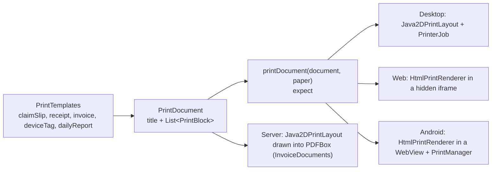

# Printing

The counter prints claim slips, device tags and receipts, and the admin screen prints the end of day report. A
printout is described once, as platform neutral blocks, and each platform lays those blocks out for the paper and
sends them to its own print system. So one template works on an 80mm receipt printer and on a letter page, on
desktop, Android and the web. The server lays out the same documents as PDFs, so an invoice that's emailed looks
like the printed one.

## How it fits together

The document, the templates, `QrCode` and the date helpers (`components/utils/Formatting.kt`) are in `shared`'s
`commonMain`, and `Java2DPrintLayout` in `shared`'s `jvmMain`, so the server can use them. `printDocument`, its
platform files and `HtmlPrintRenderer` stay in `composeApp/.../components/print/`. The packages didn't change when
they moved, so imports are the same on both sides.

## The document

[`PrintDocument`](../../shared/src/commonMain/kotlin/org/mr0btain/ticketman/components/print/PrintDocument.kt)
is a title and a list of blocks, top to bottom:

| Block | Draws |
|-------|-------|
| `Heading(text, large)` | A centered heading. `large` is for the ticket number, readable across the counter |
| `Text(text, bold, small, centered)` | A paragraph |
| `Field(label, value)` | A label on the left and its value beside it |
| `Amounts(rows)` | Rows with text on the left and an amount on the right, for invoice lines and totals |
| `Divider`, `Gap` | A rule; some space |
| `Qr(text)` | A centered QR code |
| `Barcode(text)` | A centered Code 128 barcode with the text under it, for a one dimensional scanner. Left out when the text can't be one |
| `Photo(jpeg, aspectRatio)` | A centered photo about the size of the QR, like the face on an ID card. Java2D decodes it and leaves it off if it can't; HTML inlines it as a data url |
| `Signature(strokes, aspectRatio, caption)` | The customer's signature, drawn from its strokes |

Blocks say what goes on the page, not where. Sizes, wrapping and page breaks are the platform's job.

## The templates

[`PrintTemplates`](../../shared/src/commonMain/kotlin/org/mr0btain/ticketman/components/print/PrintTemplates.kt):

| Template | Printed from | Holds |
|----------|--------------|-------|
| `claimSlip(shop, ticket, customer, invoice, signature)` | Counter ticket card, after check-in | Shop header, ticket number large with a QR of the [status page](../api/status.md) link once the shop has a public address (the number before that, or if the link is too long), customer and device, check-in and promised times, deposit, the repair terms and signature |
| `deviceTag(ticket, customer)` | Counter ticket card | Number and QR, customer, device, due date. Stuck to the device |
| `receipt(shop, ticket, customer, invoice)` | Counter, after pickup | Shop header, charges, discount, tax, total, payments, change, invoice footer |
| `invoice(shop, ticket, customer, invoice)` | The server, as a PDF (`GET /api/invoice/{id}/pdf`) | Like the receipt, with the status (due, paid, void), the customer's address, phone and email, and what's still owed |
| `dailyReport(shop, report)` | Admin overview | The day's takings by payment method, sales, tax and ticket counts |
| `itemLabel(shop, item)` | Records, an inventory item's **Print label** (starts on label paper) | The item's name, price, and a barcode of its barcode or else its SKU |
| `idCard(shop, user, badgeCode, photo)` | Admin Users tab, **Print ID card** | Shop name, the profile photo (fetched as the `display` size, left off if it won't load), name large, username, and a QR of `TMBADGE:<code>` with the code under it in fours. On a receipt it makes a strip about card width |

`CounterPrinter` (`counter.printer`), `AdminHandler` and `AdminAccounts` (the ID card) build the document and call `printDocument(document, paper)`, with the paper
size from the shop profile's default or the one picked.

## Platforms

`printDocument` shows the platform's print dialog so the user can pick a printer, and returns `null` when it was sent
or cancelled, or a message saying what went wrong.

| Platform | How |
|----------|-----|
| Desktop | `Java2DPrintLayout` measures and draws the blocks with Java2D as a `Printable`. On 80mm paper it's one page as long as the content; on letter and labels (`PaperSize.LABEL`, 57 x 32mm, smaller type) it splits across pages. The dialog runs on the Swing thread, printing on IO |
| Web | `HtmlPrintRenderer` turns the document into an HTML page, loaded in a hidden iframe that's then printed, bringing up the browser's dialog |
| Android | The same HTML in a `WebView`, handed to `PrintManager`. Needs the current activity, which `MainActivity` passes with `AndroidPrintHost.attach(this)` |

### PDFs on the server

[`InvoiceDocuments`](../../server/src/main/kotlin/org/mr0btain/ticketman/components/service/InvoiceDocuments.kt)
lays a document out with the same `Java2DPrintLayout` on letter paper and draws each page through PDFBox's
`PdfBoxGraphics2D` (the `de.rototor.pdfbox:graphics2d` bridge). Text the standard PDF fonts can show stays real text,
so a PDF is a few KB and searchable; anything else is drawn as shapes. Measuring text needs fonts on the machine,
which the Docker image's base has (DejaVu). The client saves it with **Save PDF** at the counter and on the admin
Invoices tab (`CounterPrinter.savePdf`), reading it whole, since the route needs the login header that a browser
download wouldn't send.

QR codes come from `QrCode`, an in-house encoder (byte mode, medium error correction, up to version 10, 213 bytes),
so no QR library is needed on any platform. Barcodes come from `Code128`, also in house: code set C for an even
number of digits, B for any other printable ASCII, up to 48 characters, with the mod 103 check symbol. Java2D draws
the bars as wide as the content allows (at most 1.5 points a module on letter), HTML as an SVG stretched to the
width.

## Adding a printout

1. Add a function to `PrintTemplates` that returns a `PrintDocument` built from the blocks above.
2. If a new kind of block is needed, add it to `PrintBlock` and draw it in all three places: `Java2DPrintLayout`
   (desktop), and `HtmlPrintRenderer` (web and Android).
3. Call `printDocument` from the handler and show the result.
4. Test it in `PrintTemplatesTest` (the blocks) and `Java2DPrintLayoutTest` (that it lays out).

## Tests

`composeApp/src/desktopTest/.../components/print/`:

- `PrintTemplatesTest` checks what each template puts on the page,
- `Java2DPrintLayoutTest` lays documents out on both paper sizes,
- `QrCodeTest` encodes codes and reads them back with ZXing to prove they scan,
- `Code128Test` does the same for barcodes, on their own and on a printed item label.

## Gotchas

- **The device tag's QR holds the ticket number as text**, like `26-00000042`, and so does the claim slip's until the
  shop has a public address; then it's the status page link. The app has no scanner; a handheld scanner that types
  into the counter search box is what it's for, and the search takes either.
- **Receipt printers vary.** The 80mm layout leaves 4mm margins and relies on the driver to cut. Try a new template on
  real hardware.

## See also

- [Platforms](platforms.md)
- [Counter (server)](../server/counter.md)
- [Add a printout](../how-to/add-a-printable-document.md)
