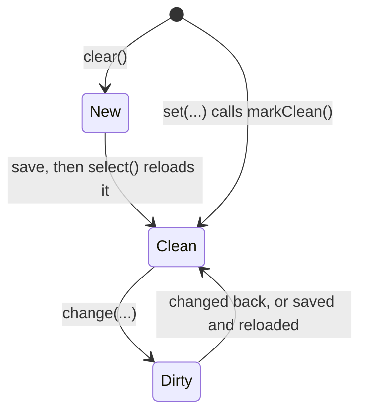

# Records: seeds, caches and pagers

The records screen shows customers, tickets, inventory and users the same way: a paged list, the selected record's
details, and a dialog to edit it. Each record type has a `<Entity>Records` handler built from the same four parts.
This page covers those parts and how a save works. [Entity layers](../architecture/entity-layers.md) shows where they
sit in the bigger picture, and [Request lifecycle](../architecture/request-lifecycle.md) follows a ticket save
end to end.

## The four parts

| Part | Class | Does |
|------|-------|------|
| List | `OffsetPager<T>` | Loads pages from the server as the list scrolls |
| Recently opened | `<Entity>Cache` (on `CustomCache`) | Keeps records already opened, with their notes and links |
| Opening a record | `RecordSelection` | Loads the record picked in the list, cancelling older loads |
| The open record | `<Entity>Seed` (on `DataSeed`) | Holds the record being viewed or edited, and knows what changed |

and a handler that puts them together, in `ui/screens/records/components/<entity>/`:

| Handler | Notes |
|---------|-------|
| `CustomerRecords` | `select`, `clearSelection`, `save`, `remove`, `search`, `get`, `clear` |
| `TicketRecords` | The same, plus a list scope (my tickets or all), saved in `LocalStorage` |
| `InventoryRecords` | The same, plus saving the item's own photo list and its stock count |
| `UserRecords` | No `save`: users are added and changed from the admin screen. Saves and deletes staff notes straight away, admins only |

## `OffsetPager`

[`OffsetPager`](../../composeApp/src/commonMain/kotlin/org/mr0btain/ticketman/components/pagination/offset/OffsetPager.kt)
is a small in-house pager, written instead of using Paging so the app has full control (for example, jumping to an
item far down the list).

```kotlin
val pager = OffsetPager<Ticket>(tag = "TicketPager", config = pagerConfig) { page, pageSize ->
    remoteHandler.ticketRepo.fetch(offset = (page * pageSize).toLong(), limit = pageSize)
}
```

- `items: StateFlow<List<T>>` is what the list shows: the loaded pages, flattened.
- `loadNext()` and `loadPrevious()` add a page at either end. `OffsetPagerLoader(pager, lazyListState)` calls them as
  the list scrolls near an edge.
- It keeps at most `maxSize` items (200) loaded, dropping pages from the far end, and keeps the last `cacheSize`
  pages it fetched (10) so scrolling back to a dropped page doesn't refetch it.
- It **doesn't load on its own**. Call `refresh()` for the first load; `MainViewModel` does after connecting and
  logging in.
- `refreshCurrentData()` reloads the pages on screen after a save, so the list shows the new values.
- One pager lives as long as its handler. Change its size with `setPageSize` and empty it with `clear()`, rather than
  making a new one, so screens already collecting `items` keep getting updates.

Page size comes from Settings.

## Caches

`CustomCache<T>` wraps the shared `LruCache`, keyed by record id. Each `<Entity>Cache` stores what opening a record
needs, so opening it again is instant:

```kotlin
class TicketCache(maxSize: Int) : CustomCache<TicketCache.TicketData>(maxSize) {
    data class TicketData(val ticket: Ticket, val notes: List<Note>, val customer: EntityReference?, val user: EntityReference?)
}
```

A save calls `cache.remove(id)` so the next open fetches fresh. Caches are main thread only.

## `RecordSelection`

Clicking quickly through a list fires several loads, and they can come back in any order.
[`RecordSelection.select(id) { ... }`](../../composeApp/src/commonMain/kotlin/org/mr0btain/ticketman/components/data/RecordSelection.kt)
cancels any load still running and only applies the newest one. The load block fetches (from the cache, or the
server in parallel) and returns a function that fills the seed; that function only runs if nothing else was picked
since. `pending` is the id being loaded, so the list can highlight the click before the details arrive.

## Seeds

[`DataSeed`](../../composeApp/src/commonMain/kotlin/org/mr0btain/ticketman/components/data/DataSeed.kt) is the base
for `CustomerSeed`, `TicketSeed`, `InventorySeed` and `UserSeed`. It holds the open record's fields as Compose state,
plus its `identifier`, `notes`, `images` (the record's own photos, for inventory) and `isNew`.



- `set<Entity>(...)` loads a record and calls `markClean()`, which snapshots `fields()` plus the id, notes and images.
- `change<Field>(...)` edits one field.
- `isDirty` compares the current `fields()` with the snapshot. Editing something back to how it was counts as
  unchanged, so a dialog's Save button can follow `isDirty` exactly.
- `getChangedFields()` lists which `ChangedField`s differ, so a save only sends what's needed.
- `<seed>.ticket` / `.customer` / ... builds the shared model from the current fields.

**Adding a field to a seed** means adding the state property, a `change<Field>` function, a line in `set<Entity>`,
a line in the model it builds, and an entry in `fields()`. Leave out `fields()` and edits to it never make the seed
dirty. Lists in `fields()` must be copies (`toList()`), or later edits change the snapshot too.

## Saving

Every `save()` follows the same steps (see `TicketRecords.save()`):

1. Return if `!seed.isDirty`.
2. Read everything from the seed up front, then launch.
3. New record: `add` (or `create` for tickets, which returns the server's number). Existing record: `update`, only if
   a field of the record itself changed. Link and note changes go through their own calls.
4. Notes: `syncNotes(id, notes, repo, snackbar)` in
   [`RecordNotes.kt`](../../composeApp/src/commonMain/kotlin/org/mr0btain/ticketman/ui/screens/records/components/RecordNotes.kt)
   fetches the server's notes and adds, updates and removes to match the seed. Notes are only sent when the record is
   saved, so cancelling the dialog drops note edits too.
5. Links (a ticket's customer and tech) and inventory photos are set if they changed. So is an item's stock count,
   which `update` leaves alone: `setStock(id, seed.loadedStock, stock)` sends the count the item was opened at with
   the new one, and the server refuses it with a `409` if a pickup has taken stock since. The snackbar says so, and
   the reload in the next step shows the real count.
6. `cache.remove(id)`, `select(id)` to reload and mark clean, `pager.refreshCurrentData()`.

Each step that fails shows its own snackbar, so a partly saved record says which part didn't go through.

Notes and their photos are edited in the kit's `TmEditNoteDialog`. Photos are uploaded as soon as they're picked
(they come back pending) and only become part of the note when the record is saved; see [Photos](../server/photos.md).

## Restricted users

Restricted users can look at records but not change them. `CustomerRecords`, `TicketRecords` and `InventoryRecords`
take a `canEdit` callback (`session.canEditNow()`) and their `save()` and `remove()` do nothing when it's false. The
records screen hides New, Delete and Edit for them (`TmPanelTopBar(canChange = false)` shows a "View only" badge in
their place), and a ticket clicked on a customer opens on the Tickets tab instead of in the edit dialog.
`RecordsAccessTest` covers the handlers. A new action that changes a record should check `canEdit()` too.

## Gotchas

- **Cancelling a dialog reloads the record** (`select(seed.identifier)`) to throw away edits. A record deleted on
  another device in the meantime fails to load.
- **`ChangedField` is one enum for every record type.** Add a value when a seed gains a field that needs its own
  change detection.
- **`syncNotes` refetches the server's notes on every save** to work out the difference, so a note added on another
  device since the record was opened survives, but one edited there is overwritten.

## See also

- [App state and handlers](state.md)
- [Entity layers](../architecture/entity-layers.md)
- [Request lifecycle](../architecture/request-lifecycle.md)
