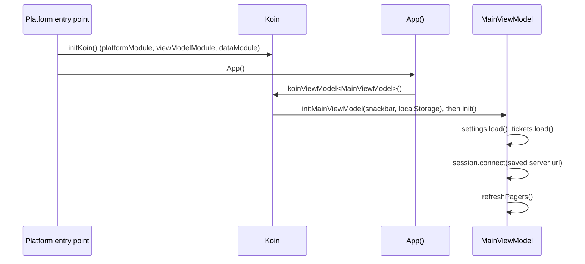

# App state and handlers

Where the client's state lives. One `MainViewModel` lasts as long as the app and owns a handler for each part of
it. Screens read the handlers' state flows and call their functions; they never talk to the network themselves.
This page covers how that's wired and what each handler owns.

## Start up



Koin modules (`components/injection/`):

| Module | Provides |
|--------|----------|
| `platformModule` (`expect`) | `KSafe`, the encrypted key value store, built per platform |
| `dataModule` | `AppDir`, `KeyValueStore` (`KSafeKeyValueStore`), `LocalStorage`, `SnackbarHostState` |
| `viewModelModule` | `MainViewModel`, through `initMainViewModel` so `init()` runs once it's built |

Desktop calls `initKoin()` inside its `Window`; Android in `TicketManApplication.onCreate` (once per process, with
the `Context` KSafe needs); web in `main()`, waiting for KSafe's cache to load before showing anything.

`App()` then builds the theme from the saved settings, sets the Coil image loader, provides `LocalImageClient`, and
shows either the kiosk or the normal app shell.

## `MainViewModel`

[`MainViewModel`](../../composeApp/src/commonMain/kotlin/org/mr0btain/ticketman/ui/MainViewModel.kt) builds
everything and connects the handlers through callbacks, so no handler holds a reference to another:

```kotlin
val session: SessionHandler = SessionHandler(
    ...,
    onLoggedIn = { refreshPagers() },
    onLoggedOut = { admin.clear(); counter.clear(); customers.clear(); tickets.clear(); ... }
)

val counter: CounterHandler = CounterHandler(..., canEdit = { session.canEditNow() })
```

Every handler gets `viewModelScope` to launch work in and, where it shows messages, the shared `SnackbarHostState`.

| Property | Handler | Screen | Owns |
|----------|---------|--------|------|
| `remoteHandler` | `RemoteHandler` | - | HTTP clients, repositories, tokens. See [Networking](networking.md) |
| `imageClient` | `ImageClient` | all | Photo uploads and the image loader. See [Transfers and photos](transfers-and-photos.md) |
| `customers`, `tickets`, `inventory`, `users` | `CustomerRecords`, `TicketRecords`, `InventoryRecords`, `UserRecords` | Records | Per record type: cache, pager, seed, selection, save, remove, search. See [Records](records.md) |
| `session` | `SessionHandler` | Login, Settings | Connecting, login and logout, `currentUser`, `isAdmin`, `canEdit`, account requests and setup, this device's station |
| `settings` | `SettingsHandler` | Settings | Saved settings as state flows. Each change is written to `LocalStorage` at once |
| `counter` | `CounterHandler` | Counter | Search, queue, the open ticket and customer, price check. Its parts: `checkIn` (`CounterCheckIn`), `pickup` (`CounterPickup`), `invoices` (`CounterInvoices`, the invoice list) and `printer` (`CounterPrinter`) |
| `admin` | `AdminHandler` | Admin | Overview, daily report, low stock, audit log. Its parts: `accounts` (`AdminAccounts`: users, requests, invites, PINs), `devices` (`AdminDevices`: stations, sessions, blocked logins) and `server` (`AdminServer`: server info, shop profile, backup and restore, mock data) |
| `kiosk` | `KioskHandler` | Kiosk | Kiosk on or off, the PIN lock, the idle timer |

`selectedMainTabIndex` is the one bit of UI state kept on the view model itself, so the start tab setting can set it.

## How handlers are written

- **State goes out as `StateFlow`.** Each handler keeps a private `MutableStateFlow` and exposes it read only:

  ```kotlin
  private val _queue = MutableStateFlow(CounterQueueResponse())
  val queue = _queue.asStateFlow()
  ```

  Screens `collectAsState()` them. A few older properties use Compose `mutableStateOf` directly (the seeds and the
  pager's loading flags).
- **Actions are plain functions** that launch on the scope and report back through state, a snackbar, or an
  `onResult: (String?) -> Unit` callback that gets `null` on success and a message otherwise. Dialogs use the
  callback to stay open and show the error.
- **Handlers check what they can before calling.** `CounterHandler`, `CustomerRecords`, `TicketRecords` and
  `InventoryRecords` refuse changes when `canEdit()` is false, and their screens hide the buttons that make them;
  `UserRecords` refuses staff note changes unless `isAdmin()`. This only hides and blocks things on screen; the server
  checks again.
- **`clear()`** forgets everything loaded, and is called on logout so the next person doesn't see it.
- Handlers live as long as the view model, so a screen can leave and come back without losing its state.

## Session state

`SessionHandler` is what the rest of the app reads to know who's here:

| Flow | Meaning |
|------|---------|
| `currentUser` | The logged in `User`, or null |
| `canEdit` | `currentUser.canAccess(NORMAL)` |
| `isAdmin` | `currentUser.canAccess(ADMIN)`, used to show the Admin tab |
| `loginState`, `loginMessage`, `showLogin` | The login dialog |
| `accountSetup` | A first login setup waiting to be finished; `App()` blocks everything else until it's done |
| `serverConnected` | Whether the server answered |
| `station` | This device's `Station`, if it's registered |

`canEditNow()` and `isAdminNow()` read the same thing without collecting, for handlers to call.

## Gotchas

- **Big handlers are split into parts.** `CounterHandler` and `AdminHandler` hold one part per area of their
  screen, made in their constructor and sharing a small `CounterSupport` / `AdminSupport` (the scope, snackbar
  messages, and for the counter `canEdit` and switching views; for admin the loading flag and reloading the audit
  log after a change). A part reaches the rest of its handler only through the callbacks it's given, like
  `reloadOverview`. `clear()` on the handler clears its parts too. Split a new screen's state the same way once it
  grows past a few hundred lines.

## See also

- [Networking](networking.md)
- [Records](records.md)
- [Storage](storage.md)
