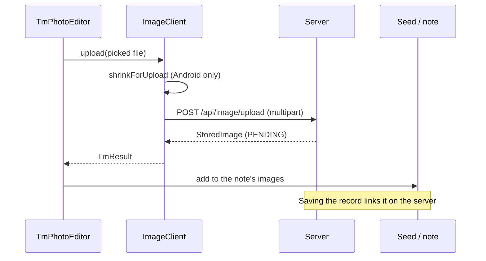

# Transfers and photos

Most requests are small JSON bodies. Two kinds aren't: photos, and backup archives that can be gigabytes. This page
covers the client helpers that move those without holding them in memory, and how photos are uploaded, shown and
cached. The server half is on [Photos](../server/photos.md) and [Backup and restore](../server/backup-restore.md).

## Large transfers

Rules for anything that can be big:

- **Lift the timeout.** Normal requests time out after 60 seconds. Call `transferTimeout()` inside the request
  builder; it removes the request timeout and keeps a socket timeout, so a stalled transfer still fails.
- **Don't log bodies.** The HTTP client logs headers only. Logging bodies makes Ktor buffer them.
- **Stream, don't read whole.** Use the helpers below rather than `readRawBytes()` plus `saveFile()`.

| Helper (`components/network/transfer/`) | Does |
|-----------------------------------------|------|
| `HttpClient.downloadTo(url, expectedBytes, openSink, onProgress)` | Streams a response into a kotlinx-io `RawSink` 64 KB at a time. Fails if fewer bytes arrive than expected, so a cut off download isn't mistaken for a whole one |
| `saveDownload(client, url, fileName, expectedBytes, onProgress)` (`expect`) | Asks where to save, then downloads there |
| `fileBody(file, contentType)` (`expect`) | A request body that streams a picked file as it's read |

Per platform:

| | `saveDownload` | `fileBody` |
|-|----------------|------------|
| Desktop, Android | FileKit's save dialog, then `downloadTo` the chosen file. A failed download deletes the partial file | Streams from the file |
| Web | Hands the URL to the browser as a download link. Progress isn't reported (`HandedToBrowser`) | Reads the whole file, since the browser can't stream a picked file here |

The web version works because backup download links carry their own token in the URL instead of needing the login
header.

`AdminServer` (`admin.server`) is the user of all of this: downloading a backup with `saveDownload`, and uploading a restore with
`fileBody` as the raw request body.

`saveFile(bytes, name, extension)` (`components/data/SaveFile.kt`, `expect`) saves bytes already in memory. Nothing
calls it at the moment; prefer `saveDownload` for anything from the server.

## Photos

### `ImageClient`

[`ImageClient`](../../composeApp/src/commonMain/kotlin/org/mr0btain/ticketman/components/image/ImageClient.kt) is
built by `MainViewModel` and handed to composables through `LocalImageClient`. It's `null` in previews and render
tests, and photo components show a placeholder then.

| Function | Does |
|----------|------|
| `upload(file, description, onProgress)` | Reads a picked file, shrinks it where the platform can, checks it's under 25 MB, and uploads it. Returns the pending `StoredImage` |
| `urlFor(image, variant)` | Where a photo's thumb, display or original is fetched from |
| `newImageLoader(context)` | The Coil `ImageLoader`, set as the app's singleton in `App()` |

### Uploading

`shrinkForUpload` only does anything on Android, where photos over 1.5 MB are scaled to 2560px as a JPEG before
sending. Desktop and web send the file as is and leave resizing to the server, because FileKit's desktop compressor
ignores EXIF orientation and would send photos sideways.

`ImageRemoteRepository.upload` sends the bytes as multipart (field names from `ImageLimits`), with
`transferTimeout()` and upload progress.

### Showing

Use the kit's components, in `ui/kit/images/`:

| Component | For |
|-----------|-----|
| `TmImage` | One photo, at a chosen variant |
| `TmImagePager` | Swiping through a set |
| `TmImageView` | Full screen, opened at the photo that was tapped |
| `TmPhotoEditor` | Adding, describing and removing photos while editing a note or item |

They load through the Coil loader from `newImageLoader`, which:

- fetches through `RemoteHandler.httpClient`, so photo requests carry the bearer token and get refreshed like any
  other call,
- keeps a memory cache (15% of memory) and a 250 MB disk cache (`imageDiskCache()`; none on the web, where the
  browser caches),
- since a photo never changes, uses cached copies without asking the server again.

## See also

- [Photos (server)](../server/photos.md)
- [Backup and restore](../server/backup-restore.md)
- [Platforms](platforms.md)
