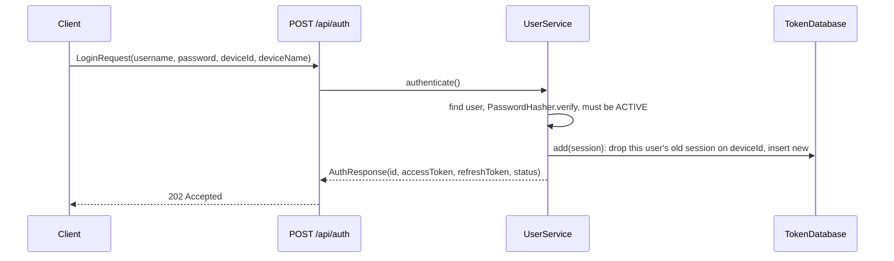

# Authentication and sessions

How the server knows who's calling: logging in, the tokens it hands out, the sessions behind them, and how each
route decides whether to let a caller in. PIN logins at stations build on this and are covered in
[PINs and stations](pins-and-stations.md); accounts and setup in [Users and accounts](users-and-accounts.md).

## The pieces

| File | Does |
|------|------|
| `plugins/Security.kt` | Installs the four JWT auth providers |
| `service/JwtService.kt` | Makes and checks tokens; the validators the providers call |
| `service/UserService.kt` | Password and PIN login, starting sessions, refreshing, logging out |
| `service/PasswordHasher.kt` | PBKDF2 hashing for passwords, PINs, invite codes and station secrets |
| `database/TokenDatabase.kt`, `TokenTable.kt`, `StoredSession.kt` | Sessions, one row per user per device |
| `routing/AuthRoute.kt` | `/api/auth`: login, refresh, logout, PIN login, account requests |
| `routing/Helpers.kt` | `getIdentifierFromToken()`, `getSessionIdFromToken()` for routes |

## Logging in

`authenticate()` handles a few cases besides a plain login:

| Situation | Result |
|-----------|--------|
| Right password, active user | Tokens, `status = OK` |
| Right password, approved but `needsSetup` | Tokens, `status = NEEDS_SETUP`. The tokens only work on setup routes |
| Pending user with an invite, right setup code | No tokens, `status = INVITE_SETUP` and a 30 minute `setupToken` |
| Pending account request, right password | No tokens, `status = PENDING_APPROVAL` |
| Anything else | `401`, and a `LOGIN_FAILED` audit entry |
| Too many wrong tries | `429`, see below |

### Wrong password limit

`POST /api/auth` and `/api/auth/user` count failed logins in memory, in two `RequestLimiter`s in `AuthRoute.kt`:
20 per address and 10 per username, each over 15 minutes. Once either is used up the route answers `429` before
checking the password, so even the right password waits until the oldest failure is 15 minutes old. Good logins
never count. The client shows `NetworkError.TOO_MANY_REQUESTS` ("Too many tries, wait a moment and try again").

A username's count is shared by every address, so someone on the network can keep a user locked out of password
login by guessing at it. PIN login and existing sessions aren't affected, and the counts reset when the server
restarts.

A username that doesn't exist still runs a dummy hash check, so the response takes as long as a wrong password and
can't be used to find out which usernames exist.

Passwords stored before hashing was added are plain text. `PasswordHasher.verify` compares those directly, and a
successful login re-saves the password hashed.

## Tokens

Both tokens are HMAC-SHA256 JWTs signed with `jwt.secret`, carrying:

| Claim | Value |
|-------|-------|
| `aud`, `iss` | `jwt.audience`, `jwt.issuer` from config |
| `identifier` | The user's id |
| `sid` | The session id, shared by the refresh token and every access token made from it |
| `typ` | `access` or `refresh` (`JwtService.ACCESS_TYPE`, `REFRESH_TYPE`) |
| `exp` | Access: 1 hour. Refresh: 365 days, or 12 hours for a PIN session |

The client sends the access token as `Authorization: Bearer ...`. When it gets a `401`, it posts the refresh token
to `/api/auth/refresh`, which checks that the token verifies, is the one stored for its session, and belongs to an
active user, then returns a new access token for the same session. The refresh token itself isn't replaced.

Every auth provider only lets in tokens with `typ = access`, so a refresh token can't be used as a bearer token,
and `/api/auth/refresh` refuses access tokens. Tokens made before `typ` was added have none: old access tokens are
refused (the client refreshes and gets a typed one), and old refresh tokens still refresh because they match their
stored session.

Invite setup tokens are separate: they carry a `purpose = invite-setup` claim and no `sid`, so they fail every auth
provider and can only be spent on `/api/auth/setup/invite`.

## Sessions

A session is a row in `TokenTable`: session id, user, refresh token, device id and name, kind (`PASSWORD` or
`PIN`), created and last used times.

- **One per user per device.** The client makes a random device id on first start and sends it with every login.
  `TokenDatabase.add` deletes that user's existing session on that device before inserting, so logging in again on
  the same device replaces its session and leaves other devices alone.
- **A token is only good while its session exists.** Every request checks that the token's `sid` is still in
  `TokenTable` for that user. That's what makes these take effect on the next request, without waiting for tokens
  to expire:
  - logging out (`POST /api/auth/logout` deletes the caller's session),
  - an admin ending a session or all of a user's sessions (`/api/admin/sessions/...`),
  - deactivating a user or changing their status (their sessions are deleted),
  - a password reset by an admin (ends their sessions),
  - a new PIN login at a station (ends the previous PIN session on that device),
  - removing a station.
- `lastUsedAt` is updated on each refresh, so the Sessions tab shows roughly when a device was last active.

## Checking each request

[`Security.kt`](../../server/src/main/kotlin/org/mr0btain/ticketman/components/plugins/Security.kt) registers four
JWT providers. All of them verify the signature, issuer, audience and expiry, then call a validator:

| Provider | Validator | Lets in | Used for |
|----------|-----------|---------|----------|
| default (`authenticate { }`) | `customValidator(NORMAL)` | Normal and Admin | Changing records |
| `"restricted"` | `customValidator(RESTRICTED)` | Everyone set up | Reading records |
| `"admin"` | `customValidator(ADMIN)` | Admin | `/api/admin`, user management, staff notes, shop profile |
| `"setup"` | `setupValidator` | Any active user, set up or not | `/api/user/setup`, `/api/user/me`, `/api/auth/logout` |

`customValidator` lets a caller in when the audience matches, the user `canAccess(level)` (active, setup finished,
level high enough), and the session still exists. `setupValidator` skips the setup and level check, which is what
lets a new user finish setting up and nothing else.

A caller who fails gets `401 Unauthorized` from every provider, whatever the reason.

Inside a route, `call.getIdentifierFromToken()` gives the caller's user id and `call.getSessionIdFromToken()` their
session id. Routes that act on "me" use these rather than taking an id from the request, so nobody can act as
someone else.

### Routes with no login

`POST /api/auth` (login), `/api/auth/refresh`, `/api/auth/request-account`, `/api/auth/setup/invite`, the station
routes `/api/auth/pin`, `/station/status`, `/station/staff` (which check the station's secret instead), `GET /`, and
the backup download link (which checks a one off token in the URL).

## Hashing

[`PasswordHasher`](../../server/src/main/kotlin/org/mr0btain/ticketman/components/service/PasswordHasher.kt) uses
PBKDF2-HMAC-SHA256 with 310,000 iterations and a 16 byte salt. Hashes are stored as
`pbkdf2$<iterations>$<salt>$<hash>`, so the iteration count can be raised later and old hashes still verify. The
same hasher is used for passwords, PINs, invite codes and station secrets.

## Gotchas

- **Not enough access looks like a bad token.** Every provider answers `401`, never `403`. See
  [Request lifecycle](../architecture/request-lifecycle.md#gotchas) for what the client does with it.
- **A blank device id never replaces a session.** Logins without one (old clients, scripts) add a new session every
  time.
- **`POST /api/auth/user`** checks a username and password and returns the access level without starting a session.
  It's older than sessions; the client still uses it in `ServerUserClient.checkLoginCredentials`.

## Known gaps

- **Login limits are per server run.** The wrong password counts live in memory, so restarting the server clears
  them. Behind a reverse proxy every request comes from the proxy's address, so all devices share one address count.
- **Refresh tokens aren't rotated.** The same one is used for the whole session.
- **The `SECRET` default is public.** The server logs an error on start when `SECRET` isn't set. See
  [Configuration](../configuration.md#secret).

## See also

- [Users and accounts](users-and-accounts.md)
- [PINs and stations](pins-and-stations.md)
