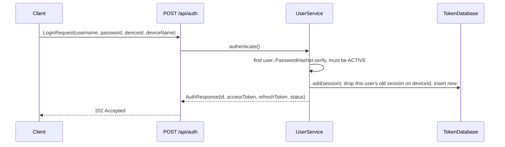

# Authentication and sessions

How the server knows who's calling: logging in, the tokens it hands out, the sessions behind them, and how each
route decides whether to let a caller in. PIN logins at stations build on this and are covered in
[PINs and stations](pins-and-stations.md); accounts and setup in [Users and accounts](users-and-accounts.md).

## The pieces

| File | Does |
|------|------|
| `plugins/Security.kt` | Installs the four JWT auth providers, and answers `401` or `403` when one turns a caller away |
| `plugins/Proxy.kt` | Takes client addresses from `X-Forwarded-For` on requests from a trusted proxy (`TRUSTED_PROXIES`) |
| `service/JwtService.kt` | Makes and checks tokens; the checks the providers call |
| `service/ServerSecret.kt` | The key tokens are signed with: `SECRET`, or one the server makes and keeps |
| `service/UserService.kt` | Password and PIN login, starting sessions, refreshing, logging out |
| `service/PasswordHasher.kt` | PBKDF2 hashing for passwords, PINs, invite codes and station secrets |
| `database/TokenDatabase.kt`, `TokenTable.kt`, `StoredSession.kt` | Sessions, one row per user per device |
| `routing/AuthRoute.kt` | `/api/auth`: login, refresh, logout, PIN login, leaving a kiosk, account requests |
| `routing/Helpers.kt` | `getIdentifierFromToken()`, `getSessionIdFromToken()` for routes |

## Logging in

`authenticate()` handles a few cases besides a plain login:

| Situation | Result |
|-----------|--------|
| Right password, active user | Tokens, `status = OK` |
| Right password, approved but `needsSetup` | Tokens, `status = NEEDS_SETUP`. The tokens only work on setup routes |
| Pending user with an invite, right setup code | No tokens, `status = INVITE_SETUP` and a 30 minute `setupToken` |
| Pending account request, right password | No tokens, `status = PENDING_APPROVAL` |
| Anything else | `401`, and a `LOGIN_FAILED` audit entry |
| Too many wrong tries | `429`, see below |

### Wrong password limits

`POST /api/auth` counts failed logins in memory, in
[`LoginLimiter`](../../server/src/main/kotlin/org/mr0btain/ticketman/components/service/LoginLimiter.kt). Only
failures count, so staff logging in all day never hit it. Three limits, over the last 15 minutes:

| Limit | Counts | Then |
|-------|--------|------|
| Per address | 20 wrong passwords from one device, on any usernames | Waits until enough of them are 15 minutes old |
| Per username | 5 free wrong passwords, from any device | Each one after locks the name: 30 seconds, then 1, 2, 4, 8 minutes, up to 15. The count starts over after 15 minutes with no wrong one, or a good login |
| Server wide | 100 wrong passwords from everywhere, guessing spread over many addresses | Any address that has had a wrong one in the window waits until it's 15 minutes old, so each gets one try. Devices that never typed a wrong one still get in |

A locked username or address is refused before the password is checked, so even the right one waits. The route
answers `429` with a `Retry-After` header and `Too many wrong logins, try again in 30 seconds` (or however long it
is). The client shows `NetworkError.TOO_MANY_REQUESTS` ("Too many tries, wait a moment and try again").

Every wrong password is in the audit log as `LOGIN_FAILED` already (`UserService`). A username or address being
locked, and a server wide surge starting, add one more (`Locked out for 30 seconds after 6 wrong passwords`). The
admin Sessions tab lists what's locked now (`GET /api/admin/logins`) and can let one try again
(`POST /api/admin/logins/unlock`), like a staff member who forgot their password and had it reset.

A username's count is shared by every address, so someone on the network can keep a user locked out of password
login by guessing at it, though the doubling waits mean only a few tries an hour. PIN login and existing sessions
aren't affected, and the counts reset when the server restarts.

The address is the connection's, which behind a reverse proxy is the proxy's for every device. So
`plugins/Proxy.kt` takes it from `X-Forwarded-For` instead, but only when the connection itself comes from an
address in `TRUSTED_PROXIES` (loopback and the private ranges unless set, never with `none`). It takes the last
address in the header, the one the nearest proxy added, since anything before it was sent by the client. From
anywhere else the header is ignored, so a device that reaches the server directly can't pick its own address. It's
our own small plugin rather than Ktor's `XForwardedHeaders`, which believes the header from anyone. See
[Configuration](../configuration.md#trusted_proxies).

A username that doesn't exist still runs a dummy hash check, so the response takes as long as a wrong password and
can't be used to find out which usernames exist.

Passwords stored before hashing was added are plain text. `PasswordHasher.verify` compares those directly, and a
successful login re-saves the password hashed.

## Tokens

Both tokens are HMAC-SHA256 JWTs signed with the server's secret, carrying:

| Claim | Value |
|-------|-------|
| `aud`, `iss` | `jwt.audience`, `jwt.issuer` from config |
| `identifier` | The user's id |
| `sid` | The session id, shared by the refresh token and every access token made from it |
| `typ` | `access` or `refresh` (`JwtService.ACCESS_TYPE`, `REFRESH_TYPE`) |
| `jti` | A random id, so two tokens made in the same second never match |
| `exp` | Access: 1 hour. Refresh: 365 days, or 12 hours for a PIN session |

The secret is `SECRET` when it's set. Otherwise `ServerSecret` makes a random one on first start and keeps it in
`<dataPath>/server/secret`, readable only by the account running the server. It's kept
because a new secret would log every device out. See [Configuration](../configuration.md#secret).

The client sends the access token as `Authorization: Bearer ...`. When it gets a `401`, it posts the refresh token
to `/api/auth/refresh`, which checks that the token verifies, is the one stored for its session, belongs to an
active user and that the session hasn't expired. It then returns a new access token **and a new refresh token**,
and the one sent stops working.

That swap is a compare and set (`TokenDatabase.rotate` only writes while the old token is still the stored one),
so of two refreshes with the same token only the first gets through. A copied refresh token stops working as soon
as the real device refreshes. The new refresh token runs out when the first one would have, so refreshing never
stretches a session past its year (or 12 hours).

Every auth provider only lets in tokens with `typ = access`, so a refresh token can't be used as a bearer token,
and `/api/auth/refresh` refuses access tokens. Tokens made before `typ` was added have none: old access tokens are
refused (the client refreshes and gets a typed one), and old refresh tokens still refresh because they match their
stored session.

Invite setup tokens are separate: they carry a `purpose = invite-setup` claim and no `sid`, so they fail every auth
provider and can only be spent on `/api/auth/setup/invite`.

## Sessions

A session is a row in `TokenTable`: session id, user, its current refresh token, device id and name, kind
(`PASSWORD` or `PIN`), created and last used times, when it expires, and an idle limit.

- **One per user per device.** The client makes a random device id on first start and sends it with every login.
  `TokenDatabase.add` deletes that user's existing session on that device before inserting, so logging in again on
  the same device replaces its session and leaves other devices alone. Logins with no device id (scripts, old
  clients) can't be told apart, so only the newest 10 of those are kept per user (`MAX_UNNAMED_SESSIONS`).
- **A token is only good while its session exists.** Every request checks that the token's `sid` is still in
  `TokenTable` for that user. That's what makes these take effect on the next request, without waiting for tokens
  to expire:
  - logging out (`POST /api/auth/logout` deletes the caller's session),
  - an admin ending a session or all of a user's sessions (`/api/admin/sessions/...`),
  - deactivating a user or changing their status (their sessions are deleted),
  - a password reset by an admin (ends their sessions),
  - a new PIN login at a station (ends the previous PIN session on that device),
  - removing a station.
- **It also has to be live** (`StoredSession.isLive`): not past `expiresAt` (copied from the refresh token's `exp`),
  and for a kiosk PIN session, not unused for longer than its `idleTimeoutSeconds`. See
  [PINs and stations](pins-and-stations.md#kiosk-sessions-on-the-server).
- `lastUsedAt` is updated by requests, at most every 30 seconds (`touchIfStale`), and on each refresh, so the
  Sessions tab shows when a device was last active.
- **Expired sessions are deleted** by `TokenDatabase.removeExpired()` in the hourly sweep, along with kiosk
  sessions left past their idle limit. Sessions saved before `expiresAt` was kept get it from their refresh token
  on start (`backfillExpiry`).

## Checking each request

[`Security.kt`](../../server/src/main/kotlin/org/mr0btain/ticketman/components/plugins/Security.kt) registers four
JWT providers. All of them verify the signature, issuer, audience and expiry, then call a validator:

| Provider | Validator | Lets in | Used for |
|----------|-----------|---------|----------|
| default (`authenticate { }`) | `checkAccess(NORMAL)` | Normal and Admin | Changing records |
| `"restricted"` | `checkAccess(RESTRICTED)` | Everyone set up | Reading records |
| `"admin"` | `checkAccess(ADMIN)` | Admin | `/api/admin`, user management, staff notes, shop profile, leaving a kiosk |
| `"setup"` | `setupValidator` | Any active user, set up or not | `/api/user/setup`, `/api/user/me`, `/api/auth/logout` |

`checkAccess` lets a caller in when the audience matches, it's an access token, the session exists and is live,
and the user `canAccess(level)` (active, setup finished, level high enough). `setupValidator` skips the setup and
level check, which is what lets a new user finish setting up and nothing else.

A caller turned away gets one of two answers:

| Why | Answer | What the client does |
|-----|--------|----------------------|
| No token, a bad or expired one, a refresh token, an ended session, or a deactivated user | `401` `Bad Token or Unauthorized` | Refreshes, then logs in again |
| A good token, but the user's access level is too low or they haven't finished setup | `403` `You don't have access to that` | Shows the message. Refreshing wouldn't help |

`checkAccess` returns `AccessCheck.Denied` for the second case, and the provider's `validate` marks the call so its
`challenge` answers `403`.

Inside a route, `call.getIdentifierFromToken()` gives the caller's user id and `call.getSessionIdFromToken()` their
session id. Routes that act on "me" use these rather than taking an id from the request, so nobody can act as
someone else.

### Routes with no login

`POST /api/auth` (login), `/api/auth/refresh`, `/api/auth/request-account`, `/api/auth/setup/invite`, `GET /api/ping`, the station
routes `/api/auth/pin`, `/station/status`, `/station/staff` (which check the station's secret instead), `GET /`, and
the backup download link (which checks a one off token in the URL).

## Hashing

[`PasswordHasher`](../../server/src/main/kotlin/org/mr0btain/ticketman/components/service/PasswordHasher.kt) uses
PBKDF2-HMAC-SHA256 with 310,000 iterations and a 16 byte salt. Hashes are stored as
`pbkdf2$<iterations>$<salt>$<hash>`, so the iteration count can be raised later and old hashes still verify. The
same hasher is used for passwords, PINs, invite codes and station secrets.

## Gotchas

- **A blank device id never replaces a session.** Logins without one (old clients, scripts) add a new session every
  time, and the 11th drops the oldest, so a script that logs in on every run can log its own earlier runs out.
  Send a fixed `deviceId` from scripts.
- **A refresh whose answer is lost logs the device out.** The server has already swapped the token, so the one the
  device still holds is refused. The client then logs in with the saved password if it has one, or asks.
- **Changing `SECRET`, or deleting `server/secret`, logs every device out**, since no token verifies any more.
- **`403` is only for access levels.** A deactivated user still gets `401`, since their sessions are already gone.

## Known gaps

- **Login limits are per server run.** The wrong password counts live in memory, so restarting the server clears
  them.

## See also

- [Users and accounts](users-and-accounts.md)
- [PINs and stations](pins-and-stations.md)
