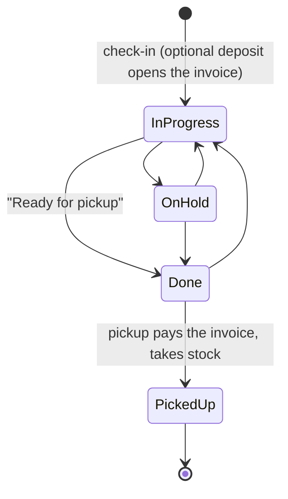

# Counter: check-in, invoices and pickup

The counter is where a device comes in and goes back out. On the server that's three services working on tickets,
invoices and inventory together: `CheckInService`, `InvoiceService` and the read only `CounterDatabase`. This page
covers the rules they enforce and which steps happen together. The maths behind totals is on
[Money](../shared/money.md).

## Check-in

`POST /api/counter/check-in` with a `CheckInRequest` (ticket, customer, tech, optional deposit and signature),
Normal access. [`CheckInService.checkIn`](../../server/src/main/kotlin/org/mr0btain/ticketman/components/service/CheckInService.kt)
checks everything first and answers `400` (or `409` for an existing ticket) with the reason:

- the ticket id is a v7 UUID (its check-in time is read from it) and isn't already taken,
- the customer exists,
- a manufacturer or model, and a problem, were entered,
- it starts `IN_PROGRESS` or `ON_HOLD`, with no negative estimate,
- the tech, if given, can take tickets (`canAccess(NORMAL)`),
- a deposit, if given, is more than zero,
- the signature, if given, passes `SignatureInput.problem()`, and there **is** one if the shop has repair terms.

Then, in one `transaction { }`:

1. add the ticket (number and pickup time cleared, so the server assigns them),
2. record its first status change,
3. link the customer and tech,
4. if there's a deposit, make the invoice (with the shop's tax rate, which it keeps) and add the payment,
5. if there's a signature, save it with a copy of the shop's terms, the time, and who took it,
6. write the `CREATE` audit entry.

If anything throws, none of it is saved, the audit entry included. The response is `201` with a `CheckInResponse`
(the saved ticket, with its number, and the invoice if one was made).

`POST /api/counter/repeat-check` (Restricted) is called during check-in to warn about repeat repairs: it returns the
customer's earlier tickets for the same device within the shop's `repeatWindowDays` (90 by default), matching on
serial when there is one and on make and model otherwise.

## Invoices

One per ticket, made on first need: a deposit at check-in, `POST /api/invoice/ticket/{ticketId}` (get or make), or
pickup. [`InvoiceService`](../../server/src/main/kotlin/org/mr0btain/ticketman/components/service/InvoiceService.kt)
owns the rules; `InvoiceDatabase` just stores.

| Route (`/api/invoice`) | Access | Does |
|------------------------|--------|------|
| `GET /ticket/{ticketId}`, `GET /{id}`, `GET /fetch` | Restricted | Read |
| `POST /ticket/{ticketId}` | Normal | Get the ticket's invoice, making it if needed |
| `POST /{id}/update` | Normal | Replace the charges and discount (`InvoiceUpdateRequest`) |
| `POST /{id}/payments` | Normal | Add a payment |
| `DELETE /{id}/payments/{paymentId}` | Normal | Remove a payment |
| `POST /{id}/void` | Admin | Void it |

Rules:

- Only an `OPEN` invoice can be changed, paid or have payments removed (`409` otherwise).
- Every charge needs a description, a quantity over zero with at most two decimals, and a price that isn't negative.
- A `PART` needs an inventory item that exists, and a whole number quantity.
- Discounts and payments can't be negative; payments must be more than zero.
- Saving charges recalculates the totals with `InvoiceMath`, using the tax rate stored on the invoice when it was
  made. Changing the shop's rate later doesn't touch invoices that already exist.

Voiding a paid invoice puts its parts back in stock. Voiding never changes the ticket.

`InvoiceService` returns an `AccountResult` (`Done`, `Invalid`, `Conflict`, `NotFound`, the same type the account
code uses), and routes turn it into a status with `respondAccount()`: `400`, `409`, `404`, or the success code.

## Work log

Time and parts logged on a ticket as it's worked on, in `ticket_work` (`TicketWorkTable`, `WorkDatabase`), through
`InvoiceService.logWork` and `removeWork` (routes under `/api/data/ticket`, see the [ticket API](../api/ticket.md#work-log)).

- Logging one makes the invoice if the ticket has none, and adds a `LABOR` or `PART` charge whose identifier is the
  entry's. Both are written in one transaction, under the same `CHANGE_LOCK` as pickup.
- The price is the one sent, or the shop profile's `laborRateCents` for time and the item's price for a part. Labor
  isn't taxed and parts are, which can be changed on the invoice.
- Removing an entry takes its charge off too, if it's still there. Neither works once the invoice is paid or void or
  the ticket is picked up (`409`), so the log matches what was charged.
- Stock is taken at pickup as for any part on the invoice, not when it's logged.
- Editing the invoice at the counter replaces its lines as a whole, so a line taken off there leaves its entry in
  the log, and an entry logged while someone has the invoice open at the counter is dropped if they then save it.

## Pickup

`POST /api/counter/pickup` with a `PickupRequest(ticketIdentifier, payments)`, Normal access.
`InvoiceService.pickup`, one at a time (see below):

1. The ticket exists and isn't already picked up, and every payment is more than zero.
2. Gets or makes the invoice, which must be `OPEN`.
3. The payments must cover the balance. Short is `409` "$x is still owed". Over is fine; the negative balance is the
   change.
4. Every stocked part has enough in stock, counting all of the invoice's lines for the same item. Short is `409`
   "Only n of Screen in stock, fix the count in Inventory first". Untracked items (`stock` of `Int.MAX_VALUE`) are
   never short.

Then, in one `transaction { }`:

1. add each payment,
2. take each part's quantity out of stock (untracked items are left alone). If a count set by hand since step 4
   leaves too few, this throws, the whole transaction rolls back and the answer is the same `409`,
3. mark the invoice `PAID` with the time,
4. set the ticket's `pickedUpAt` and status `PICKED_UP`, and record the status change,
5. write the audit entry.

The response is the paid invoice, which the client uses for the receipt.

### One change at a time

Pickup checks things and then writes, so two at once could both pass the checks. Every `InvoiceService` change that
does that (update, add or remove a payment, pickup, void) runs inside `synchronized(CHANGE_LOCK)`, so the second waits,
then sees the ticket is picked up and gets a `409`. Reads and `forTicket` don't need it. A new change of that kind
should take the lock too.

### `PICKED_UP` is the server's

Only pickup sets `PICKED_UP`, so the invoice is always paid with it, and a picked up ticket stays closed:

- `POST /api/data/ticket/add` with `PICKED_UP` is `400`.
- `POST /api/data/ticket/update` that sets `PICKED_UP`, or changes a picked up ticket's status, is `409`. Other
  fields of a picked up ticket can still be fixed.
- `TicketDatabase.update` never writes `PICKED_UP` and never changes it, so a save that started before a pickup
  can't reopen the ticket.

The ticket dialog only offers `PICKED_UP` for a ticket that already is. Voiding the invoice doesn't reopen the
ticket; a device that comes back gets a new ticket.

### Stock counts

A stock count is changed in three places, and each is a single SQL `UPDATE`, never a read and then a write, so two
at once can't lose one:

| Where | What it does |
|-------|--------------|
| Pickup | `InventoryDatabase.adjustStock(id, n)`: `stock = stock - n` where `stock >= n`. Returns false when it's short |
| Void of a paid invoice | `adjustStock(id, -n)`: puts the parts back |
| By hand | `POST /api/data/inventory/set/stock/{id}` with `StockChangeRequest(from, to)`: `stock = to` where `stock = from` |

`POST /api/data/inventory/update` saves everything else about an item but not its stock. Without that, a dialog
opened before a pickup would send the old count back and undo the pickup. Instead the client sends the count the
item was opened at as `from`. If it's changed since, the answer is `409` "Stock changed to n since this was opened,
check the count and try again", and nothing is written. A count below zero is `400`, on `set/stock` and on
`/add`. `Int.MAX_VALUE` is allowed and means untracked.

## The queue and search

[`CounterDatabase`](../../server/src/main/kotlin/org/mr0btain/ticketman/components/database/CounterDatabase.kt) is
read only:

- `GET /api/counter/queue?recent=10`: tickets that aren't picked up, sorted into **ready for pickup** (`DONE`,
  oldest first), **due today** and **overdue** (open tickets by `promisedAt`, using the server's time zone for
  "today"), and the most recently **checked in**. Each is a list of `TicketSummary` (ticket, customer, tech).
- `GET /api/counter/search?query=`: one box for everything. Matching tickets come first, then the tickets of matching
  customers, so a phone number brings up that customer's tickets.

## Gotchas

- **A throw inside check-in or pickup reaches the client as a `500`** from `StatusPages`, rolling the whole thing
  back. The exception is in the server's log, not the response.
  Check-in holds the numbering locks so it doesn't race itself, see [Numbering](numbering.md#inside-an-outer-transaction).

## See also

- [Money](../shared/money.md)
- [Numbering](numbering.md)
- [Database layer](database.md)
- The [end to end script](../../scripts/counter_e2e.py) walks the whole flow over HTTP
