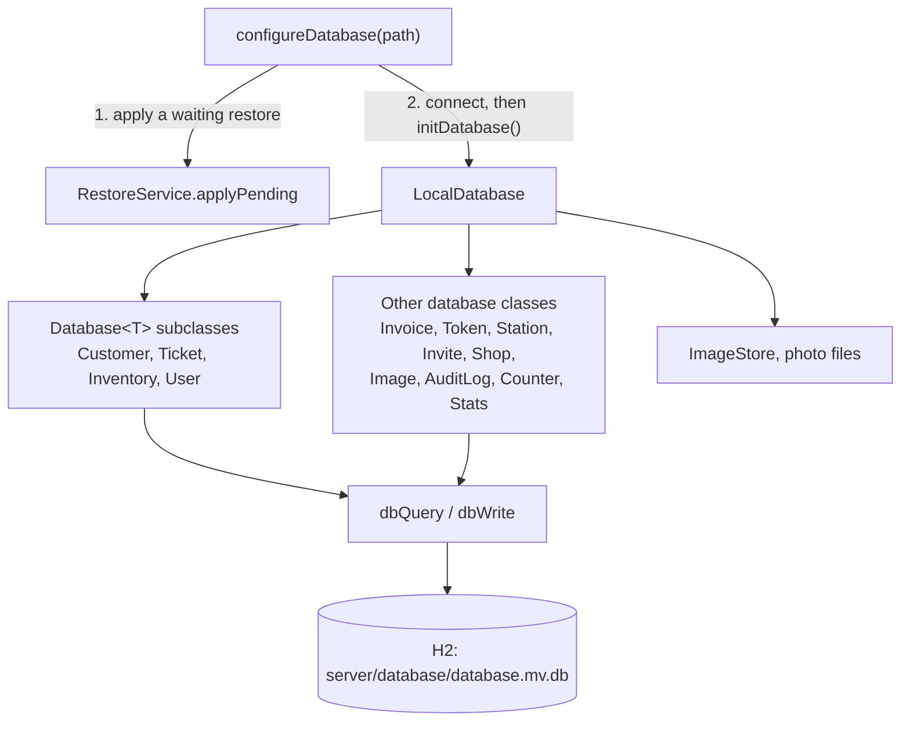

# Database layer

How the server stores things: one H2 file database, Exposed tables, and one database class per area that every
route and service goes through. Read [Entity layers](../architecture/entity-layers.md) first for how a record type
is spread over these files.

## How it's put together



[`configureDatabase()`](../../server/src/main/kotlin/org/mr0btain/ticketman/components/database/ConfigureDatabase.kt)
runs once from `Application.module()`. It applies any restore waiting from before the restart (it has to happen
before H2 opens the files), then builds a `LocalDatabase` and calls `initDatabase()`.

[`LocalDatabase`](../../server/src/main/kotlin/org/mr0btain/ticketman/components/database/LocalDatabase.kt):

- connects Exposed to `jdbc:h2:<path>/server/database/database;DB_CLOSE_DELAY=-1`, so the database stays open for
  the life of the process,
- holds one instance of every database class (`ticketDatabase`, `userDatabase`, `invoiceDatabase`, ...) and the
  `ImageStore`,
- creates tables and runs migrations in `initDatabase()` (see [Migrations](migrations.md)),
- makes online backups with `backupTo(file)` (H2's `BACKUP TO`), and reports its size on disk.

Exposed's connection is global, so the database classes don't hold a reference to it. Each one just opens
transactions.

## The database classes

| Class | Kind | Stores |
|-------|------|--------|
| `CustomerDatabase` | `Database<Customer>` | Customers, their notes, the customer ↔ ticket links |
| `TicketDatabase` | `Database<Ticket>` | Tickets, numbers, notes, status history, signatures, customer and tech links |
| `InventoryDatabase` | `Database<Inventory>` | Inventory, notes, item photos, stock changes |
| `UserDatabase` | `Database<User>` | Users, password and PIN hashes, PIN lockout, staff notes |
| `InvoiceDatabase` | own | Invoices, charges and payments, invoice numbers |
| `TokenDatabase` | own | Sessions, one per user per device (`TokenTable`, `StoredSession`) |
| `StationDatabase` | own | Registered stations, their secrets and kiosk settings |
| `InviteDatabase` | own | Setup codes for invited users |
| `ShopDatabase` | own | The one shop profile |
| `ImageDatabase` | own | Photo rows (the files are in `ImageStore`), plus `linkImages` |
| `AuditLogDatabase` | own | Who did what |
| `CounterDatabase` | read only | Counter search and the queue, across tickets and customers |
| `StatsDatabase` | read only | Numbers for the admin overview |

The four `Database<T>` subclasses are the main record types. The base class fixes the operations they all have,
so the shared routes and the client's `RemoteRepository` can treat them the same way.

## `Database<T>`

[`Database.kt`](../../server/src/main/kotlin/org/mr0btain/ticketman/components/database/Database.kt):

| Subclasses write | The base provides |
|------------------|-------------------|
| `add`, `update`, `remove` | `updateNote(note)`, `removeNote(id)` |
| `getById`, `getPagedItems(PagedRequest)`, `count`, `search(query, limit)` | `addImagesToNote(id, images)` |
| `addNote(id, note)`, `getNotes(id)` | `insertNote(note)` and `attachNote(...)` helpers for `addNote` |
| `noteLinkColumn` | Tag constants (`GET_BY_ID_TAG`, `UPDATE_TAG`, ...) |

Conventions every subclass follows:

- Reads return the value or `null` (a list or `null` for pages). `null` means it failed or wasn't found.
- Writes return `Boolean`: `false` when the record isn't there or the write failed.
- `getPagedItems` pages with `offset` and `itemsPerPage`. Tickets come newest first (by id, which as a v7 UUID sorts
  by creation time); customers, inventory and users come by name.
- `search` returns `TmSearchResult`s (an id and display text) for search boxes and pickers.

### Notes on records

Notes live in one shared `NoteTable`, joined to their owner by a per type table (`TicketNoteTable`,
`CustomerNoteTable`, ...). `addNote` inserts the note and the join row in one transaction.

`updateNote` and `removeNote` take only the note's id, because that's all the routes get. So before changing a note
the base class checks it's linked through **this** type's `noteLinkColumn`. Without that check, the customer route
could be used to edit a staff note on a user. Every subclass sets `noteLinkColumn` to its join table's note column:

```kotlin
override val noteLinkColumn = TicketNoteTable.note
```

Saving a note links its photos through `linkImages()` (in `ImageDatabase.kt`), which only accepts photos that are
freshly uploaded or already on that note, and marks photos dropped from the note as deleted. See the photos page
(Phase 4c) for the full photo lifecycle.

## `dbQuery` and `dbWrite`

[`DbCall.kt`](../../server/src/main/kotlin/org/mr0btain/ticketman/components/database/DbCall.kt) wraps every
database call:

```kotlin
fun getById(identifier: Uuid): Ticket? =
    dbQuery(GET_BY_ID_TAG) { TicketEntity.findById(identifier)?.toTicket() }

fun remove(identifier: Uuid): Boolean =
    dbWrite(REMOVE_TAG) {
        val entity = TicketEntity.findById(identifier) ?: return@dbWrite false
        entity.delete()
        true
    }
```

| | On its own | Inside an outer `transaction { }` |
|-|------------|-----------------------------------|
| Opens a transaction | Yes | No, joins the outer one |
| Exception | Logged under the tag, rolled back, returns `null` / `false` | Thrown, so the outer transaction rolls back |
| Logs | Success with `m`, `null`/`false` with `i` | Nothing |

The second column is what makes multi step operations safe. `CheckInService` opens one `transaction { }` and calls
`tickets.add`, `setCustomer`, `invoices.addPayment` and `setSignature` inside it; if any of them throws, none of
them happened.

Routes turn the results into status codes: `null` from a read of one record is `404`, and from a list or search
`500` (an empty list is `200`). `false` from a write is `404` when the record might be missing and `500` otherwise.

Every server database uses these. Don't wrap `transaction { }` in `appLogTryCatch` in new server code: it always
opens its own transaction, so a throw inside it never reaches an outer one.

## Tables and entities

Tables are Exposed objects under `tables/<area>/`. Main records use `UuidTable` with a `UuidEntity` DAO class whose
`to<Model>()` builds the shared model. Join tables are plain `Table`s with a composite primary key.

Some columns hold shared classes as JSON (`json<Device>("device", ...)`), which keeps small value types like
`Device`, `TicketStatus` and `TicketSignature` out of their own tables. Their `Json` ignores unknown keys, so older
rows still read after a field is removed.

Foreign keys on note and link tables use `ReferenceOption.CASCADE`, so deleting a ticket removes its join rows.
An invoice's `ticket_id` isn't a foreign key: `TicketDatabase.remove` deletes the invoice itself when it's open with
nothing paid, and otherwise keeps it with the ticket's number (`ticket_label`, `ticket_removed_at`).
The notes themselves don't cascade, so each `remove` takes the record's notes first, deletes the record, then
deletes the notes with the base class's `deleteNotes()`, which marks their photos deleted. An inventory item's own
photos are marked deleted too. The [sweep](../operations.md#the-hourly-sweep) clears the files up a day later.

## Gotchas

- **Two `Database`s.** Exposed has `org.jetbrains.exposed.v1.jdbc.Database` (the connection) and TicketMan has
  `components.database.Database<T>` (the base class). `LocalDatabase.kt` imports Exposed's.
- **`DB_CLOSE_DELAY=-1`** keeps H2 open until the process ends. Tests have to run `SHUTDOWN` themselves before
  deleting a data folder, which `cleanupTestDataDir()` in the server tests does.
- **Take the notes before deleting the record.** Once the record is gone its join rows are too, and
  `entity.notes` comes back empty. A new record type's `remove` follows the same order.

## See also

- [Migrations](migrations.md)
- [Numbering](numbering.md)
- [Request lifecycle](../architecture/request-lifecycle.md)
