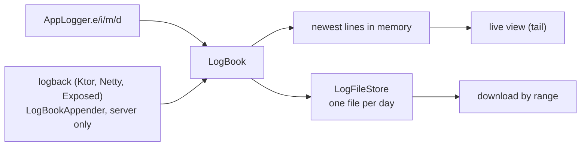

# Logs

The server and every client save what they log to files, one per day, and Settings shows either log live in a terminal
and downloads all of it or a range. The audit log is something else: it records what people did, see
[Audit log](audit-log.md). This page covers where log lines go, how files are kept, and the viewer.

## How it works

- [`LogBook`](../../shared/src/commonMain/kotlin/org/mr0btain/ticketman/logging/LogBook.kt) (shared) takes every line
  each platform's `AppLogger` logs, numbers it (`LogLine.sequence`), keeps the newest 3000 in memory and hands each to
  the `LogFileStore` attached, under a lock (`LogLock`, an `expect` class) so lines from several threads don't
  interleave. Lines logged before a store is attached are written when it is, so start up isn't lost. `AppLogger.d`
  lines are only kept while `AppLogger.debug` is on, as before.
- On the server, `LogBookAppender` (`server/.../components/logging/`, named in `logback.xml`) adds what the libraries
  log through SLF4J, with `WARN` as its own level.
- [`LogFileStore`](../../shared/src/commonMain/kotlin/org/mr0btain/ticketman/logging/LogFileStore.kt) (shared, on
  kotlinx-io) writes `ticketman-2026-11-06_0000.log`, named for when the file started. Each line is
  `2026-11-06 14:03:22.123 ERROR [Tag] message` in the machine's local time
  ([`LogFormat`](../../shared/src/commonMain/kotlin/org/mr0btain/ticketman/logging/LogFormat.kt)); a message's later
  lines (a stack trace) are indented four spaces, so only a line's first line starts with a time. A download by range
  reads the files whose day overlaps it and keeps the lines in it, with their indented lines.
- The store never logs through `AppLogger` (it would call back into itself); its own problems go to the console.

## Keeping files

`LogSettings`, the same on the server and each device:

| Setting | Default | Does |
|---------|---------|------|
| `keepFiles` | 14 | Newest files kept, older ones are deleted |
| `maxTotalMb` | 100 (server), 20 (devices) | The most the files take together. The oldest go first, as soon as the current file pushes the total past it. The current file alone reaching it stops being written (with a line saying so) until the next one starts |
| `rolloverMinute` | 0 | Minutes after midnight, local time, when a new file starts |

Changing them applies straight away: old files past the new limits go, and the next line starts a new file if the
time moved.

- **Server**: files in `<dataPath>/server/logs/`, settings in `settings.json` beside them, not in the database, so the
  log is saved from the first line of start up and a restore doesn't touch it (backups don't hold logs). `ServerLogs`
  (`server/.../service/ServerLogs.kt`) starts first thing in `Application.module()` and stops on `ApplicationStopped`.
  Admins set them on Settings (Admin group) through `POST /api/admin/logs/settings`; see the
  [API](../api/admin.md#logs).
- **Clients**: files in `logs/` under the app's folder (`AppDir`), settings in `LocalStorage.logSettings`.
  `ClientLogs.start` runs from `initKoin`. The web has no folder: a browser only keeps what it logged since the page
  opened, in memory, and its Settings rows for files are greyed out.

## The viewer

Settings > Logs > **View logs** (and Admin > **Server logs** for admins) opens `LogsDialog`, run by `LogsHandler`
(`viewModel.logs`):

- `TmLogTerminal` (kit, `ui/kit/data/`) draws the lines like a terminal, always on the palette's dark colors
  (`TmTheme.terminal`), and follows the newest while it's scrolled to the bottom.
- This device's log follows `LogBook.last`; the server's is asked for every 2 seconds through
  `GET /api/admin/logs/tail`, starting over when its `run` changes (the server restarted).
- Level chips and a text filter narrow what's shown, Pause holds it still, Clear empties the view.
- **Download** saves everything, today, whole days or a time range (in this device's time) as a `.log` file with
  `saveFile`. The server's is read whole from `GET /api/admin/logs/download`, since a browser download wouldn't send the
  login header, and the download is audited.

## Tests

`LogFileStoreTest` (shared `jvmTest`) covers the format, rolling over at the set time, trimming by count and size,
and exporting a range. `LogsTest` (server) covers start up being saved, the routes and saved settings.
