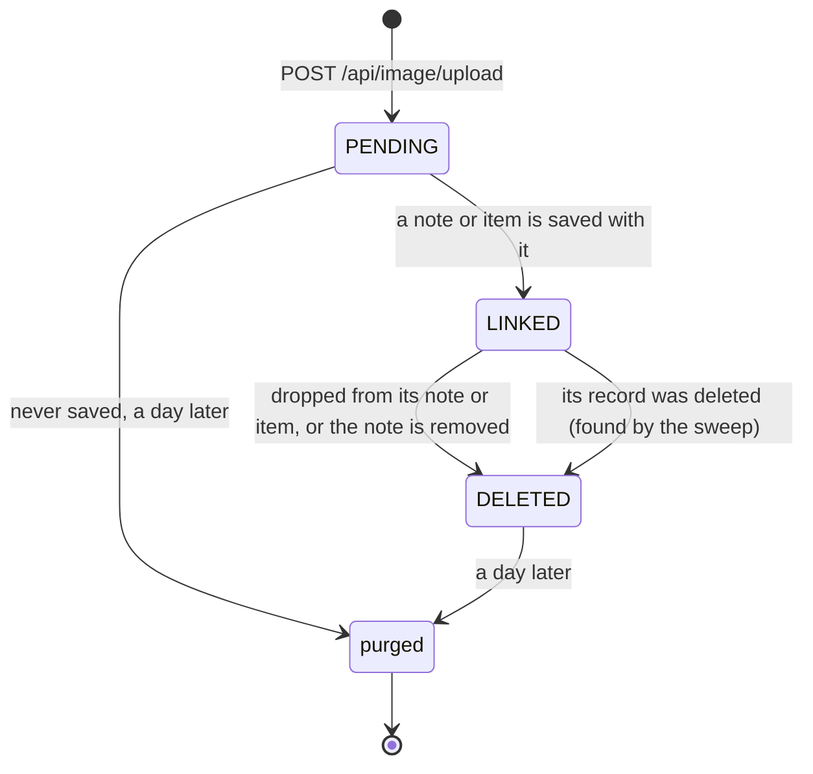

# Photos

Photos go on notes (any record type's) and on inventory items. The server takes an upload, checks and cleans it,
saves three sizes to disk, and keeps a row describing it. A photo only becomes part of a record when the record is
saved with it, and photos that are dropped are deleted a day later rather than straight away. This page follows a
photo through that lifecycle. The client side (picking, uploading, caching) is in the client pages (Phase 5).

## Where things are

| File | Does |
|------|------|
| `routing/ImageRoute.kt` | `/api/image`: upload, details, files |
| `service/ImageService.kt` | Receives an upload, processes it, stores it; serves files; the sweep |
| `image/ImageProcessor.kt` | Decodes, turns upright, strips metadata, writes the JPEG variants (Thumbnailator) |
| `image/ImageStore.kt` | The files on disk |
| `database/ImageDatabase.kt` | Photo rows, `linkImages()`, `markImagesDeleted()`, the database half of the sweep |
| `shared/.../data/image/` | `StoredImage`, `ImageVariant`, `ImageLimits` |

## Lifecycle



`ImageStatus` is stored on the row with `statusChangedAt`, which is what the day is counted from.

### 1. Upload

`POST /api/image/upload`, Normal access, as multipart with a file part named `image` and an optional `description`
part (the names are in `ImageLimits`).

- The file is streamed to a temp file under `images/.tmp/` and stopped once it passes 25 MB (`413`). It's never held
  in memory whole.
- `ImageProcessor.process` reads the size from the header first and refuses anything over 50 megapixels (`413`), so a
  small file can't claim to be huge and use up memory when decoded. Unreadable files are `415`.
- It then decodes the photo, turns it upright from its EXIF orientation, flattens any transparency onto white, and
  writes each `ImageVariant` as a JPEG, fitted inside a square and never enlarged:

  | Variant | Longest edge | Quality | Used for |
  |---------|--------------|---------|----------|
  | `THUMB` | 320 | 0.75 | Lists, note blocks |
  | `DISPLAY` | 1600 | 0.82 | The pager and full screen view |
  | `ORIGINAL` | 2560 | 0.90 | Downloads, backups |

  Re-encoding everything proves the file really is an image and drops its other metadata, like where it was taken.
- At most two photos are processed at once, since decoding a big one takes a few hundred MB.
- The files are moved into place and a `PENDING` row is inserted with the size, the original's SHA-256 and who
  uploaded it. The response is `201` with the `StoredImage`.

### 2. Linking

The client puts the returned `StoredImage` in a note's `images` (or an item's photo list) and saves:

- notes: `/add/note/{id}` or `/update/note/{id}` on any record type,
- inventory items: `POST /api/data/inventory/set/images/{id}`, which sets the whole list.

Both go through [`linkImages(requested, current)`](../../server/src/main/kotlin/org/mr0btain/ticketman/components/database/ImageDatabase.kt),
inside the save's transaction. For each photo the client listed it takes it only if it's **already on this owner**
or **pending**; anything else (a made up id, a photo on someone else's note) is ignored. Taken photos become `LINKED`
and get the description and tags the client sent. Photos the owner had that aren't listed any more become `DELETED`.

This is what stops a client attaching another record's photo by guessing its id, and it means the client never has
to make a separate "delete photo" call: it just saves the list it wants.

### 3. Serving

| Route | Access | Returns |
|-------|--------|---------|
| `GET /api/image/{id}` | Restricted | The `StoredImage` |
| `GET /api/image/{id}/{thumb\|display\|original}` | Restricted | The JPEG |

Deleted photos are `404`. Because a photo's bytes never change, files are sent with
`Cache-Control: private, max-age=31536000, immutable` and an ETag made from the hash and variant; a matching
`If-None-Match` gets `304` with no body. The client's photo loader keeps them in a disk cache.

### 4. Deleting and the sweep

Nothing deletes photo files directly. Code marks rows deleted (`markImagesDeleted()`, or `linkImages` dropping them)
and `ImageService.sweep()` does the rest. It runs every hour from `Application.module()`:

1. `LINKED` photos that nothing points at any more (their note's record was deleted) are marked `DELETED`.
2. `PENDING` and `DELETED` photos older than 24 hours lose their rows and their files.
3. Photo folders with no row at all, older than an hour, are removed. They're left by a crash between writing the
   files and inserting the row.
4. Temp files older than an hour are removed.

The day's delay is on purpose. A backup copies the database first and the photos after; without the delay a photo
could be deleted between the two and the backup would list a photo it doesn't have. It also means a photo removed by
mistake is still on disk for a day.

## On disk

```
<dataPath>/server/images/<first 2 characters of id>/<id>/{original,display,thumb}.jpg
```

Paths are built only from the photo's id, never from anything the client sends, so an upload can't write outside the
folder. The two character level keeps any one folder from holding tens of thousands of entries.

## Gotchas

- **Never delete photo files yourself.** Mark the rows deleted and let the sweep remove them, or a backup taken at
  the same time can end up inconsistent.
- **Pending photos can be fetched.** Any logged in user who knows a pending photo's id can download it until it's
  linked or purged.
- **The in-process test engine doesn't cut off big uploads like Netty does.** Check upload changes against a real
  `:server:run`.

## See also

- [Backup and restore](backup-restore.md)
- [Database layer](database.md#notes-on-records)
