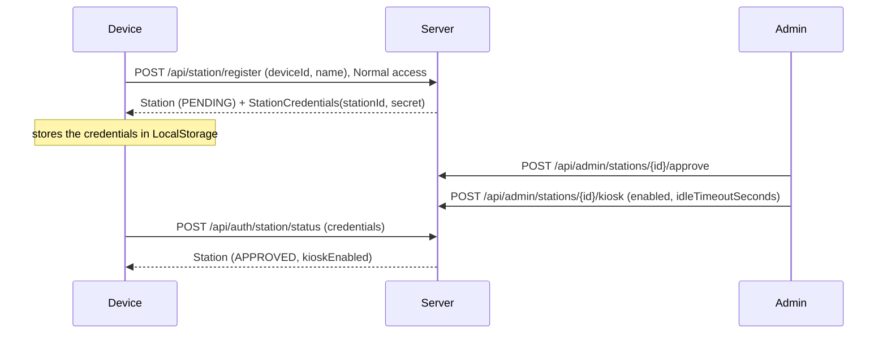

# PINs and stations

Counter staff don't type a password every time they step up to the front desk. Instead, a device the shop trusts
is registered as a **station**, and on a station staff switch in with a 6 digit PIN. A station can also be put in
**kiosk mode**, where it only shows the counter and locks itself when left alone. This page covers how that's built
on the server, with the client's side at the end. How an admin sets it up is on
[Running a server](../operations.md#counter-stations-and-kiosks).

## Stations

A `Station` row (`StationTable`, `StationDatabase`) holds a name, the device id of the device it's on, a status
(`PENDING` or `APPROVED`), who asked for it and who approved it, a hashed secret, and the kiosk settings.

- **Registering** needs a normal login. The server makes a 32 byte random secret, stores only its PBKDF2 hash, and
  returns it once in `StationRegistrationResponse`. A device registering again replaces its station: it starts over
  as pending with a new secret.
- **Proving it's the station.** The station routes under `/api/auth` (`/pin`, `/station/status`, `/station/staff`)
  have no login; the device sends its `StationCredentials` instead, and `StationDatabase.verify` checks the secret
  against the hash.
- **Approving** and **kiosk settings** are admin routes. Kiosk mode needs an approved station (`409` otherwise) and
  an idle timeout of 30 to 3600 seconds.
- **Removing** a station (`DELETE /api/admin/stations/{id}`) also ends any PIN session on its device.

## PINs

PINs are stored on the user as a PBKDF2 hash (`pinHash`), with `pinFailedAttempts` and `pinLocked`.

| | |
|-|-|
| Rules | `PinRules` in `shared`: 6 digits, not all the same, not a straight run like `123456` |
| Setting | During first login setup, or `POST /api/user/me/pin` with the current password |
| Lockout | Each wrong PIN adds to `pinFailedAttempts`. The 5th locks it; a right PIN resets the count |
| Unlocking | Admin: `POST /api/user/pin/{id}/unlock`. Clearing: `DELETE /api/user/pin/{id}` |

Changing your own PIN needs your password, so someone using a device you left logged in can't set a PIN and then
sign in as you at a station.

## PIN login

`POST /api/auth/pin` with a `PinLoginRequest(station credentials, userIdentifier, pin)`.
[`UserService.pinLogin`](../../server/src/main/kotlin/org/mr0btain/ticketman/components/service/UserService.kt):

1. Verify the station's secret (`403` "isn't a registered station") and that it's approved (`403` "waiting for an
   admin").
2. Find the user. They must pass `canAccess(RESTRICTED)`: active and set up. An unknown user still runs a dummy hash
   so timing doesn't give it away.
3. `UserDatabase.checkPin`: no PIN or wrong PIN is `401` ("Wrong PIN, 3 tries left"), locked is `423`.
4. Start a `PIN` session on the **station's** device id.

PIN sessions differ from password ones:

- **One person per station.** Starting a PIN session first deletes every PIN session on that device, whoever it
  belonged to. The previous person is signed out on their next request.
- **12 hours.** The refresh token for a PIN session expires after 12 hours, so a shift's login can't linger for a
  year.
- **On a kiosk, they end when left alone.** See below.
- They show on the admin Sessions tab as `PIN`, with the station's name as the device.

A user's password session on the same device isn't touched, since it's a different kind.

### Kiosk sessions on the server

The kiosk's idle lock is a timer on the device, so it can't help when the device is switched off or loses its
connection with someone signed in. The server has its own limit for that:

- A PIN login at a station with kiosk mode on stores an idle limit on the session: the station's idle timeout plus
  `UserService.KIOSK_IDLE_MARGIN` (10 minutes). Stations without kiosk mode get none.
- Every request moves the session's `lastUsedAt` on (at most every 30 seconds). Once it's older than the limit the
  session isn't live: requests get `401`, and so does refreshing. The hourly sweep deletes it.
- While someone is using the kiosk without loading anything, the client tells the server they're still there (see
  below), so typing a long note doesn't end the session.
- **Leaving kiosk mode** is reported with `POST /api/auth/kiosk/leave` (admin only). It takes the idle limit off the
  admin's PIN session there, since they're carrying on with the app, and writes an audit entry ("Left kiosk mode at
  Front Counter"). Their 12 hours still stand. A session that isn't a PIN session gets `404`.

`POST /api/auth/station/staff` lists who can PIN in (active, set up, with a PIN that isn't locked), for the
station's sign in screen.

Wrong and locked PINs write `LOGIN_FAILED` audit entries naming the station.

## On the client

`SessionHandler` holds the device's station: it registers it, keeps the credentials in `LocalStorage`, and refreshes
the `Station` from `/api/auth/station/status` each time it connects. If the server no longer knows the station, the
credentials are forgotten.

[`KioskHandler`](../../composeApp/src/commonMain/kotlin/org/mr0btain/ticketman/ui/screens/kiosk/components/KioskHandler.kt)
turns kiosk mode on when the station is approved and `kioskEnabled`:

- the whole app is replaced with the counter and a PIN lock screen, and the window goes full screen,
- `RemoteHandler.credentialFallback` is turned off, so when a PIN session runs out the client doesn't log the
  device's owner back in with their saved password; it goes back to the lock screen,
- touching or typing anything resets an idle timer; when it runs out (or someone locks it) the client logs the
  current person out on the server too (`RemoteHandler.endSession`) and shows the lock screen,
- while someone is signed in and has touched it in the last minute, it calls `GET /api/user/me` at most once a
  minute (`RemoteHandler.keepKioskAlive`), which keeps the server's idle limit from running out under them,
- **leaving** kiosk mode needs an admin to PIN in. Anyone else is signed straight back out. The client then calls
  `/api/auth/kiosk/leave`. Leaving only lasts until the app restarts or `resume()` is called; the station is still a
  kiosk on the server.

## See also

- [Authentication and sessions](auth.md)
- [Users and accounts](users-and-accounts.md)
