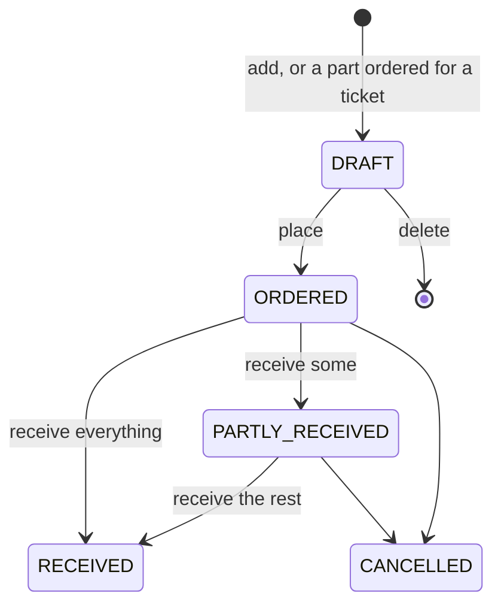

# Purchasing

Ordering parts from suppliers and taking them into stock, in
[`PurchaseService`](../../server/src/main/kotlin/org/mr0btain/ticketman/components/service/PurchaseService.kt) over
`PurchaseDatabase` (`suppliers` and `purchase_orders`). The routes are on [Purchasing API](../api/purchase.md).

- **Numbers** are `PO-26-00000001`, per year, made under the service's lock (every change to an order holds it, so
  two receipts can't both count).
- **Lines** are kept whole as JSON on the order, each with the item, a description (the item's name when blank), how
  many were ordered and have arrived, the cost, and the ticket it's for, if any.
- **Only drafts change.** Placed orders are received or cancelled; a draft is deleted rather than cancelled.
- **Receiving** checks every count (no more than is outstanding), then in one transaction saves the order, adds the
  parts to stock with `InventoryDatabase.adjustStock(id, -n)` (untracked items are left alone) and sets each item's
  `costCents` to what this order paid. See [Stock counts](counter.md#stock-counts).
- **Tickets waiting on parts.** The shop profile's `partsOrderedStatus` and `partsArrivedStatus` (each a
  `StatusChoice` staff can pick, or null to leave the ticket) are where a ticket goes when an order with a line for
  it is placed, and when the last part ordered for it, across every open order, arrives. Moves go through
  `TicketMoves`, shared with estimates: never a picked up ticket, and the change is recorded in its history.
- **Ordering for a ticket** (`/orders/part`) adds a line to the supplier's newest draft, or makes one, so parts for
  several repairs go out together when someone places it.
- **Low stock** on the admin screen drafts an order per supplier for everything listed, each line enough to get back
  to twice the item's reorder point (`PurchasingHandler.draftForLowStock`, on the client).
- **Suppliers** can be deleted; orders keep the name they were made with, and items that pointed at one just have no
  supplier.

## See also

- [Counter](counter.md), for stock
- [Purchasing screen](../ui/screens/purchasing.md)
