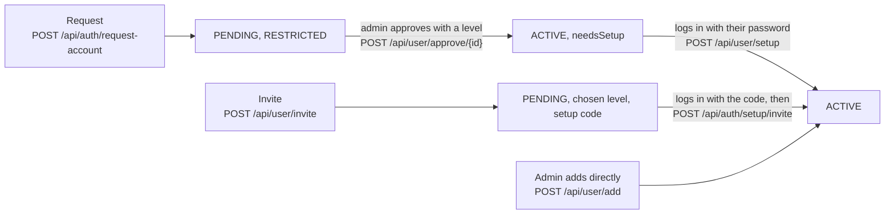

# Users and accounts

Who can use TicketMan and how they get an account: the user model's status and access level, the three ways an
account is made, first login setup, and the rules that stop an admin locking everyone out. Logging in and sessions
are on [Authentication and sessions](auth.md).

## Status and access level

A user has two separate fields:

| `UserStatus` | Can log in? |
|--------------|-------------|
| `PENDING` | No. Asked for an account or was invited, and hasn't been approved or finished their invite |
| `ACTIVE` | Yes |
| `DEACTIVATED` | No. Kept so their name stays on old tickets, notes and audit entries |

| `AccessLevel` | Can |
|---------------|-----|
| `RESTRICTED` | Read records and the counter |
| `NORMAL` | Also change records, check in, take payments |
| `ADMIN` | Everything, including `/api/admin`, managing users and the shop profile |
| `NONE` | Only exists in old data, where it meant deactivated. Moved to `DEACTIVATED` on start |

Plus `needsSetup`: approved but hasn't finished first login. `User.canAccess(level)` combines them (active, not
`needsSetup`, level high enough) and is the only check the auth providers make.

Keeping status apart from level means deactivating someone and turning them back on doesn't lose what access they
had.

## Making an account

All three live in [`AccountService`](../../server/src/main/kotlin/org/mr0btain/ticketman/components/service/AccountService.kt)
except the direct add, which is in `UserRoute`.

### Requests

Someone picks "Request an account" on the login screen and chooses a username and password. They're saved as
`PENDING` with `RESTRICTED` access. Logging in with that password answers `PENDING_APPROVAL` instead of tokens, so
the client can say they're waiting.

To stop the admin's list filling with junk: requests are limited to 5 an hour per address (`RequestLimiter`, in
memory) and to 50 waiting at once.

An admin approves (`POST /api/user/approve/{id}` with an access level) or rejects (`DELETE /api/user/reject/{id}`,
which removes the pending user) from the Users tab.

### Invites

An admin makes the account with the access level up front (`POST /api/user/invite`). The server stores a random
password nobody knows, and an 8 character setup code (from an alphabet without look-alike characters), hashed,
valid for 72 hours. The code is in the response and shown to the admin once.

The new user logs in with their username and the code as the password. That answers `INVITE_SETUP` with a 30 minute
setup token instead of session tokens. They then post their details, password and PIN with the setup token to
`/api/auth/setup/invite`, which activates them, removes the invite and starts a normal session.

`POST /api/user/invite/{id}/renew` makes a new code; the old one stops working.

### Direct add

`POST /api/user/add` (admin) makes an `ACTIVE` user straight away with the given password and level, with no setup
step.

## First login setup

Approved requests start with `needsSetup = true`. Their login returns tokens with `status = NEEDS_SETUP`, but those
tokens only pass the `"setup"` auth provider, so the only routes that work are:

- `POST /api/user/setup` (`AccountSetupRequest`): name, email, phone, optionally a new password, and a PIN,
- `GET /api/user/me`,
- `POST /api/auth/logout`.

Setup saves the details, PIN and activation together in one `dbWrite`, rolling back if any part fails, then clears
`needsSetup`. The client's `AccountSetupDialog` blocks the app until it's done.

## Managing users

All under `/api/user`, admin only unless noted:

| Route | Does |
|-------|------|
| `GET /get/{id}`, `/fetch`, `/search` | Read users (Restricted access and up, passwords and PINs blanked) |
| `GET /me` | The caller (setup provider) |
| `POST /update` | Change details, level or status. Not the password |
| `POST /password/{id}` | Set a new password, ending all that user's sessions (except the caller's, if it's their own) |
| `DELETE /remove/{id}` | Delete the user, their staff notes and sessions |
| `GET /pending` | Requests and invites waiting |
| `POST /me/pin` | Change your own PIN, checked against your password (Restricted and up) |
| `POST /pin/{id}/unlock`, `DELETE /pin/{id}` | Unlock a locked PIN; clear someone's PIN |
| Staff notes (`/add/note/{id}`, ...) | Notes on a user, like training or schedule. Admin only to read and write |
| `POST /set/photo/{id}` | A profile photo (`UserTable.photo`). Admins for anyone, Normal users for themselves |
| `GET`, `POST /badge/{id}` | The ID card code (`UserTable.badgeCode`), and a new one that cancels the old card |

Rules `update` and `remove` enforce:

- You can't change your own access level or status, or delete yourself.
- There must always be at least one active admin.
- A user can't be set back to `PENDING`, and pending users stay pending until approved through their own route.
- Changing a user to anything but `ACTIVE` ends their sessions.

Every change is written to the audit log.

### Photo and ID card

A user's profile photo is an ordinary uploaded photo, linked through `linkImages` like a note's, so only one just
uploaded or the one they have can be set. `UserTable.photo` points at it; the sweep counts it as in use, and deleting
the user marks it deleted. It's shown on the admin Users tab, the user menu, Settings > Account and the ID card,
not on the kiosk's PIN screen, which has no session to fetch photos with.

The ID card code is random and separate from the user's id (`BadgeCode`), so a lost card is cancelled by making a
new code, and the card shows nothing else about the user. Only admins can read it. Printing a card for someone
without one makes it.

## The first admin

A new database has no users. On start, `ensureAdminExists()` in `Application.kt` makes an `admin` user if there are
no admins, with `ADMIN_PASSWORD` or a random password printed in the log. See
[Configuration](../configuration.md#admin_password).

## Rules shared with the client

`UsernameRules` (3 to 32 of `a-z 0-9 . _ -`, stored trimmed and lowercase), `PasswordRules` (at least 8 characters)
and `PinRules` (6 digits, not repeated or a run) are in `shared`, so the client checks them before sending and the
server checks them again on every route that takes one: requests, invites, setup, `POST /api/user/add`,
`/password/{id}`, and `/update` when the username changes. A username from before the rules can stay as it is
while the user's other details are edited.

## Known gaps

- The request limiter is in memory, so restarting the server resets it. Behind a reverse proxy it counts the
  address the proxy forwards, which needs the proxy in `TRUSTED_PROXIES` (see
  [Configuration](../configuration.md#trusted_proxies)).

## See also

- [Authentication and sessions](auth.md)
- [PINs and stations](pins-and-stations.md)
- [Running a server](../operations.md#staff-accounts)
