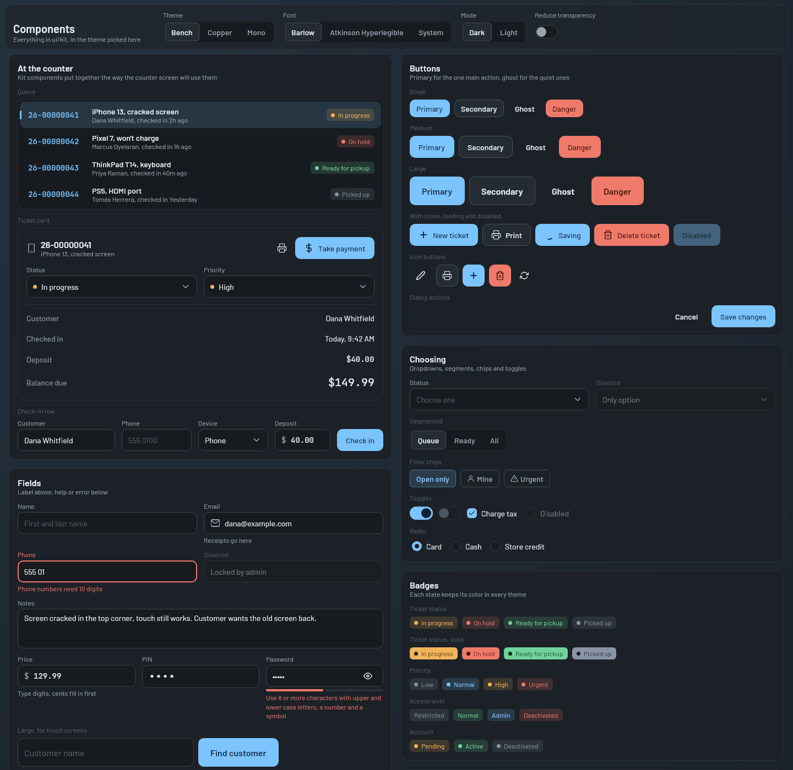
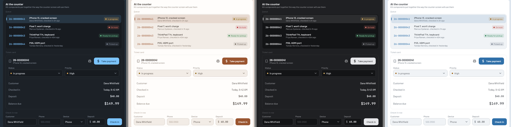
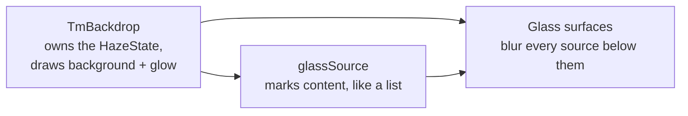

# UI kit

Every piece of shared UI lives in the kit, under
[`ui/kit/`](../../composeApp/src/commonMain/kotlin/org/mr0btain/ticketman/ui/kit). Screens are put together from
kit components and take their colors, type, corners and spacing from `TmTheme`, so a change made in the kit shows
up everywhere.



## How it works

`App()` wraps everything in `TmTheme(palette, font, darkTheme, reduceTransparency)`, built from the saved settings
(see [Storage](../client/storage.md)). `TmTheme` provides five composition locals, read through the `TmTheme`
object:

| Read | Type | What's in it |
|------|------|--------------|
| `TmTheme.colors` | `TmColors` | Layer colors, text colors and five tones, for the picked palette and mode |
| `TmTheme.typography` | `TmTypography` | The type scale, plus the monospace `numeric*` styles |
| `TmTheme.shapes` | `TmShapes` | Corner sizes: `chip` 6, `control` 10, `panel` 14, `sheet` 18, `pill` |
| `TmTheme.spacing` | `TmSpacing` | `xxs` 2, `xs` 4, `sm` 8, `md` 12, `lg` 16, `xl` 24, `xxl` 32 (dp) |
| `TmTheme.glass` | `TmGlass` | Whether reduce transparency is on |

It also sets up `MaterialTheme` from the same values, so the few Material pieces still in use (`Text`, `Icon`,
dialogs and menus underneath the kit's wrappers) match. Screens never read `MaterialTheme` themselves; see
[Kit rules](kit-rules.md).

### Colors

[`TmColors`](../../composeApp/src/commonMain/kotlin/org/mr0btain/ticketman/ui/kit/theme/TmColors.kt) is layered
from back to front:

| Layer | Used for |
|-------|----------|
| `background` (with `glow`) | Behind everything. `TmBackdrop` draws it with one soft glow in the top left |
| `surface` | Cards, panels, list panes |
| `surfaceRaised` | Things on a card: hovered rows, menus, glass with reduce transparency on |
| `surfaceSunken` | Wells inside a card, like input fills |
| `glass` | The tint on floating glass layers |
| `hairline`, `outline` | Borders and dividers; `outline` for things that need to stand out more |
| `text`, `textMuted`, `textFaint` | Body text, secondary text, hints and placeholders |

Then five **tones**, each a `TmTone(color, onColor, soft)`: `accent`, `success`, `warning`, `danger` and `neutral`.
`color` is the solid fill (or the text on a `soft` fill), `onColor` is text on a solid fill, and `soft` is a faint
version for badge and selected row backgrounds.

States map to tones through the `TmColors.tone(...)` extensions in
[`TmBadge.kt`](../../composeApp/src/commonMain/kotlin/org/mr0btain/ticketman/ui/kit/feedback/TmBadge.kt), for ticket
status, priority, access level and user status. Ticket statuses go: in progress → warning, on hold → danger, ready
for pickup → success, picked up → neutral. Use these rather than picking a tone on a screen, so a state keeps its
color in every theme.

### Palettes and fonts

[`TmPalettes`](../../composeApp/src/commonMain/kotlin/org/mr0btain/ticketman/ui/kit/theme/TmPalettes.kt) holds the
themes: **Bench** (graphite with a blue accent, the default), **Copper** and **Mono**. Each `TmPalette` has an `id`,
a name and description for the picker, and a dark and a light `TmColors`.



[`TmFonts`](../../composeApp/src/commonMain/kotlin/org/mr0btain/ticketman/ui/kit/theme/TmFonts.kt) holds the
interface fonts: **Barlow** (default), **Atkinson Hyperlegible** and **System**. Numbers don't follow the picked
font: `TmFonts.mono()` is always JetBrains Mono.

To add either, see [Kit rules](kit-rules.md#a-theme-or-font). Both are saved by `id`, so don't change an
`id` once it's released.

### Type

[`TmTypography`](../../composeApp/src/commonMain/kotlin/org/mr0btain/ticketman/ui/kit/theme/TmTypography.kt) has
five text sizes (28, 20, 16, 14, 12) as `display`, `title`, `subtitle`, `bodyLarge`, `body`, `label` and `caption`.
Ticket and invoice numbers, money, PINs and SKUs use the monospace `numeric` (14), `numericLarge` (20),
`numericDisplay` (28) and `numericHero` (56, for a number read out across the counter) so columns line up and digits
are easy to read back. `TmMoneyText` and `TmTicketIdText` already do this.

### Glass and solid

There are two kinds of surface, in
[`foundation/`](../../composeApp/src/commonMain/kotlin/org/mr0btain/ticketman/ui/kit/foundation):

- **Solid**, `TmSurface(level = BASE | RAISED | SUNKEN)`: opaque, so text stays sharp. For cards, panels and lists.
- **Glass**, `TmGlassSurface` or `Modifier.glass()`: blurs whatever is behind it. Only for layers that float over
  content: the nav rail, top and bottom bars, dialogs, menus, the snackbar, sticky headers.

Glass is done with [Haze](https://github.com/chrisbanes/haze):



`TmBackdrop` owns a `HazeState`, registers the background as a source and provides the state through
`LocalTmHazeState`. Content that glass should blur, like a list scrolling under a sticky header, is marked with
`Modifier.glassSource()`. Glass surfaces then blur the backdrop and every source below them.

Outside a `TmBackdrop` (previews, some render tests) there's no Haze state, and glass is drawn as a plain `glass`
fill. With reduce transparency on, it's drawn as a solid `surfaceRaised` fill instead, which is easier to read and
lighter on slow machines.

### Interaction and sizing

- `Modifier.tmClickable(onClick, shape)` gives anything the kit's hover and press tint and a focus ring that only
  shows for keyboard focus. `TmSurface(onClick = ...)` and every kit button use it. Use it instead of `clickable`
  on screens, so everything reacts the same.
- `TmControlSize` (`SMALL` 32, `MEDIUM` 40, `LARGE` 52 dp) is shared by buttons, fields and dropdowns so they line
  up in a row. `LARGE` is for touch screens: the counter and the kiosk use it.
- `TmVerticalScrollbar` is an `expect`: a thin scrollbar on desktop, nothing on Android and web.
  `TmLazyColumn` and `TmScrollColumn` add it for you.

## Components

Grouped as the folders are. Each has KDoc on its function; this is the map.

| Folder | Components | Use for |
|--------|-----------|---------|
| `buttons/` | `TmButton` (`PRIMARY`, `SECONDARY`, `GHOST`, `DANGER`; `loading`, `leadingIcon`), `TmIconButton`, `TmButtonRow` | Actions. One primary per view. Name buttons for what happens: "Save customer", not "Submit". `TmButtonRow` is cancel + confirm, right aligned, for the end of every dialog |
| `inputs/` | `TmTextField`, `TmMoneyField` (cents, typed like a till), `TmPinField`, `TmPasswordField` (with strength), `TmSignaturePad`, `TmSignatureView`, `TmFieldPair`, `TmFieldFrame`, `TmCustomerForm` / `TmCustomerDialog` (a new customer, on a panel or in its own dialog) | Forms. Labels sit above the field, help or error text below. `TmFieldFrame` is the shared look; new field types draw through it |
| `selection/` | `TmDropdown`, `TmMenu` + `TmMenuItem`, `TmSegmented`, `TmFilterChip`, `TmSwitch`, `TmCheckbox`, `TmRadio` | Picking. `TmSegmented` for a few options where one is always picked; when they don't fit the width it draws as a `TmDropdown` instead |
| `search/` | `TmSearchField`, `TmSearchBar` (results under it as you type, waits `TM_SEARCH_DEBOUNCE` = 350 ms), `highlightMatch` | Looking things up |
| `containers/` | `TmPanel`, `TmPaneHeader`, `TmStickyHeader`, `TmPageHeader`, `TmSectionLabel`, `TmListRow`, `TmSwitchRow`, `TmTabs`, `TmLazyColumn`, `TmScrollColumn`, `TmDialog`, `TmConfirmDialog`, `TmConfirmDeleteDialog`, `TmTextEditDialog`, `TmAdjustBalanceDialog`, `TmFullScreenDialog` | Layout and dialogs |
| `feedback/` | `TmBadge`, `TmStatusBadge`, `TmPriorityBadge`, `TmAccessBadge`, `TmUserStatusBadge`, `TmDot`, `TmNotice`, `TmSnackbarHost`, `TmEmptyState`, `TmLoading`, `TmProgressBar` | Telling people what happened. Messages say what happened and what to do, and don't apologize |
| `data/` | `TmStatTile`, `TmCountBar`, `TmMoneyText`, `TmTicketIdText`, `TmKeyValueRow`, `TmTableHeader`, `TmTableRow`, `TmColumn` | Showing numbers and records |
| `images/` | `TmImage`, `TmImagePager`, `TmImageView`, `TmPhotoEditor`, `TmAvatar` (a round profile photo, or initials) | Photos. See [Transfers and photos](../client/transfers-and-photos.md) |
| `notes/` | `TmNoteBlock`, `TmEditNoteDialog` | Notes on a record, newest first, with their photos |
| `navigation/` | `TmNavRail`, `TmBottomNav`, `TmTopBar`, `TmPanelTopBar`, `TmStepper` | Moving around. `TmPanelTopBar` is the records toolbar |
| `theme/` | `TmTheme`, `TmColors`, `TmPalettes`, `TmFonts`, `TmTypography`, `TmShapes`, `TmSpacing` | Tokens |
| `foundation/` | `TmBackdrop`, `TmSurface`, `TmGlassSurface`, `glass()`, `glassSource()`, `TmDivider`, `tmClickable`, `tmFocusRing`, `TmControlSize`, `TmVerticalScrollbar` | The pieces the rest are built on |
| `gallery/` | `KitGallery` | Every component in every state |

A few that are easy to get wrong:

- **`TmDialog`** takes `maxWidth` (480 dp by default) and `dismissOnOutsideClick`. Turn the latter off for forms,
  so a stray click doesn't throw away what was typed. Put a `TmButtonRow` in `actions`.
- **`TmConfirmDeleteDialog(isTwoStep = true)`** asks twice, for records that take other things with them.
- **`TmStatusBadge`** uses `TicketStatusType.label`, so `DONE` reads "Ready for pickup" everywhere.
- **`TmPanelTopBar(canChange = false)`** hides add and delete and shows a "View only" badge.
- **`TmScrollColumn`** needs a bounded height (a weight or a fixed size), or it never scrolls.

## The component gallery

[`KitGallery`](../../composeApp/src/commonMain/kotlin/org/mr0btain/ticketman/ui/kit/gallery/KitGallery.kt) shows
every component in its states, with pickers for theme, font, mode and reduce transparency. Open it from Settings >
Appearance > Component gallery, or from the nav on debug builds ("Components").

The sections are listed in `gallerySections()` in `GallerySections.kt`. A new component gets a sample there,
usually in an existing section. `KitGalleryRenderTest` draws the gallery to PNGs in
`composeApp/build/kit-gallery/`, one per theme and mode, one per font, one with reduce transparency and one at
720 px wide:

```bash
./gradlew :composeApp:desktopTest --tests "*KitGalleryRenderTest"
```

That's the quickest way to look over a kit change in every theme without running the app.

## Where it lives

| What | Where |
|------|-------|
| Theme and tokens | `composeApp/.../ui/kit/theme/` |
| Surfaces, backdrop, interaction | `composeApp/.../ui/kit/foundation/` |
| Scrollbar `actual`s | `TmScrollbar.desktop.kt`, `.android.kt`, `.wasmJs.kt` next to their source sets |
| Gallery | `composeApp/.../ui/kit/gallery/` |
| Gallery render test | `composeApp/src/desktopTest/.../ui/kit/KitGalleryRenderTest.kt` |
| Fonts | `composeApp/src/commonMain/composeResources/font/` |

## Gotchas

- **Glass needs something to blur.** A glass layer only looks like glass if what's under it is marked with
  `glassSource()` (or is the backdrop). The app shells mark the screen area for you; a list scrolling under a
  sticky header inside a screen needs its own `glassSource()`.
- **Don't put glass on cards.** Blurred cards are hard to read and slow to draw. Cards and lists are `TmSurface`.
- **Content color.** `TmSurface` and `TmGlassSurface` set `LocalContentColor` to `colors.text`, so `Icon` and
  `Text` without a color pick it up. Outside them they get Material's default.
- **The mono font loads from resources on each `TmTheme`.** Render tests draw a few frames before keeping one so
  fonts have loaded; do the same in any new render test.

## See also

- [Kit rules](kit-rules.md)
- [App shell and navigation](screens/navigation.md)
- [Settings screen](screens/settings.md), where the theme, font and mode are picked
