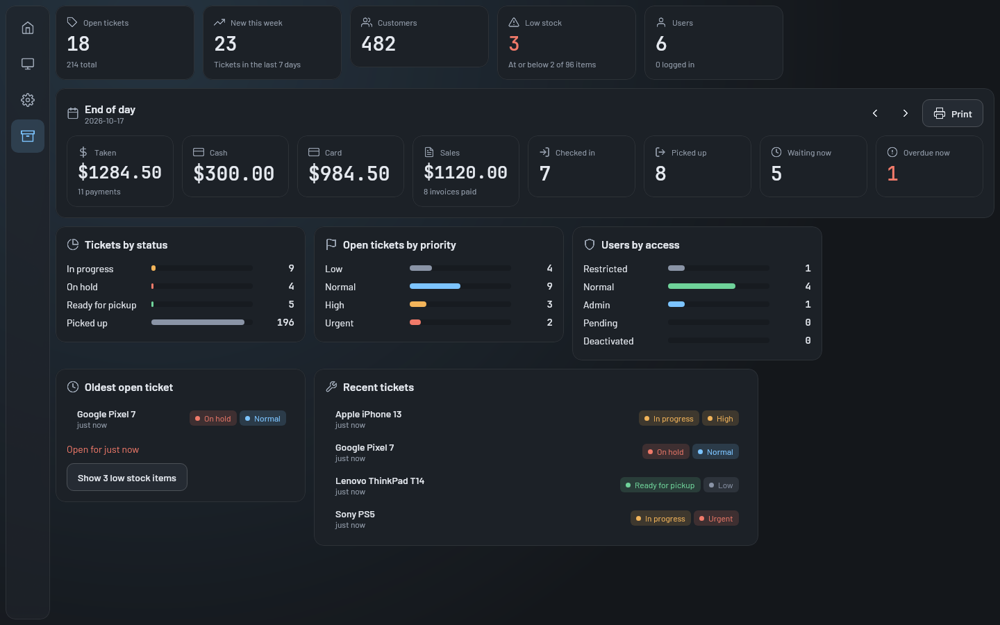
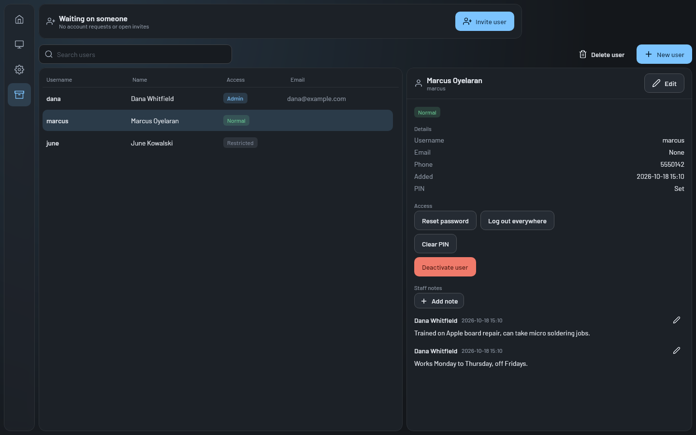

# Admin screen

The admin screen (`Destination.ADMIN`) is where an admin looks after the shop: numbers for the day, staff accounts,
logged in devices, counter stations, low stock, invoices, the shop profile, backups and the audit log. It's only in the nav
for admins. Touch this when adding something admins manage. Most tabs are thin screens over server features
documented in [the server pages](#see-also).

## How it works

[`AdminScreen`](../../../composeApp/src/commonMain/kotlin/org/mr0btain/ticketman/ui/screens/admin/AdminScreen.kt)
checks `session.isAdmin`. Anyone else who gets here sees "Admin access required" (with a Log in button if they're
logged out); the server refuses their requests anyway.

For an admin it shows `TmTabs` and a **Refresh** button. Opening the screen calls `AdminHandler.refreshAll()`,
which loads every tab's data at once: overview, low stock, the daily report, pending accounts, stations, sessions,
server info, any waiting restore, the shop profile and the first page of the audit log. Refresh does the same and
reloads the record lists. The Users tab shows a badge with the number of accounts waiting.

All the state is in
[`AdminHandler`](../../../composeApp/src/commonMain/kotlin/org/mr0btain/ticketman/ui/screens/admin/components/AdminHandler.kt);
the users list itself comes from the shared `UserRecords` pager and seed, like the record lists.

### Tabs

| Tab | Shows | Does | More |
|-----|-------|------|------|
| **Overview** | Stat tiles (open tickets, new this week, customers, low stock, users), the end of day report, tickets by status and priority, users by access, the oldest open ticket, recent tickets | Step the report a day back or forward (never past today) and print it. Clicking a ticket opens it on the records screen | `GET /api/admin/stats`, `/report/daily` |
| **Users** | Accounts waiting on someone (requests and invites), the user list, the picked user's details and staff notes | Invite, approve with an access level, reject, renew an invite's code; add, edit, reset password, deactivate or reactivate, log out everywhere, unlock or reset PIN, delete. Staff notes save straight away | [Users and accounts](../../server/users-and-accounts.md) |
| **Sessions** | Logged in devices grouped by user, with password or PIN, when they logged in, were last active and expire | Log out one device. This device's own session can't be logged out here | [Authentication and sessions](../../server/auth.md#sessions) |
| **Stations** | Devices that asked to be counter stations | Approve, remove, turn kiosk mode on and set its idle timeout | [PINs and stations](../../server/pins-and-stations.md) |
| **Low stock** | Tracked items at or below a threshold (5 by default, saved on this device) | Change the threshold; click an item to open it on the records screen | |
| **Invoices** | Every invoice, newest first, with its status, total, paid and balance | Click one to open its ticket at the counter; void any that isn't void yet; load older ones | `POST /api/invoice/fetch`, [Invoices API](../../api/invoice.md) |
| **Server and data** | Server address, name, version, uptime, database and photo sizes, Java and OS, mode, HTTPS settings, the certificate's fingerprint and expiry (warned in its last year) and a new one waiting; the shop profile; backup and restore, the daily backup's folder and last run, and the last restore (warned when it had no photos); mock data on development servers | Edit the shop profile (name, contact, tax rate, invoice footer, repair terms, repeat window, default paper), download a backup, upload one to restore on next start (warned when the file looks database only), cancel a waiting restore, make a new certificate for the next start or drop it, seed test data | [Backup and restore](../../server/backup-restore.md), [Running a server](../../operations.md) |
| **Audit log** | Who did what, newest first, colored by action | Load more | [Audit log](../../server/audit-log.md) |

### Dialogs

`AdminScreen` owns the users tab's dialogs (`UserDialog`, `ResetPasswordDialog`, `InviteDialog`, `ApproveDialog`,
`InviteCodeDialog` and the delete confirmation), the same way the records screen owns its own. `UserDialog` only
asks for a password when adding a user; existing users get a new one through Reset password, which also ends
their sessions. A new invite's setup code is shown once in `InviteCodeDialog` and can't be looked up again, only
replaced by renewing.

The backup and restore card streams both ways: the backup downloads through `saveDownload` and the restore uploads
through `fileBody`, so neither is held in memory. See [Transfers and photos](../../client/transfers-and-photos.md).

## Where it lives

| What | Where |
|------|-------|
| Screen, tabs, users dialogs | `ui/screens/admin/AdminScreen.kt` |
| State and actions | `ui/screens/admin/components/AdminHandler.kt` |
| Shared bits (user state chip, access level dropdown) | `ui/screens/admin/components/AdminCommon.kt` |
| One folder per tab | `ui/screens/admin/<overview|users|sessions|stations|inventory|invoices|server|audit>/` |
| Render tests | `ScreenRenderTest.adminOverview()`, `adminUsers()` |
| Handler tests | `composeApp/src/commonTest/.../ui/screens/admin/AdminHandlerTest.kt` |

## Adding a tab

1. Add an entry to the `AdminTab` enum with its label. The enum order is the tab order.
2. Add its state and loading to `AdminHandler`, and load it in `refreshAll()`.
3. Put the tab's composable in its own folder under `ui/screens/admin/` and add a branch for it in
   `AdminContent`'s `when`.
4. Wrap the server routes it uses in `authenticate("admin")`.

## Gotchas

- **Links to records go through the main tab index.** Clicking a ticket or a low stock item selects it in its
  handler, sets `changeMainTabIndex` (1 for tickets, 2 for inventory) and navigates to Records with `navigateTo`, so
  the back stack doesn't grow. An invoice opens its ticket on the counter the same way (`onOpenTicketAtCounter`).
- **The Invoices tab loads through `CounterHandler`**, which owns the invoice list (`loadInvoices`, `voidInvoice`).
  The screen's Refresh reloads it when that tab is open.
- **The Users tab is the only place users are edited.** The records screen has no users tab.
- **The mock data card only shows on development servers** (`ServerInfoResponse.developmentMode`), and the server
  refuses the request on any other.

## Known gaps

- Everything reloads on every visit and every Refresh, one request per tab, even for tabs that aren't open.
- `AdminHandler` is over 500 lines. A new tab with much state should get its own handler.

## See also

- [Users and accounts](../../server/users-and-accounts.md)
- [Authentication and sessions](../../server/auth.md)
- [PINs and stations](../../server/pins-and-stations.md)
- [Backup and restore](../../server/backup-restore.md)
- [Audit log](../../server/audit-log.md)
- [Running a server](../../operations.md)
