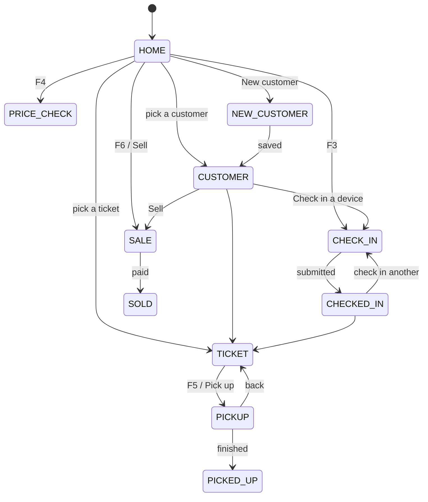
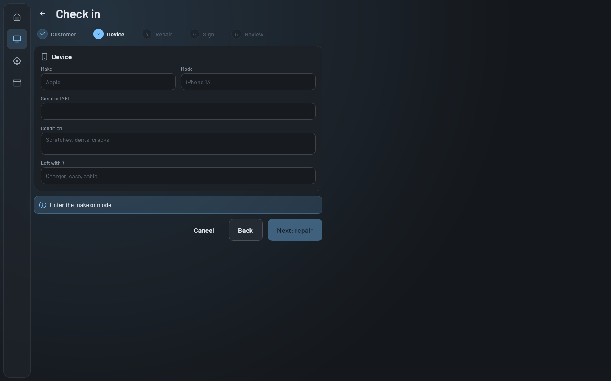
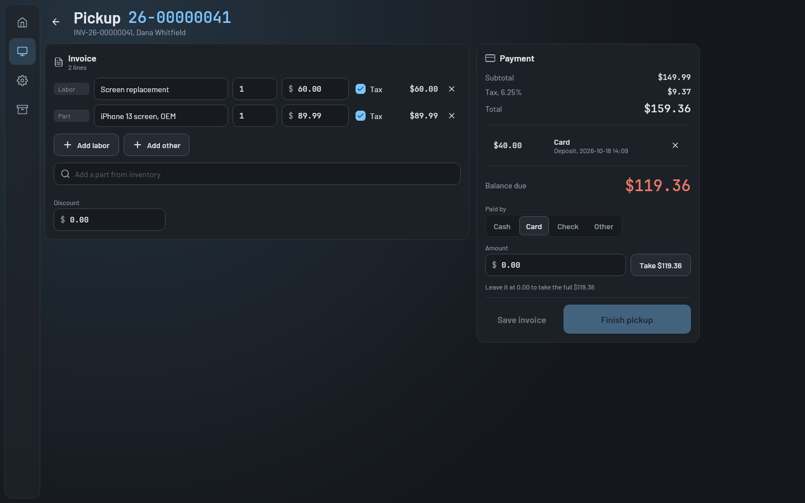

# Counter screen

The counter (`Destination.COUNTER`) is the front desk: one search box for tickets and customers, the queue on the
side, and the check-in and pickup flows. It's built for a touch screen and a keyboard, with large controls and
function key shortcuts. Touch this when changing how a device is checked in or handed back. What the server does
with a check-in or a pickup is in [Counter: check-in, invoices and pickup](../../server/counter.md).

## How it works

[`CounterScreen`](../../../composeApp/src/commonMain/kotlin/org/mr0btain/ticketman/ui/screens/counter/CounterScreen.kt)
is a top bar (search, Check in, New customer, Sell, Price check), a main area, and the `QueuePanel` (360 dp) on the
right, laid out by `CounterLayout`. Under 900 dp wide the buttons become icons and the queue moves into a dialog
opened from its own button (`QueueDialog`); the main area stays put when the window crosses that width, so a half
done check-in isn't lost. The ticket card, pickup and check-in wrap and stack their panels to fit a phone. What
the main area shows is `CounterHandler.view`, one `CounterView` at a time:

Every view can go back to `HOME` (Escape, or its back button), and typing in the search bar always goes back to
`HOME` to show the results. All of it lives in
[`CounterHandler`](../../../composeApp/src/commonMain/kotlin/org/mr0btain/ticketman/ui/screens/counter/components/CounterHandler.kt)
on `MainViewModel`, so leaving the counter and coming back keeps the open ticket. `CounterHandler` holds the
search, queue, shop profile, ticket and customer cards and price check itself, and a part for each bigger flow:
`counter.checkIn` (`CounterCheckIn`, the wizard and new customer screen), `counter.pickup` (`CounterPickup`),
`counter.sale` (`CounterSale`),
`counter.invoices` (`CounterInvoices`, the invoice list the admin screen shows) and `counter.printer`
(`CounterPrinter`). They share a `CounterSupport` (scope, snackbar, `canEdit`, switching views, reloading the
queue) and load tickets through `RemoteHandler.loadTicketDetail` (`TicketDetail.kt`).

### Keyboard

`CounterScreen` catches keys with `onPreviewKeyEvent`, so they work wherever focus is:

| Key | Does |
|-----|------|
| F2 | Back to home and focus the search |
| F3 | Start a check-in |
| F4 | Price check |
| F5 | Pick up the open ticket (only on the ticket view) |
| F6 | Start a sale |
| Esc | Back to home, or clear the search if already there |

The shortcuts are listed on the home view before anything is searched, and in the button labels. The search field
is focused when the counter opens. All three only happen for someone using a keyboard (`usingKeyboard()` in
`KeyHints.kt`, from Compose's input mode): on a touch screen there are no F keys to hint at, and focusing the
field would pop up the on screen keyboard.

### Scanning

A barcode scanner types the code and presses Enter. In the main search, Enter looks the text up as an item's
barcode or SKU (`CounterHandler.scan`, `GET /api/data/inventory/code/{code}`) and opens the price check on it;
anything else stays a search, where ticket numbers and status links are found as usual. On the sale and pickup
screens, Enter in the part search (`ChargeLines`' `onFindCode`) adds the item with that code, or the only match,
counting it up if it's already a line; the sale screen puts the cursor there when it opens, so a scan goes straight
in. `ScannerInputTest` checks that Enter reaches a search field on desktop.

### Search and queue

- **Search** waits 300 ms after the last key, then asks `/api/counter/search` for up to 20 tickets and customers.
  `SearchResults` lists both.
- **Queue** loads when the counter opens, after a check-in or pickup, and on the Settings interval (`CheckForUpdates`)
  while the counter shows home, a ticket or a customer; an open ticket card reloads with it (`reloadTicket(quiet =
  true)`). Not during a check-in or pickup. Its
  four sections are Ready for pickup, Overdue, Due today and Just checked in, each in its status tone.

### Ticket

`TicketCard` shows a ticket with its customer, notes, signature, invoice and status history. Staff who can edit get
a quick status switch (`TmSegmented` over `TicketStatusType.selectable`, so never Picked up), Print, and Pick up.
A text field under the notes adds one, saved straight away (`addTicketNote`), text only.

### Check-in

[`CheckInWizard`](../../../composeApp/src/commonMain/kotlin/org/mr0btain/ticketman/ui/screens/counter/CheckInWizard.kt)
walks through steps with a `TmStepper`:

| Step | Asks for | Can't go on until |
|------|----------|-------------------|
| Customer | Search, or add one inline | A customer is picked |
| Device | Make, model, serial, condition, what was left with it | Make or model is filled in |
| Repair | Problem, priority, estimate, promised day (today to a week), deposit and how it was paid, technician | The problem is described |
| Sign | The shop's repair terms and a signature pad, with the signer's name | Signed and named. Only shown when the shop has repair terms |
| Review | Everything, to check | - |

Everything typed is kept in one `CheckInForm`, so going back a step loses nothing. The device step offers the
customer's devices from before as chips (`onLoadDevices`), filling the fields in and keeping the ticket on that
device's history, and a kind (phone, tablet, laptop, ...). On the review step **Add another device** keeps what's
been filled in (`CheckInForm.extra`) and starts the device step again with the same customer, technician and
deposit; checking in then sends them all in one request as linked tickets, and `CheckedInView` reads out every
number. The customer card's **Devices** panel (`DevicesPanel`) lists their devices, each opening to its repairs,
and the ticket card's **Related repairs** shows the tickets checked in with it and the device's earlier ones.

The device step also has the **intake checklist** for the device's kind (the shop's list from its profile, or the
built in one), each item marked works, faulty or not tested, and an optional **passcode**. On the ticket card the
**Intake** panel (`IntakePanel`) shows the checklist, and for staff who can edit, **Show** fetches the passcode (an
audited read) and hides it again after a minute, with **Change** and **Clear**.

The repeat warning on the device step says whether each earlier repair is still under warranty, with **Warranty
return** for one that is: the ticket is checked in as its return (`warrantyOf`), its work starting free. The
ticket card badges warranty returns and shows how long a picked up repair is covered; pickup says a warranty
return's work starts free. The stepper only opens a step
when every step before it is filled in. The form makes the ticket's id up front, so the **repeat check** can leave
it out: half a second after the device stops changing, it asks the server for this customer's earlier tickets for
the same device and warns if it's been in recently.

Check in sends one `CheckInRequest` (ticket, customer, technician, deposit, signature) to
`POST /api/counter/check-in`, which saves it all together. The result shows on `CheckedInView`, with the new number
in `numericHero` to read out to the customer and a button to print the claim slip.

### Pickup

[`PickupScreen`](../../../composeApp/src/commonMain/kotlin/org/mr0btain/ticketman/ui/screens/counter/PickupScreen.kt)
opens with the ticket's invoice, made if it doesn't have one yet.

- **Lines** are edited in place: labor, parts (searched from inventory) and other charges, each with a quantity,
  price and whether it's taxed, plus a discount. Quantities are kept as text while typing so "1." isn't thrown
  away.
- **Totals** are worked out on the screen with the shared `InvoiceMath`, so they match what the server will
  charge. See [Money](../../shared/money.md).
- **Payments** already taken (like the deposit) are listed and can be removed. New ones are added with an amount
  and method; leaving the amount at 0.00 takes whatever is still owed. They're only sent when the pickup is
  finished.
- **Balance due** turns into **Change due** once enough has been taken.
- **Finish pickup** is on once the lines are valid and nothing is owed. It saves any changed lines first, then posts
  `/api/counter/pickup` with the new payments. The server pays the invoice, takes the parts from stock and closes
  the ticket in one go. `PickedUpView` then shows what was paid and the change, with a button to print the receipt.

If the pickup is refused (short on stock, someone else picked it up), the screen reloads the invoice and shows the
server's message.

`PaymentPanel` (`PaymentPanel.kt`) is the totals and payment side, shared with sales. Its "Paid by" chips add
**Store credit** when the customer has some (it shows how much and won't take more) and **Gift card**, which asks
for the code and checks the card's balance (`CounterHandler.findGiftCard`) before taking it. **Add gift card** puts
a gift card line on the invoice (a code to top up, or blank for a new card, loaded when it's paid).

### Sales

[`SaleScreen`](../../../composeApp/src/commonMain/kotlin/org/mr0btain/ticketman/ui/screens/counter/SaleScreen.kt)
sells from stock with no ticket: the same `ChargeLines` and `PaymentPanel` as pickup, and an optional customer
(already picked when started from a customer's card). Nothing is saved until **Complete sale**, which sends one
`SaleRequest` to `POST /api/counter/sale`; the server makes the invoice, takes the payments and the stock, and
saves it paid, or refuses all of it. `PickedUpView` then shows it as "Sold", with the receipt (printed by
`CounterPrinter.printSale`, since there's no ticket to load) and Save PDF.

### Customer

`CustomerCard` shows the customer's contact details, tickets, **store credit** (balance and recent changes, with
**Adjust** for admins through the kit's `TmAdjustBalanceDialog`) and **invoices**, their repairs' and sales.
`openCustomer` loads the credit history and invoices with them; they're only shown, so a failed read shows nothing.

### Printing

**Save PDF** sits next to Print on a ticket with an invoice and after pickup: `CounterPrinter.savePdf` has the
server make the invoice as a PDF (`GET /api/invoice/{id}/pdf`) and saves it, to email to the customer.

`PrintButton` asks which slip (claim slip, device tag, receipt) and which paper, starting on the shop's default
paper, then calls `counter.printer.print`, which loads the ticket fresh so the printout matches the server. See
[Printing](../../client/printing.md).

### View only

Restricted users can search, open tickets and customers, use price check and print. The Check in, New customer and
Sell buttons, the ticket's status switch and Pick up are hidden, a "View only" badge shows instead, and
the handler and its parts refuse those actions anyway.

## Where it lives

| What | Where |
|------|-------|
| Screen, shortcuts, view switching | `ui/screens/counter/CounterScreen.kt` |
| Top bar and queue placement, wide and narrow | `ui/screens/counter/CounterLayout.kt` |
| State and every action | `ui/screens/counter/components/CounterHandler.kt`, and its parts `CounterCheckIn.kt`, `CounterPickup.kt`, `CounterSale.kt`, `CounterInvoices.kt`, `CounterPrinter.kt`, `CounterSupport.kt` |
| `TicketDetail`, `CustomerDetail` and loading a ticket's card | `ui/screens/counter/components/TicketDetail.kt` |
| Ticket and customer rows, `isOverdue`, `isClosed` | `ui/screens/counter/components/CounterRows.kt` |
| Each view | `TicketCard.kt`, `CustomerCard.kt`, `SearchResults.kt`, `QueuePanel.kt` (with `QueueDialog`), `PriceCheck.kt`, `CheckInWizard.kt`, `CheckedInView.kt`, `NewCustomerScreen.kt` (new customer, the kit's `TmCustomerForm` under a header), `PickupScreen.kt` (with `PickedUpView`), `SaleScreen.kt`, and `PaymentPanel.kt` shared by the last two |
| Print button | `ui/screens/counter/PrintButton.kt` |
| Render tests | `ScreenRenderTest.counterTicket()`, `pickup()`, `sale()`, `counterCustomer()`, `checkIn()`, and `counterTicketNarrow()`, `pickupNarrow()`, `saleNarrow()`, `checkInNarrow()` at phone width |
| Handler tests | `composeApp/src/commonTest/.../ui/screens/counter/CounterHandlerTest.kt` |

## Gotchas

- **Keys go to the counter first.** `onPreviewKeyEvent` sees F-keys and Escape before any field does, and consumes
  them. A field on the counter can't use those keys for anything else.
- **Pickup edits are local until saved.** Lines are rebuilt from the invoice whenever the server sends new lines,
  but not when only the payments change, so removing a deposit doesn't throw away edits. Save invoice sends them
  without finishing.
- **The ticket card's notes save at once**, the records screen's when the record is saved. The counter's are text
  only; photos and editing are on the records screen.

## See also

- [Counter: check-in, invoices and pickup](../../server/counter.md)
- [Kiosk](kiosk.md), which shows this screen full screen with a PIN lock
- [Printing](../../client/printing.md)
