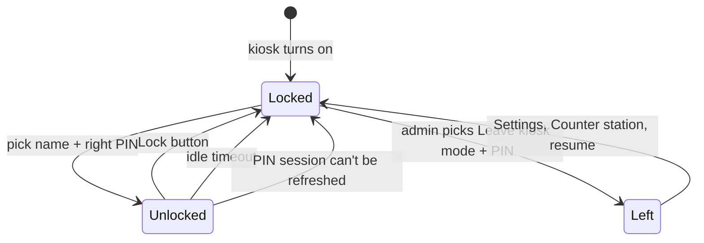

# Kiosk

Kiosk mode turns an approved counter station into a shared terminal: the whole app is replaced by the counter, full
screen, and staff sign in by picking their name and typing a PIN. It locks itself when left alone. Touch this when
changing the lock screen or how a kiosk signs people in and out. Registering and approving stations, and how PIN
login works on the server, are in [PINs and stations](../../server/pins-and-stations.md); setting one up is in
[Running a server](../../operations.md#counter-stations-and-kiosks).

## How it works

[`KioskHandler`](../../../composeApp/src/commonMain/kotlin/org/mr0btain/ticketman/ui/screens/kiosk/components/KioskHandler.kt)
watches this device's `Station` (from `SessionHandler`). Kiosk mode is **active** when the station is approved, has
`kioskEnabled`, and an admin hasn't left it on this device. When `active` turns on, the handler:

1. sets `RemoteHandler.credentialFallback = false`, so a PIN session that runs out isn't quietly replaced by the
   device owner's saved password,
2. asks for full screen through `AppWindow.setFullscreen(true)`, which on Android also pins the app (see
   [Pinning on Android](#pinning-on-android)),
3. starts the idle watch,
4. locks, which signs out whoever logged the device in.

`App()` sees `kiosk.active` and shows
[`KioskShell`](../../../composeApp/src/commonMain/kotlin/org/mr0btain/ticketman/ui/screens/kiosk/KioskShell.kt)
instead of the normal shell. It's a `TmBackdrop` with either the `LockScreen`, or a `TmTopBar` (station name, who's
signed in, a Lock button) over the [counter](counter.md).

### Locking and the idle timer

- **Activity.** `KioskShell` watches every pointer event (in the `Initial` pass, so it doesn't take them from what's
  underneath) and every key, and calls `recordActivity()`.
- **Idle.** A loop checks once a second; when nobody has touched anything for the station's `idleTimeoutSeconds`,
  it locks.
- **Keeping the session alive.** The server ends a kiosk's PIN session a while after the idle timeout if no
  requests reach it, in case the device was switched off. So the same loop calls `RemoteHandler.keepKioskAlive()`
  once a minute while someone has touched the screen in the last minute. See
  [Kiosk sessions on the server](../../server/pins-and-stations.md#kiosk-sessions-on-the-server).
- **Lock** shows the lock screen at once, clears what was loaded for the last person (`onSignedOut`), then ends
  their session on the server (`RemoteHandler.endSession`) and reloads the staff list.

### Signing in

`LockScreen` loads the staff who can PIN in here (`/api/auth/station/staff`, everyone active with a PIN) and shows
each as a tile. Picking one shows the `PinPad`: big keys for touch, and the number keys and Backspace work too. It
sends the PIN as soon as six digits are in. A wrong PIN shows the server's message ("Wrong PIN, 3 tries left") and
reloads the staff list; five wrong tries lock that person's PIN until an admin resets it.

`unlock()` calls `RemoteHandler.pinLogin`. On success `onSignedIn` loads the user and the lists, and the counter
shows.

### Clocking in and out

**Clock in or out** on the lock screen asks someone to pick their name and type their PIN, then `KioskHandler.punch`
sends it to [`POST /api/timeclock/punch`](../../api/timeclock.md#post-apitimeclockpunch) through
`RemoteHandler.stationPunch` (the unauthenticated client, so a locked kiosk with no session can). Nobody is signed
in: the kiosk stays locked and shows "Clocked in at 09:02" or "Clocked out at 17:31, 8.48h on the clock" until
someone is picked.

### Leaving kiosk mode

"Leave kiosk mode" on the lock screen asks for an admin to pick their name and PIN. `exit()` PINs them in, then:

- an admin: the handler marks itself `suspended`, turns `active` off and the normal app comes back, still signed
  in as that admin. It tells the server (`RemoteHandler.leaveKiosk`), which stops their PIN session ending with the
  kiosk's idle limit,
- anyone else: signed straight back out with "Only an admin can leave kiosk mode".

Leaving only lasts until the app restarts. Settings > Account and station > Counter station has a button that calls
`resume()` to turn it back on.

### Pinning on Android

`MainActivity` follows `AppWindow.fullscreen`: on, it calls `startLockTask()` once the activity is in front; off,
`stopLockTask()`. That's Android's screen pinning, so Home and Overview stop working until it's undone. Because
TicketMan isn't the device owner, Android first asks whoever is holding the device to confirm ("App is pinned",
Got it or No thanks), and anyone can unpin later by swiping up and holding (or Back and Overview together with
button navigation).

The activity reports whether it's pinned in `AppWindow.pinned` (null on desktop and web, which can't pin), checking
every two seconds while kiosk mode is on, since Android doesn't tell the app when someone unpins it. While it's
`false`, `KioskShell` shows a "Screen not pinned" notice above the lock screen or counter with a Pin screen button
(`AppWindow.requestPin()`), which asks Android again. Leaving kiosk mode unpins it.

## Where it lives

| What | Where |
|------|-------|
| State, locking, idle timer, sign in and out | `ui/screens/kiosk/components/KioskHandler.kt` |
| What a kiosk shows | `ui/screens/kiosk/KioskShell.kt` |
| Lock screen and PIN pad | `ui/screens/kiosk/LockScreen.kt`, `PinPad.kt` |
| Full screen and pinning requests | `ui/AppWindow.kt`, applied in each platform's entry point (pinning in `androidApp/.../MainActivity.kt`) |
| Tests | `composeApp/src/commonTest/.../ui/screens/kiosk/KioskHandlerTest.kt` (takes a `now` clock to move time along) |
| Render test | `ScreenRenderTest.kioskLock()` |

## Gotchas

- **The kiosk follows the server.** Turning kiosk mode on or off, or changing the timeout, on the admin Stations
  tab reaches the device the next time it refreshes its station: when it connects, or from Refresh in its Counter
  station dialog.
- **Turning on locks immediately.** Whoever was logged in on the device is signed out the moment it becomes a
  kiosk, by design.
- **Keys are seen twice.** The shell's key handler records activity and passes the key on, so the counter's own
  shortcuts still work under it.

## Known gaps

- **Only Android is locked down, and only as far as screen pinning goes.** Someone who knows the gesture can unpin
  it; the notice then says so until it's pinned again. Making the app the device owner (through an MDM, or
  `adb shell dpm set-device-owner` on a wiped device, which needs a `DeviceAdminReceiver` the app doesn't have yet)
  would pin without asking and without a way out. Desktop and web only go full screen, which doesn't stop someone
  leaving the app.
- **Browsers only go full screen from a click or key press.** A kiosk that starts on page load stays windowed until
  someone touches it, and pressing Escape leaves full screen; the web entry point asks again on the next click or
  key press while kiosk mode is on.

## See also

- [PINs and stations](../../server/pins-and-stations.md)
- [Counter screen](counter.md)
- [Settings screen](settings.md)
