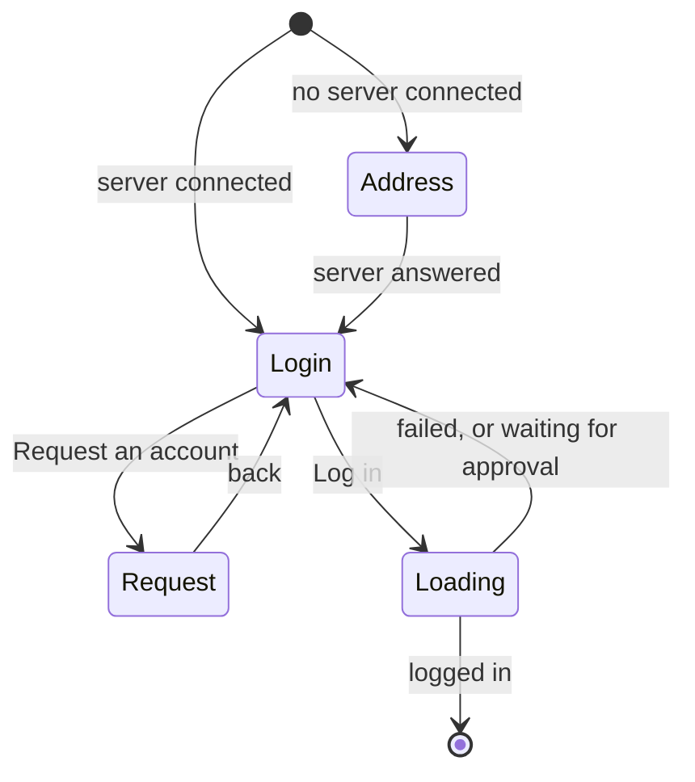
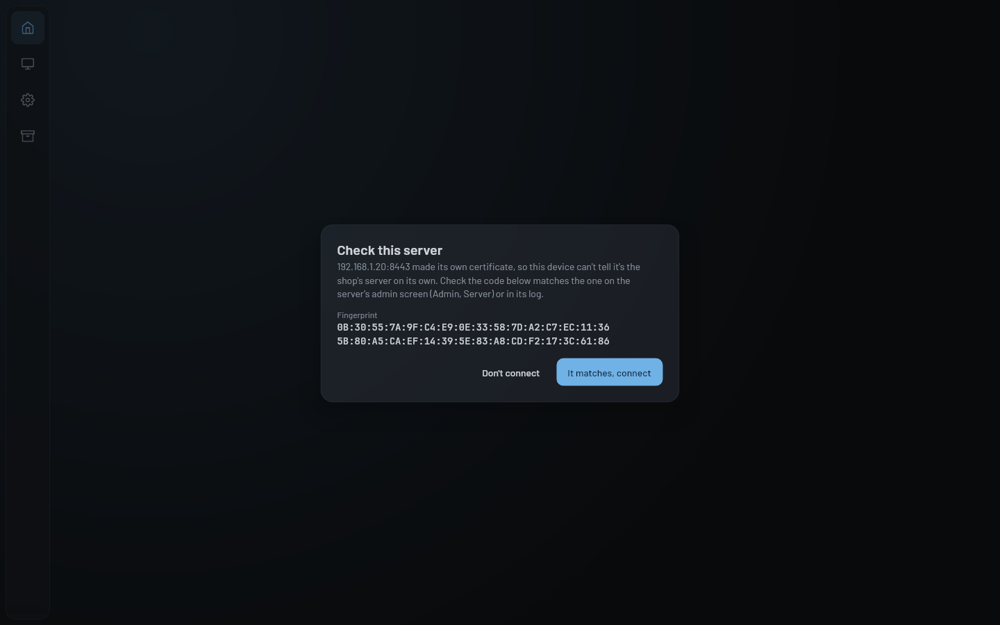

# Login

The dialogs that get someone onto the shop's server: connecting to an address, trusting a server's own
certificate, logging in, asking for an account, and finishing first login setup. They aren't a screen in the nav;
`App()` shows them over whatever screen is open. Touch this when changing how people sign in. What happens on the
network is in [Networking](../../client/networking.md), and accounts on the server in
[Users and accounts](../../server/users-and-accounts.md).

## How it works

Everything is driven by
[`SessionHandler`](../../../composeApp/src/commonMain/kotlin/org/mr0btain/ticketman/ui/screens/login/components/SessionHandler.kt)
(`viewModel.session`). `App()` shows three dialogs from its state, later ones on top:

| Dialog | Shown while | Closes when |
|--------|-------------|-------------|
| `AccountSetupDialog` | `session.accountSetup` is set | Setup is finished, or cancelled |
| `LoginPopup` | `session.showLogin` | Logged in, or dismissed |
| `ServerTrustDialog` | `session.untrustedCertificate` is set | Trusted or refused |

The login dialog opens from the Log in button at the foot of the nav rail, the counter and admin screens' empty
states, and on its own when a session can't be refreshed (`SessionHandler.expired()`).

### The login dialog

[`LoginPopup`](../../../composeApp/src/commonMain/kotlin/org/mr0btain/ticketman/ui/screens/login/LoginPopup.kt) is
one `TmDialog` that changes what it asks for, fading between them:

| State | Shows | Notes |
|-------|-------|-------|
| `Address` | `ServerAddressField` | Saving it calls `settings.setServerUrl`, which connects. Errors only show after an attempt |
| `Login` | `LoginField`: username, password, and a link to request an account | A new user with an invite types their setup code as the password |
| `Request` | `RequestAccountForm`: username, first and last name, email, phone, password (8 or more) and confirm | The server rate limits these. The admin approves or rejects on the Users tab |
| `Loading` | A spinner | While `loginState` is `LOADING` |

What a login can come back with, and what the dialog does:

| Outcome | Dialog |
|---------|--------|
| Logged in | Closes. The user and lists load (`onLoggedIn`), unless first login setup is needed |
| Logged in, setup needed | Closes, and `AccountSetupDialog` opens as `Approved` |
| Invite code used | Closes, and `AccountSetupDialog` opens as `Invite` with the setup token |
| Waiting for approval | Stays, with "Your account is waiting for an admin to approve it." |
| Wrong details | Stays, with "Wrong username, password or setup code." |
| Too many wrong tries | Stays, with "Too many tries, wait a moment and try again" (the server's `429`) |
| Couldn't reach the server, or anything else | Stays, with the error's message |

### First login setup

[`AccountSetupDialog`](../../../composeApp/src/commonMain/kotlin/org/mr0btain/ticketman/ui/screens/login/AccountSetupDialog.kt)
can't be clicked away, only finished or cancelled. It asks for first and last name, email, phone, a password, and a
PIN (entered twice, checked against `PinRules`):

- **Invite**: the password is required, since they logged in with a code. Cancel just closes it.
- **Approved** request: they already chose a password, so a new one is optional. Cancel logs them out, since
  their tokens only work on setup routes until it's finished.

The rest of the app sits behind it until it's done.

### Trusting a server

When the server uses a certificate it made itself, `setUrl` comes back `UNTRUSTED` and
[`ServerTrustDialog`](../../../composeApp/src/commonMain/kotlin/org/mr0btain/ticketman/ui/screens/login/ServerTrustDialog.kt)
shows its SHA-256 fingerprint, split into two lines to read off against the admin screen's Server tab or the
server's log. A **changed** certificate gets a warning and a red confirm button. Trusting saves the fingerprint
for that address; see [Trusting a server's certificate](../../client/networking.md#trusting-a-servers-certificate).

## Where it lives

| What | Where |
|------|-------|
| Session state and every action | `ui/screens/login/components/SessionHandler.kt` |
| Login dialog and its states | `ui/screens/login/LoginPopup.kt`, `components/LoginDialogState.kt`, `components/LoginState.kt` |
| Address, login and request forms | `ui/screens/login/components/ServerAddressField.kt`, `LoginField.kt`, `RequestAccountForm.kt` |
| First login setup | `ui/screens/login/AccountSetupDialog.kt`, `components/AccountSetup.kt` |
| Certificate check | `ui/screens/login/ServerTrustDialog.kt` |
| Tests | `composeApp/src/commonTest/.../ui/screens/login/SessionHandlerTest.kt`; `ScreenRenderTest.serverTrust()` |

## Gotchas

- **The dialog's state is worked out, not stored.** `LoginPopup` derives it from `loginState`, `serverConnected` and
  whether the request form is open, so a server dropping while the dialog is open sends it back to the address.
- **The username is trimmed, the password isn't.** Spaces at either end of a password are part of it.
- **Remember login** decides whether the username and password are kept after logging in. Only a remembered
  username is filled in next time (`session.savedUsername`).

## See also

- [Networking](../../client/networking.md), for connecting, tokens and the credential fallback
- [Users and accounts](../../server/users-and-accounts.md), for requests, invites and setup
- [Authentication and sessions](../../server/auth.md), for the wrong password limit
- [App shell and navigation](navigation.md)
