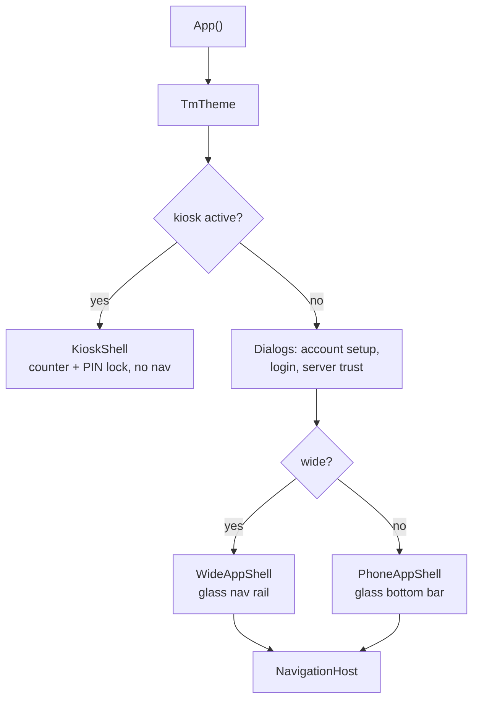

# App shell and navigation

How the app is framed and how screens are reached: `App()` picks a shell, the shell draws the nav and the backdrop,
and `NavigationHost` swaps the screen inside it. Touch this when adding a screen or changing what's in the nav.

## How it works

[`App()`](../../../composeApp/src/commonMain/kotlin/org/mr0btain/ticketman/App.kt):

1. builds `TmTheme` from the saved settings, sets the Coil image loader and provides `LocalImageClient`,
2. if the kiosk is on, shows `KioskShell` and nothing else (see [Kiosk](kiosk.md)),
3. otherwise shows whichever of these are waiting, in this order so the later ones sit on top:
   `AccountSetupDialog` (first login setup), `LoginPopup`, and `ServerTrustDialog` (over the login, which can't get
   anywhere until the server is trusted). See [Login](login.md),
4. picks a shell. **Desktop always gets the wide shell**; Android and web get it when the window's width size class
   is `Expanded`, and the phone shell otherwise.

Both shells live in
[`AppShell.kt`](../../../composeApp/src/commonMain/kotlin/org/mr0btain/ticketman/ui/screens/navigation/AppShell.kt)
and draw the `TmBackdrop`, mark the screen area as a `glassSource()` so glass layers blur it, and put the
`TmSnackbarHost` at the bottom.

| Shell | Nav | Signed in user |
|-------|-----|----------------|
| `WideAppShell` | `TmNavRail` on the left. The button at its top expands it to show labels (kept with `rememberSaveable`) | At the foot of the rail: a "Log in" button, or the user, whose menu has Settings and Log out |
| `PhoneAppShell` | `TmBottomNav` floating at the bottom. Screens are padded by 80 dp so the bar doesn't cover them | Not shown |

## Destinations

[`Destination`](../../../composeApp/src/commonMain/kotlin/org/mr0btain/ticketman/ui/screens/navigation/Destination.kt)
lists every route and the order it's shown in (`index`).
[`NavigationHost`](../../../composeApp/src/commonMain/kotlin/org/mr0btain/ticketman/ui/screens/navigation/NavigationHost.kt)
maps each route to its screen. Which ones are in the nav is decided in `App()`:

| Destination | Screen | In the nav |
|-------------|--------|------------|
| `ADMIN` | [`AdminScreen`](admin.md) | Admins only |
| `COUNTER` | [`CounterScreen`](counter.md) | Always |
| `INVOICE` | `InvoiceScreen` | Never, see below |
| `RECORDS` | [`RecordsScreen`](records.md) | Always. The start destination |
| `SETTINGS` | [`SettingsScreen`](settings.md) | Always |
| `GALLERY` | [`KitGallery`](../kit.md#the-component-gallery) | Debug builds, as "Components". Also opened from Settings |

The nav is sorted by `index`, so for an admin it reads Admin, Counter, Records, Settings.

Moving between screens goes through `navHostController.navigateTo(route)`, which navigates with
`launchSingleTop`, so clicking the screen you're on doesn't stack another copy.

Screens never hold state that has to outlive them. Everything they show comes from the handlers on
`MainViewModel`, which last as long as the app (see [App state and handlers](../../client/state.md)), so leaving a
screen and coming back keeps its search, selection and open ticket.

## Adding a screen

1. Add a `Destination` with a route and an `index` for where it sits in the nav.
2. Add a `composable(Destination.X.route) { ... }` to `NavigationHost`, passing the view model.
3. Add a `NavigationItem(title, icon, destination)` to the list in `App()`, with a condition if not everyone gets
   it. Icons are drawables in `composeResources/drawable`.
4. Put the screen in `ui/screens/<area>/`, and its state in an `<Area>Handler` under `components/`, owned by
   `MainViewModel`.

## Gotchas

- **Admin links stack.** `AdminScreen` opens a ticket or item on the records screen with plain `navigate()`, not
  `navigateTo()`, so each one adds to the back stack. The shell has no back button, but Android's system back
  walks back through them.
- **The "Start tab" setting isn't a screen.** It picks which records tab (Customers, Tickets, Inventory) opens
  first. The app always starts on Records.
- **Desktop is never a phone.** The platform check comes before the window size, so a narrow desktop window still
  gets the rail. Screens handle narrow widths themselves (records stack their panes under 760 dp).

## Known gaps

- **`InvoiceScreen` can't be reached.** It's registered in `NavigationHost` (every invoice, newest first; click one
  to open its ticket at the counter, admins can void) but no nav item or link goes to it.
- **The phone shell has no account controls.** There's no log in or log out button on phones. Logging in is
  offered by the counter and admin screens' empty states, and the login dialog opens on its own when a session
  can't be refreshed, but there's no way to log out. The records screen's "Log in from the bottom of the sidebar"
  notice is wrong on phones.
- `AdminScreen` takes `snackBarState` and `coroutineScope` parameters it doesn't use.

## See also

- [App state and handlers](../../client/state.md)
- [UI kit](../kit.md)
- [Platforms](../../client/platforms.md), for each platform's entry point and full screen handling
