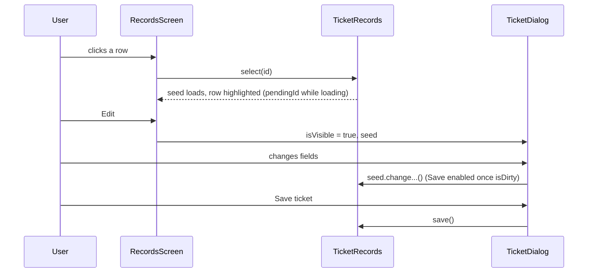

# Records screen

The Records screen (`Destination.RECORDS`, the app's start screen) is where customers, tickets and inventory are
looked up, added, edited and deleted. Each record type is a tab with the same layout: a toolbar, a list and the
picked record's details. Touch this when changing what a record shows or how it's edited. The data side (pagers,
caches, seeds, saving) is covered in [Records: seeds, caches and pagers](../../client/records.md).

## How it works

[`RecordsScreen`](../../../composeApp/src/commonMain/kotlin/org/mr0btain/ticketman/ui/screens/records/RecordsScreen.kt)
draws `TmTabs` (Customers, Tickets, Inventory) and one panel for the open tab. The open tab is
`MainViewModel.selectedMainTabIndex`, not screen state, so the admin screen can switch it when it links here and the
"Start tab" setting can pick it.

Each panel (`CustomerPanel`, `TicketPanel`, `InventoryPanel`) is a
[`RecordsLayout`](../../../composeApp/src/commonMain/kotlin/org/mr0btain/ticketman/ui/screens/records/components/RecordsLayout.kt)
with three slots:

| Slot | Built with | What it does |
|------|-----------|--------------|
| `toolbar` | `TmPanelTopBar` | Search on the left (picking a result selects it), delete and add on the right. `extras` holds anything else, like the tickets tab's My tickets / All tickets switch |
| `list` | `RecordsList` | A `TmTableHeader` and a `TmLazyColumn` of `TmTableRow`s, or an empty state. Loads pages as it scrolls through `OffsetPagerLoader` |
| `detail` | `RecordDetail` | The picked record: a header with an Edit button, then `DetailSection`s scrolling under it. An empty state when nothing is picked |

At 760 dp and wider the list and details sit side by side (56 / 44); narrower, the details stack under the list.

### What each tab shows

| Tab | List columns | Details | Dialog |
|-----|--------------|---------|--------|
| Customers | Name, phone, email, street | Contact, their tickets (click to open), notes | `CustomerDialog`: first and last name, phone, email, address, their tickets, notes |
| Tickets | Number, device, priority, status | Status and priority badges, customer, technician, device, created, estimate, problem, updates | `TicketDialog`: customer and technician search, device, problem, status, priority, updates |
| Inventory | Name, description, stock, cost, price | Description, price, cost, stock, photos, notes | `InventoryDialog`: name, description, stock (or untracked), cost, price, photos, notes |

Users are records too (`UserRecords`), but they're managed on the [admin screen](admin.md), not here.

### Dialogs

`RecordsScreen` owns every dialog and whether it's showing; the panels only call back (`onAddCustomer`,
`onEditTicket`, ...). The dialogs edit the handler's **seed** directly: every field change calls a `change...()` on
it, and the dialog's Save stays off until `seed.isDirty`.

- **Add** clears the selection first (`clearSelection()`), so the seed is a blank new record.
- **Cancel** re-selects the same record, which reloads the seed from the cache and throws the edits away. If the
  record has been deleted on another device meanwhile, the reload finds nothing: the handler clears the seed,
  reloads the list and says it may have been deleted (`forgetIfOpen`).
- **Save** calls the handler's `save()` and closes the dialog, for all three record types. A new ticket's number
  shows in the details and the list once the server has given it one.
- **Notes** are added and edited in the kit's `TmEditNoteDialog`, on the seed. They're sent when the record is
  saved, not when the note dialog closes (see [`syncNotes`](../../client/records.md#saving)).
- **Delete** opens `TmConfirmDeleteDialog(isTwoStep = true)`, which asks twice, then calls the handler's
  `remove()` with the selected record. The record stays selected until the server agrees; if it refuses, a
  snackbar says why ("Customer not deleted: ...").

Clicking a photo anywhere on the screen opens one shared `TmImageView` at that photo.

### View only

Restricted users can look but not change anything. `RecordsScreen` reads `session.canEdit` and passes it down:

- `TmPanelTopBar(canChange = false)` drops add and delete and shows a "View only" badge,
- `RecordDetail(canEdit = false)` drops the Edit button,
- clicking a ticket on a customer opens it on the Tickets tab instead of in the edit dialog.

The handlers refuse changes too, and the server checks again. See
[Restricted users](../../client/records.md#restricted-users).

## Where it lives

| What | Where |
|------|-------|
| The screen, dialogs and wiring | `ui/screens/records/RecordsScreen.kt` |
| Shared layout, list and detail | `ui/screens/records/components/RecordsLayout.kt` |
| Per type: panel, list pane, info pane, dialog, handler | `ui/screens/records/components/<customer|ticket|inventory>/` |
| Notes syncing | `ui/screens/records/components/RecordNotes.kt` |
| Render test | `ScreenRenderTest.records()`, writing `records-*.png` |

## Adding a field to a record

1. Add it to the model and the server layers (see [Entity layers](../../architecture/entity-layers.md)).
2. Add it to the seed's `fields()` and give the seed a `change...()` for it.
3. Show it in the info pane with a `TmKeyValueRow` inside the right `DetailSection`.
4. Edit it in the dialog with a kit field calling the seed's `change...()`.
5. If it should be a column, add a `TmColumn` to the list pane's `COLUMNS` and a cell for it.

## Gotchas

- **The pending row.** While a picked record loads, `selection.pending` holds its id and the list highlights that
  row, so the click shows straight away. Pass `pendingId ?: seed.identifier` as the selected row.
- **Changing the ticket list's scope** scrolls it back to the top, since it's a different set of tickets.
- **Dialogs need a picked record for Edit.** `onEditTicket` does nothing for a new seed; the button is only there
  once something is selected.

## See also

- [Records: seeds, caches and pagers](../../client/records.md)
- [Notes in the database layer](../../server/database.md)
- [UI kit](../kit.md)
