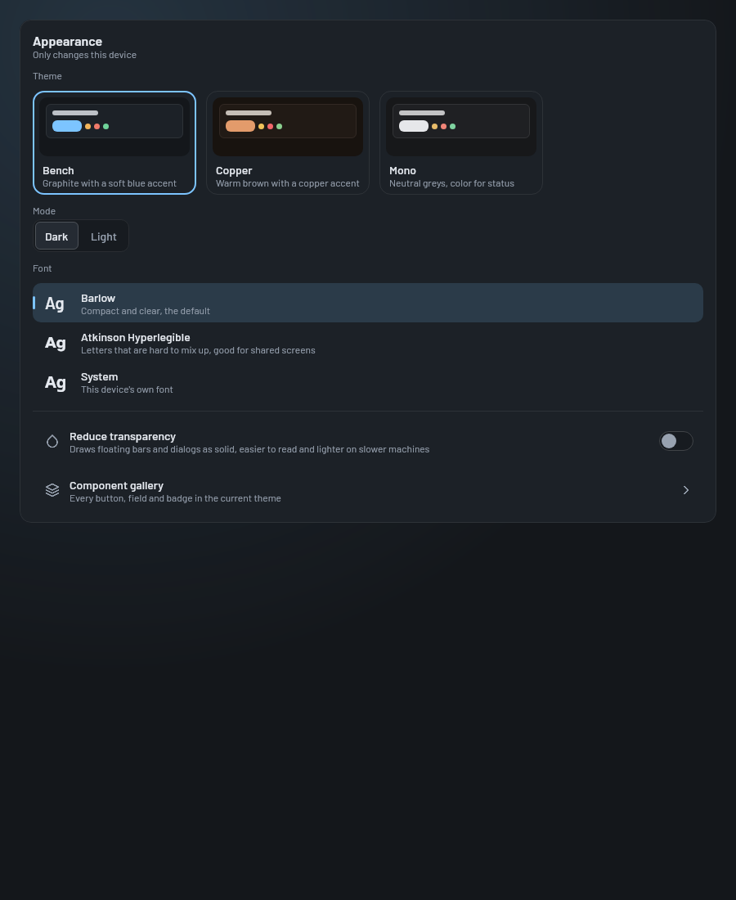

# Settings screen

The settings screen (`Destination.SETTINGS`) holds this device's settings: how the app looks, which server it talks
to, list sizes, and the signed in person's PIN and this device's counter station. Everything here only changes this
device. Touch this when adding a setting. How settings are stored is in [Storage](../../client/storage.md).

## How it works

[`SettingsScreen`](../../../composeApp/src/commonMain/kotlin/org/mr0btain/ticketman/ui/screens/settings/SettingsScreen.kt)
is a column of panels, laid out by `SettingsLayout`: Account and Appearance beside the rest on windows 1000 dp and
wider, one under the other on narrower ones.

| Panel | Setting | What it does |
|-------|---------|--------------|
| **Account** | - | Who's signed in, with Log out, or Log in when nobody is. The only way to log in and out on phones, whose layout has no user menu (`AccountPanel`) |
| **Appearance** | Theme | Cards drawn in each palette's own colors (`TmPalettes.all`) |
| | Mode | Dark or light |
| | Font | `TmFonts.all` |
| | Reduce transparency | Draws glass as solid |
| | Component gallery | Opens the [kit gallery](../kit.md#the-component-gallery) |
| **Login** | Remember login | Keeps the username and password after logging in, so the app can log back in when a refresh token is refused. Off on shared devices |
| **Server** | Server address | Where the server is. No scheme means `https://`. Saving it reconnects (`session.changeServer`) |
| | Device name | What admins see for this device on the Sessions tab, from the next login. Also the suggested name when registering a station |
| **Records** | Start tab | Which records tab opens first, picked from a dropdown |
| | Page size | Records loaded per page, 5 to 100. Reloads the lists |
| | Search result limit | 1 to 100 |
| | Cache size | Opened records kept in each cache, 1 to 200. Resizes the caches straight away |
| **Account and station** | Change PIN | Opens `ChangePinDialog`, which asks for your password as well. Says when your PIN is locked |
| | Counter station | Opens `StationDialog`: register this device as a station, see if it's approved, refresh it, or go back to kiosk mode after an admin left it |

Every value comes from a `StateFlow` on
[`SettingsHandler`](../../../composeApp/src/commonMain/kotlin/org/mr0btain/ticketman/ui/screens/settings/components/SettingsHandler.kt),
and every change goes through one of its setters, which saves it to `LocalStorage` at once and, where needed,
tells the rest of the app (a new server address reconnects, a new page size reloads the lists). There's no Save
button.

### Setting rows

The panels below Appearance are built from data rather than by hand. Each is a `SettingItemGroup(label, icon, items)`
drawn by `SettingsGroup`, and each item is a `SettingItem<T>`:

| `type` | `T` | Drawn as | `onClick` |
|--------|-----|----------|-----------|
| `SWITCH` | `Boolean` | A `TmListRow` with a `TmSwitch`; the whole row toggles | Gets the new value |
| `TEXT` | `String` | A row showing the value; clicking opens a `TmTextEditDialog` | Gets the typed text. Return `false` to keep the dialog open and show `description` as the error |
| `CLICKABLE_TEXT` | `String` | A row showing the value with a chevron | Gets the current value. Used to open a dialog |
| `CHOICE` | `String` | A row with a `TmDropdown` of the item's `options` | Gets the picked option |

`initialState` is the value shown, read from the handler's state, so the row updates when the setting changes.

## Adding a setting

1. Add it to `LocalStorage` (see [Adding a setting](../../client/storage.md#adding-a-setting)).
2. Add a `StateFlow` and a setter to `SettingsHandler`. Check the value in the setter, and pass a callback in if
   another part of the app has to react.
3. Collect it in `SettingsScreen` and add a `SettingItem` to the right group. For a typed value, have `onClick`
   return `false` when it's out of range, and put the range in `description`.
4. For a picker that doesn't fit a row, add it to `AppearanceSettings` or its own panel, built from kit components.

## Where it lives

| What | Where |
|------|-------|
| Screen and the setting groups | `ui/screens/settings/SettingsScreen.kt` |
| Saved settings as state | `ui/screens/settings/components/SettingsHandler.kt` |
| Appearance panel and theme cards | `ui/screens/settings/components/AppearanceSettings.kt` |
| Row model and drawing | `SettingItem.kt`, `SettingItemGroup.kt`, `SettingType.kt`, `SettingsGroup.kt` |
| PIN and station dialogs | `ui/screens/settings/components/AccountDialogs.kt` |
| Render tests | `ScreenRenderTest.settings()` (two columns), `KitGalleryRenderTest.appearanceSettings()` |

## Gotchas

- **`SettingItem` is cast by `type`.** `SettingsGroup` uses `runIfType<String>` or `runIfType<Boolean>`, and an
  item whose `type` doesn't match its `T` is quietly not drawn.

## Known gaps

- `SettingItem.enabled` is only partly used (there's a `TODO` on it), and `SettingsScreen` declares log tags
  inside the composable.

## See also

- [Storage](../../client/storage.md)
- [UI kit](../kit.md), for the themes and fonts
- [Kiosk](kiosk.md) and [PINs and stations](../../server/pins-and-stations.md), for stations
- [Networking](../../client/networking.md#server-addresses), for server addresses
